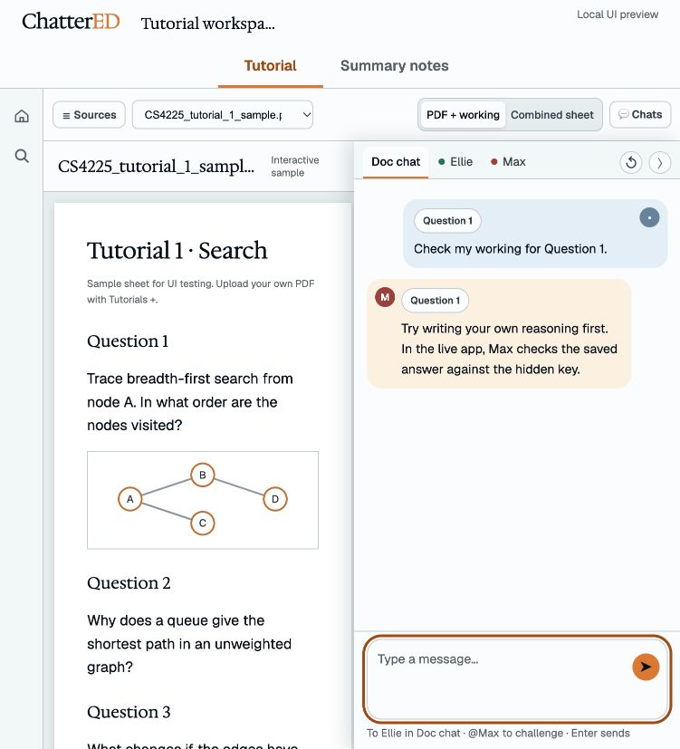
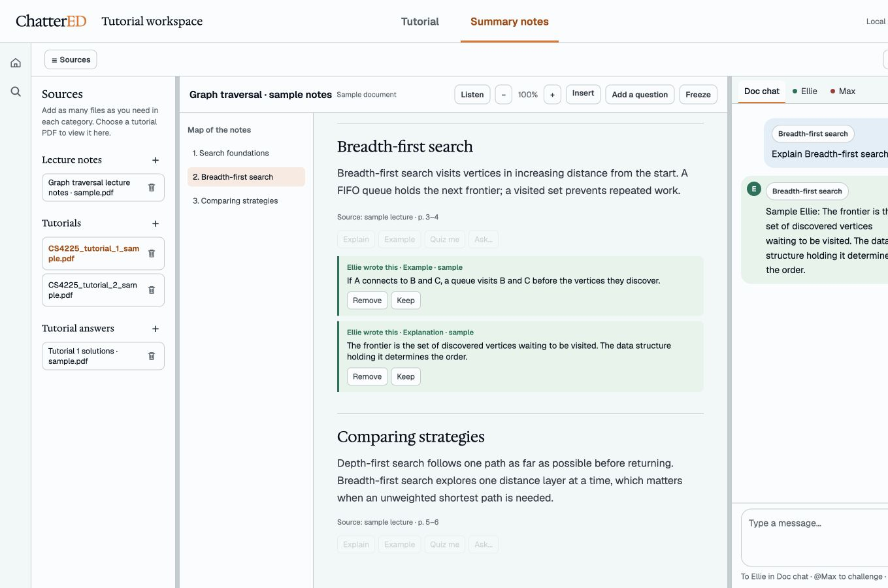

# Tutorial workspace UX revamp plan

Status: renderer implementation in progress on `UX-Revamp`, 26 October 2026. **The original `tutorial-workspace-preview.html` remains the primary design prototype.** It preloads two sample tutorials, working sections, sources, and deterministic sample agent responses. `tutorial-workspace-parity.html` mounts the **same Svelte renderer** as Electron with the development mock bridge. Electron remains the authority for real persistence and agent behaviour. Implemented here: centered global modes, inline title, grouped sources, contextual tutorial selector, PDF + working / Combined sheet views, collapsible chat, Studio colours and message presentation. The backend-only proposals below remain deferred.

## Prototype reconciliation: one renderer, two bridge implementations

Open the **primary design prototype** at `http://127.0.0.1:5273/tutorial-workspace-preview.html`. Its sample actions deliberately use local, scripted replies labelled “Sample”; they make destinations and proposed visuals testable without pretending to run the backend. The two sample sheets are rendered mock pages with one diagram; uploaded PDFs still use pdf.js. The samples are not a source of tutorial grading, answer keys, persistence or model behaviour.

Open the **feature reference** at `http://127.0.0.1:5273/tutorial-workspace-parity.html` after starting Vite in `app/` with `npx vite --host 127.0.0.1`. This page executes `main.ts`, `App.svelte`, and all production renderer components. `lib/bridge.ts` selects `mockBridge.ts` only in Vite development when Electron's preload is absent. The mock makes the controls inspectable but cannot prove model quality, saved SQLite state, source ingest, real PDF bytes, or actual privacy. Confirm those in Electron. Use the real renderer when implementing the approved design so the prototype and app do not drift.

The live app and source inventory showed these capabilities that a faithful prototype must continue to expose:

| Surface | Existing capabilities to retain in the functional prototype |
|---|---|
| App chrome | Home, Search, Usage, Settings, notebook breadcrumb/title, trial and cost state, navigation shortcuts. |
| Notebook home and search | Create/open/rename/duplicate notebooks, folders, search results and filters, source/notes/tutorial result navigation. |
| Sources | Multiple files with lecture/tutorial/solutions roles, role changes, context ticks and all-sources tick, reading/error/retry states, removal, drag-and-drop and file picking. |
| Summary notes | Generated overview and editable notes, progress/objectives, provenance and slide links, fold and citation navigation, Listen, Insert menu (formula, table, diagram, flashcards, quiz, infographic), More menu, freeze/zoom, inline agent edits and their review actions, Max open-question rail. |
| Tutorial | Multiple tutorial tabs, AI-generated copied sheet, parts and answer slots, per-part progress, Check, Hint ladder, Refresher, Show answer, notes links, Explain/Ask on sheet content, zoom, read again, split/pop out/close, saved answers. The inspected notebook displayed Q1–2 in copied text but only started answer slots at Problem 3; that is a real ingest/output case to cover, not evidence that the backend can check arbitrary PDF questions. |
| Chat | Doc chat plus span threads, private Ellie and Max channels, mentions, targeted reply composer, open quiz routing, source-context chip, unread state, reset confirmation, private notices, insert-private-turn-into-document, jump to span/page, suggested prompts, send/stop/retry/discard, waiting/error states and per-message cost. |
| Layout | Resizable source/chat seams, tutorial split and zoom, floating notes, keyboard and pointer navigation. |

The mock bridge may show a scripted state for a capability and does not guarantee that every real workflow can complete in a browser. Each phase below therefore has both a localhost visual/interaction pass and an Electron regression pass.

## Scope and guardrails

This rollout changes the Electron **renderer only**. Keep the existing notebook IDs, source roles, tutorial part IDs, saved answers, document schema, IPC calls, agent routing, checks, hints, refreshers, progress, and search results. Do not edit `app/src/main/`, `app/src/core/`, `app/src/shared/`, database migrations, prompts, or model orchestration as part of this revamp. Use `app/src/renderer/DESIGN.md` for the Studio typography and colour roles.

The prototype uses browser `File` objects and local storage, and its chat replies are placeholders. Those are preview mechanics, not implementation targets. In Electron, use the existing Svelte stores and bridge. `bridge().openDocument({ fileId })` already supplies source bytes; the renderer already uses pdf.js through `app/src/renderer/lib/rasterise.ts`. Reuse that read path for the original PDF viewer without introducing a new backend endpoint.

The alternate tutorial view is recorded in `docs/research/tutorials.md` §10. The original copied sheet with answer slots remains a permanent user-selectable option. Printed questions without a generated part have local drafts only; the renderer never assigns them a fabricated part ID or calls the grader for them.

## Visual references

These captures show the primary HTML prototype. The current HTML and renderer parity route are the source of truth for exact header placement and interaction. The bundled PDF in the parity route is a local fixture with a vector diagram; uploaded source PDFs still require a real Electron check before release.

The refined inline edit treatment keeps the live Remove/Keep review flow in both modes: [tutorial example](app/docs/ux-revamp/prototype-tutorial-inline-edit.png) and [summary notes example](app/docs/ux-revamp/prototype-inline-edits.png).

The live prototype is `app/src/renderer/tutorial-workspace-preview.html` at `http://127.0.0.1:5273/tutorial-workspace-preview.html` while Vite is running. The screenshots are review references, not pixel-perfect requirements for native macOS window chrome.

## Current Electron app versus target

### Live Electron audit, 26 October 2026

I inspected the running Electron window (its renderer was served from `localhost:5273`) and used navigation and presentation controls only. I did not submit an agent request, change a source role, remove a file or edit a saved answer. The audit therefore confirms **visible controls and read-only transitions**, not every backend result. The Electron window currently uses the real preload bridge; the separate browser parity route uses a development mock. Repeat this audit against the packaged app before release.

| Surface | Observed in Electron | Preservation gate |
|---|---|---|
| Home | Folders, notebook cards, progress, New folder, New notebook, per-item More menu, and earlier practice sessions. | Keep notebook and folder IDs, create/rename/move/duplicate/delete flows, progress, and navigation. Test real actions on a disposable notebook. |
| Search | Offline search across slides, notes and tutorial sheets; notebook scope picker; All/Notes/Tutorials/Slides filters; Slides and Notes preview columns with their own resize/hide controls. Chats are excluded. | Keep the search store and result navigation unchanged; do not implement the prototype's simplified search screen over this route. |
| Sources | One list supports multiple files, three role choices (Lecture/Tutorial/Solutions), per-file use checkboxes, use-all, ingest metadata, remove, and a notes map. Solutions are hidden from normal context and used to check answers. | Visual grouping may change, but retain role and inclusion semantics, status, removal, map navigation, and the selected tutorial's identity. Test a role change on a disposable source. |
| Tutorial | Tutorial tabs, per-file part progress, zoom, read-again, split sheet, notes window, source links, per-part status, Check and Help. Help exposes a three-rung hint ladder, Ellie refresher, and answer release. Check is disabled until the part has an answer. Inline Max/Ellie edits have Remove/Keep. | The combined ProseMirror sheet remains mounted and functional. A new view must call `TutorialStore.check/help` with the same existing `partId` and use `TutorialStore.openFileId`; no new renderer grading. Preserve zoom, split, read-again, notes window, source links, busy/refusal states, and inline edit review. |
| Summary notes | Editable ProseMirror document, overview/objectives, provenance links, notes map, Listen, Insert (Formula, Table, Diagram, Flashcards, Quiz, Infographic), More (zoom, Add a question, Freeze), folded cards, Max question, and Remove/Keep on agent edits. | Restyle the existing editor and controls. Keep `DocStore` operations, authored spans, source citations, Freeze semantics, and both chat and inline edit outcomes. |
| Chat | Doc chat with anchored threads, unread count, jump to span, reply-in-thread, cost/status labels and new conversation. Ellie and Max are separate private tabs with different privacy text and composers. | Keep all three backend channels and explicit destination. A collapsed panel must preserve drafts and unread state. Agent actions focus returned thread IDs; private messages must never silently become Doc chat messages. |
| Usage and Settings | Usage has range/document filters, cost breakdown and CSV export. Settings exposes backend/provider/model choices, connection status and pacing. | Keep both routes reachable from the permanent rail. Do not let workspace-specific chrome or a prototype mock replace these real screens. Test their existing controls separately on the real bridge. |

**Critical mapping limit:** In the inspected notebook, the first two printed tutorial questions appeared in the generated document as copied prompt text, while answerable backend parts began at Problem 3. The prototype's Question 1/2 answer boxes therefore have no demonstrated `partId` for Check/Hint/Refresher. In PDF + working, render every printed question and let the learner draft locally, but enable those backend actions only for a verified mapped part. Mark unmapped sections clearly and preserve their text through view changes. Do not fabricate grading or silently bind an answer to the wrong part. If full checking for every printed question becomes a requirement, that is a separate backend/contract decision outside this renderer-only revamp.

**Release gate:** Before replacing any live layout, record the current Git commit, current uncommitted renderer work, and one disposable notebook fixture. Confirm the real Electron bridge on that fixture and rerun the same matrix in a packaged build; `localhost:5273` alone tests the development renderer, not the shipped bundle. Keep each implementation slice separately reviewable and reversible. No live user document should be used for destructive parity tests.

**Baseline checks on 26 October:** `npm run typecheck`, `npm run lint`, and `sh tools/check-scope.sh` passed. `npm test` passed 3,607 of 3,609 tests; two existing `src/main/llm/claude-cli.test.ts` PATH-resolution assertions failed because they received `/opt/homebrew/bin/claude` where the fixture expected its temporary binary or null. Resolve or quarantine that environment-dependent baseline before using an all-green test suite as a revamp gate. No frontend implementation was changed in this audit.

| Area | Electron now | Target and safe translation |
|---|---|---|
| Home and Search | Real notebook grid, folders, search, title-bar breadcrumb, persistent nav rail. | Keep their real flows and data. Apply the Studio visual tokens and hide workspace-only Tutorial/Summary notes controls outside an open notebook. Do not replace Home or Search with prototype mock content. |
| Workspace identity | Notebook names and rename already persist via `TitleBar.svelte` and `NotebookHome.svelte`. | Put the name beside the brand in the global header as a directly editable field. Reuse existing create/rename actions, uniqueness/error handling, folders, and notebook IDs. Centre Tutorial/Summary notes in the same header. |
| Sources | One list with role badges, context checkboxes, metadata, remove action, and a resize/collapse edge. Multiple files are already supported. | Group the existing rows visually into Lecture notes, Tutorials, and Tutorial answers; no per-category counters. Use one accessible + icon button per category and preserve each file's removal control, enabled state, ingest/error status, role menu, confirmation, and ordering. Start collapsed in tutorial mode. |
| Tutorial views | A generated ProseMirror sheet occupies the middle column; it currently shows questions 1–2 as copied text and answer slots starting at Problem 3 in the inspected notebook. | Add **PDF + working** beside the existing **Combined sheet** choice. The first shows the original tutorial PDF left and a continuous My working document right, preserving figures. The second keeps the current AI-generated sheet and its behaviour. Both options must use the same existing tutorial and saved answer identity, with no silent loss when switching. |
| More than one tutorial | `TutorialPane.svelte` has tabs for multiple tutorials and source rows can open a sheet. | Put a compact tutorial selector beside Sources in the contextual toolbar. Selection keeps the existing open tutorial file ID and returns to the corresponding view and working state. |
| Summary notes | Main-view switch exists; notes and progress are prominent, and notes can float over the tutorial. | Label the switch **Summary notes** and keep the existing notes editor, provenance, progress, citations, and Notes access. Hide the overview by default in tutorial mode. |
| Chat | `ChatColumn.svelte` already has Doc chat, Ellie, Max, keyboard tab navigation, unread state, new conversation, private disclosures, composers, and real agent turns; column width is draggable but the column remains open. | Make the column collapsible and apply Studio type and colour styling while retaining every chat component and action. Keep three channels, message history, private boundaries, insert-into-document, cost/status, keyboard navigation, and agent identity. Check and Hint should reveal and focus the **existing returned Max thread**; Refresher should reveal Ellie. Do not redirect backend messages into another channel. |
| Resize | Source/chat splitters and tutorial width already persist through `layoutstore.svelte.ts`; the sheet has its own split/zoom. | Reuse `PaneSplitter.svelte` for sources, PDF/working, and chat. Add only renderer layout state for the new PDF/working seam and chat-open state; clamp at readable minimum widths and preserve keyboard/double-click behaviour. |

## Iterative implementation order

Each step should be independently reviewable and should leave the existing study flow usable. Work in renderer components and styles, and land the current checkout's existing uncommitted renderer changes separately from this plan.

1. **Freeze the interaction baseline.** Record the current Electron paths through Home, Search, notebook creation/rename, source upload/remove, tutorial selection, Check, Hint, Refresher, private chat, and summary notes. Use a de-identified fixture; do not save real study chats or research data in screenshots. Keep Combined sheet available throughout the migration and record the alternate-view decision described above.
2. **Introduce Studio tokens and route-aware chrome.** Move colours and fonts into renderer CSS tokens, then restyle `TitleBar.svelte`, `NavRail.svelte`, `NotebookHome.svelte`, and `SearchScreen.svelte` without changing navigation or search queries. Put Tutorial/Summary notes controls only in the open-workspace shell. Check macOS traffic-light inset and draggable title bar.
3. **Rework sources and workspace heading.** Reuse `SourcesPanel.svelte` data and actions; group by role, use an accessible + per category, remove category counts, keep the red hover trash affordance, and default sources closed in tutorial mode. Reuse notebook rename/create; put the editable workspace name next to the brand and centre the global mode tabs. Group Sources and the tutorial selector on the contextual bar's left, view choice and Chats on its right. Make sure role changes and removing the selected tutorial update the visible selection without losing another tutorial's working state.
4. **Add the original PDF viewer.** Build a renderer component that reads the selected source through the existing bridge and renders actual pages with pdf.js. Keep page order, figures, zoom/scroll, error and loading states, and the current source identity. Test long and image-heavy PDFs. Do not use the generated sheet as the visual PDF, and do not change ingest or PDF storage.
5. **Add the continuous working view and user toggle.** Use the existing tutorial document/part IDs and save path where possible. Render one uninterrupted white working surface with numbered answer sections and Check, Hint, and Refresher under each section. Start with metadata-backed sections; add a manual section control for missing questions. Keep the current combined editor intact as the second option. Prove round-trip persistence when switching both directions, including existing answers, author marks, citations, and undo. If a manual section cannot be persisted or checked through current contracts, keep it a clearly labelled local draft and defer its check action rather than change backend semantics.
6. **Integrate and collapse chat.** Add a reversible chat-open control and splitter state to `ThreeColumn.svelte`/`layoutstore.svelte.ts`. Restyle `ChatColumn.svelte`, `DocChat.svelte`, `PrivateThread.svelte`, `ChatMessage.svelte`, and `MentionComposer.svelte` with the Studio tokens. Keep original feature components mounted as needed so a collapse does not reset drafts or unread state. Focus the existing thread returned by `tutorial.focusThread` after Check/Hint/Refresher; verify Max/Ellie labels and the active composer placeholder.
7. **Keep both views after parity checks.** Exercise the full regression matrix below on a clean install and an existing notebook. Retain the visible two-option view control and the live combined editor. Remove only renderer code made obsolete by the surrounding presentation. Keep the backend and saved data unchanged.

## Proposed Phase 2–4, reconciled with the fixed backend

The following is the implementation order **after** the functional prototype above is used as the parity baseline. A visual change is safe only if the same IPC command, channel identity, saved document operation, and user recourse remain available. The current design briefs require agent edits and private conversations; a renderer-only rollout cannot silently change those contracts.

| Proposal | Renderer-only decision | Reason and permitted design |
|---|---|---|
| Stop Ellie/Max writing into tutorial or notes | **Blocked as stated** | `docs/research/tutorials.md` §4 requires a short attributed help line in the tutorial; `collab-doc.md` §5 requires agent edits in notes. The main process persists those ops. Hiding them would leave invisible saved content affecting search, context, provenance and future work. A frontend preference may **collapse** agent edits to a small, discoverable indicator while preserving expansion and review. It cannot truthfully claim injection stopped. |
| Route Check, Hint, Refresher, Explain, Example, Quiz me exclusively to chat | **Partly already true; exclusive is blocked** | Tutorial Check/Help already return a chat thread to focus. Help also writes a tutorial line; notes actions may write notes edits. Preserve the existing action/agent mapping and immediately reveal/focus the returned chat thread. Do not re-route an action to a different agent or suppress persisted operations. Confirm which of Explain/Example/Quiz me are actual live controls in each context before adding labels. |
| Remove Keep/Remove | **Blocked while edits exist** | These actions are the learner's review/undo path for agent text and are explicit in `collab-doc.md` §5 and `tutorials.md` §4. Keep them beside each attributed inline edit, clearly visible and keyboard reachable. Preserve Freeze and private-thread “Insert into the document” for the same reason. |
| Floating Max avatar for spontaneous questions | **Possible for existing anchored events** | Restyle the current open-question side rail as a small focusable avatar at its saved block/part anchor. Clicking opens its actual thread. Do not synthesize a new question or a fake anchor when the backend has none. |
| Merge Doc chat, private Ellie, private Max into one timeline | **Blocked as a true merge** | `chatstore.svelte.ts` and IPC maintain three separate channels. Private threads have distinct visibility and insertion rules. A combined **visual inbox** could aggregate read-only cards by timestamp, but every card needs a channel badge and reply target, and the composer needs an explicit destination. No private message may be submitted to Doc chat through an ambiguous shared input. The safest first iteration keeps channel selection behind a compact switcher. |
| Green Ellie and orange Max avatar in the same stream | **Possible within a visual inbox** | Render speaker identity from the actual message author, retain its channel badge, and use current design tokens. Do not infer author from the action that opened the panel. |
| Clickable context pill on every agent bubble | **Only where backed by an anchor** | Span/part threads and source-page references can jump via existing IDs. General notebook and private turns may lack an exact target. In those cases show a noninteractive context label or no pill. |
| Hover chat → highlight exact document subsection | **Only for resolvable block/part IDs** | Use the existing block/part link and navigation functions. Also highlight on keyboard focus, clear on leave/blur, and avoid scroll jumps. General/private turns have no guaranteed exact subsection. |
| Default input to Ellie | **Already true for unanchored Doc chat, with exceptions** | The existing shared composer may target a selected span thread or open Max quiz. Preserve those routing rules and show a destination/answer chip. Private Ellie and private Max remain deliberate destinations. |
| Right/left alignment, rounded solid bubbles, avatars, muted notices, send icon | **Safe presentation work** | Restyle real message components, maintaining labels for accessibility, status/cost/retry/stop controls, privacy notice wording, source-context count and contrast. The send icon needs an accessible name and disabled/loading state. |
| Generic “Type a message…” placeholder | **Safe only with visible destination state** | Current placeholder communicates when a reply goes to Max, a span thread, or a private channel. A generic placeholder must be paired with an explicit persistent target chip near the composer. |

### Phase 2: clear the workbench without concealing saved edits

1. Make the new PDF + working and existing combined sheet views selectable through the same renderer and fixed tutorial IDs. Ensure PDF questions without generated parts remain readable, but do not offer a working-section Check action that the backend cannot associate with a part. Surface that limitation in the prototype rather than inventing a check result.
2. Change Check/Hint/Refresher and other **existing** action handlers only at their presentation end: preserve current IPC calls, reveal chat, focus the returned thread, and show the reply's agent/target. Keep the existing agent edit visible under its target with adjacent Remove/Keep controls and a clean solid attribution rail. Apply the same visual treatment to notes edits while retaining Freeze and provenance.
3. Convert existing Max open-question rail entries to compact margin avatars that open the same anchored thread. Verify offset alignment during scroll, zoom, folds, resizing and PDF/combined switching.

**Phase 2 gate:** inspect a tutorial with a help line and notes with an agent edit; collapse/reopen both, Keep/Remove, restart Electron, and verify saved content, search, progress, chat, and author marks still agree. Check/Hint/Refresher must call the same IPC methods with the same part ID and route to the same returned thread as before. Test a tutorial where Q1–2 have no generated part: no fake Check action appears.

### Phase 3: unified reading surface, explicit conversation destinations

1. Prototype a chronological **inbox view** over the three existing channels, using actual thread/message IDs. Keep channel identity and privacy visible on every private turn. Retain a compact Doc chat/Ellie/Max destination switcher and unread counts, even if the old full-width tabs disappear. Only switch the destination when the learner explicitly chooses it or an existing action returns a target thread.
2. Add author avatars, real anchor pills, and hover/focus highlighting where the stored anchor resolves. Use a nonclickable fallback when it does not. Keep jump-to-span/page and all current cost, status, retry, reset and private insertion controls.
3. Keep the shared Doc chat composer default to Ellie when no open-question or targeted-thread rule takes precedence. Show “Replying to Max · Problem 3” (or the true target) whenever those existing rules override the default. A private reply stays in its private channel.

**Phase 3 gate:** send in Doc chat, a span thread, Ellie private and Max private; verify each turn lands in its original backend channel and receives the original agent/routing. Test an unanswered Max question, mention overrides, unread marks, reset confirmation, a private-to-document insertion, and a conversation with no anchor. Reopen after restart and confirm order and privacy labels. If aggregation cannot be done without ambiguous reply routing, retain the compact channel switcher as the primary chat UI and defer the inbox.

### Phase 4: social message styling on the real components

1. Restyle `ChatMessage.svelte`, `DocChat.svelte`, `PrivateThread.svelte`, and `MentionComposer.svelte`: right-align learner turns, left-align agent turns, use Studio-tinted bubbles and circular speaker avatars. Retain accessible speaker text (visually hidden if needed) and message timestamps/costs where they exist.
2. Style system/privacy notices as muted centred rows while preserving their full wording and link/action semantics. Replace the form-style send button with a labelled icon inside the input edge; keep Enter/Shift+Enter, stop, pending, failure and retry behaviour. Use “Type a message…” only when the destination chip is clearly visible.
3. Compare at normal and narrow desktop widths; test long math, code, citations, multiple consecutive turns, large font settings, keyboard-only use and screen-reader names. Capture screenshots only from de-identified mock fixtures.

**Phase 4 gate:** screenshot-diff the mock feature-parity route against the agreed Studio target and execute the four-channel send matrix again in Electron. Visual changes may not alter message ordering, author, thread ID, privacy, edit actions, costs or agent calls.

## Regression gates

Automate the stable interactions where possible, then run a visual pass at 1280 × 720, a narrow desktop window, and macOS fullscreen. Run `cd app && npm run typecheck && npm run lint && npm test` and `sh tools/check-scope.sh` after each implementation slice. The screenshot references above provide the review target for layout and styling.

| Gate | Required result |
|---|---|
| Navigation | Home and Search show no workspace tabs; the rail opens the same real screens as before; a notebook reopens its last tutorial; Usage and Settings remain reachable. |
| Workspace names | Click the header title, edit it inline, save with Enter or blur, cancel with Escape, reject empty or duplicate names, restart Electron, and confirm names plus folder membership persist. |
| Source roles | Use each section's + button to add more than one file of each role, toggle context, change role, remove one source with its existing confirmation, and verify all other sources remain. No category count appears. |
| Tutorial selector | With two tutorials, switch back and forth; each PDF, working answers, selection, and chat context correspond to the correct existing file ID. Remove the selected tutorial and confirm a safe fallback. |
| View choice | Switch PDF + working → Combined sheet → PDF + working with two tutorials, typed answers, figures, a draft chat message, and the chat panel collapsed/open. Confirm no answer, selected source, chat state, zoom, or progress changes unexpectedly. Combined sheet must retain the current AI-generated output and controls. |
| PDF fidelity | On a fixture containing a figure, matrix, and scanned page, every page renders in order and remains legible after resize/zoom. A PDF read failure gives a recoverable state without deleting answers. |
| Working persistence | Sections include Question 1 and 2 when the source calls for them; manual sections can be added; type into multiple sections, switch tutorials, restart, and confirm the same answers. Existing edited answers from the generated sheet remain recoverable. |
| Check and help | Check and Hint open/focus the returned Max conversation; Refresher opens/focuses Ellie; status, hint level, answer release, and progress follow the current app's backend results exactly. No answer is inserted into learner text by a renderer action. |
| Chat parity | Doc chat, Ellie, and Max keep send/Enter/Shift+Enter, mentions, private disclosures, unread badges, new-conversation confirmation, insert-into-document, thread jump, costs, waiting states, and keyboard tab navigation. Collapse/reopen during an unsent draft and during a reply without loss. |
| Resizing and accessibility | Drag each seam, double-click reset where supported, use keyboard splitter controls, narrow the window, toggle panels, and verify focus remains visible and no panel obscures the working area. Widths restore appropriately. |
| Summary notes and search | Open Summary notes, edit and navigate citations, return to tutorial, and confirm notes/progress unchanged. Search finds the same source and notes results and opens the same targets as before. |

The revamp is complete when the new workspace matches the reference layout, typography, and colours while the above gates pass against the **existing** Electron backend.
