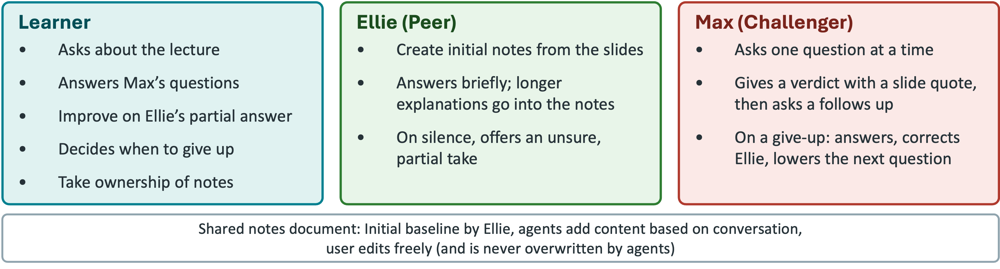
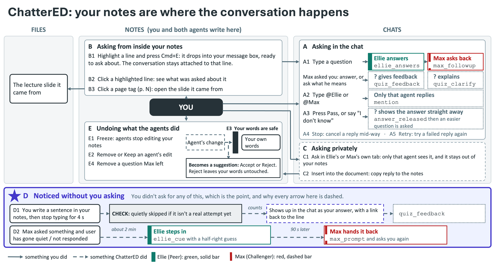

<!--
  FOR AGENTS — read before editing.
  This is the Assignment 1 report as submitted (due 22 Sep 2026), pasted from the PDF and
  re-laid-out as Markdown on 23 Sep 2026. The WORDING IS THE SUBMISSION: typos, grammar and
  pronouns are left exactly as submitted. Do not edit the report text. The layout fixes were
  headings, tables, the figure links, and one character the paste dropped (the ">" in "> 400
  words" in §2.1). Anything new goes in "Claims register" at the bottom, which is not part of
  the submission.

  Ids: T1–T6 here are R1–R6 in docs/research/ai-use-transcripts/. P1–P3 are the interviewees in
  docs/research/interviews/findings.md. GPA bands are allowed for these three and nowhere else
  (CLAUDE.md, "No participant PII").
-->

# ChatterED: Learning by making notes with agents

Loh Zheng, Lucas A0282987E
CS3249 AY2627S1: Assignment 1
School of Computing, National University of Singapore
lucasloh@u.nus.edu

## Abstract

University students often revise learning content with generative AI, yet this help does not always lead to better learning. In this assignment, I coded six real AI study sessions (152 turns) to observe actual user behaviour, and interviewed three final-year NUS students. The students were persistent, but their persistence went into steering AI towards a better explanation, rather than attempting the material themselves, a misdirected persistence.

ChatterED responds by breaking open the conversational UI, by turning conversation into a single editable set of lecture notes, generated from the lecture deck, and edited by the user alongside two AI agents, Ellie, an unsure peer, and Max, who asks and assesses the user. By making every answer by the user, and every input by the user immediately available to the conversation, ChatterED hopes to shift users from AI prompting towards self-attempting.

## 1.1 Learner and Task (Methodology)

I studied how NUS students revised lecture material (lecture slides) with generative AI through observation, using transcripts to observe students’ behaviour, and interviews, to understand reasons for their behaviours (Y.-C. Lee, 2026a)

For observation, six real AI study sessions (T1-T6) with ChatGPT, Claude, and Perplexity were collected with consent and anonymised, collectively comprising of 152 turns. The codebook mapped user behaviour to cognitive outcomes through the ICAP framework (Chi & Wylie, 2014), and each user question to a tutorial question type (Graesser & Person, 1994). Two Claude models (Fable and Opus) coded every turn, while 20 coded turns were randomly sampled and reviewed by me.

For interviews, I selected three final-year NUS students who used AI to revise lecture material across a range of academic bands, P1 (Mechanical Engineering, M, GPA 2.5-3.0), P2 (Computer Science, F, GPA 3.5-4.0), P3 (Computer Science, M, GPA 4.5-5.0). Consent was obtained and data was anonymised. They were asked about how their most recent memory of using AI for revision, success cases, failure modes, recovery actions, and suggested improvements.

## 1.2 Current Difficulty: Reduced persistence to learn, more persistence to work AI

**Misdirected Persistence:** The student sustains effort on steering the AI towards a better explanation for themselves, instead of attempting or explaining the materials themselves.

### Reduced persistence: AI reasons, user reads

Students expect that learning from AI outputs is easier than learning from the slides directly. P2 recounted that she would “throw [the lecture slides] in and ask for summary”, because she could not follow her lecturer and the slides well. Yet effort went towards getting AI to explain better, rather than attempting to understand. For T1-T5, all turns asked AI to reason, while no reasoning from user was visible; on ICAP, turns were Passive or Active, never Constructive or Interactive. For deeper questions, e.g. “How do we prove I is an independent set?”, users asked for reasoning without communicating what they understood. Interviewees found that AI answers assumed knowledge they lacked, (3/3) took too long to understand (2/3) or were too long (1/3).

### Misdirected persistence: User persists on getting AI to attempt

Persistence shifted towards getting AI to attempt. In T4, P2 spent the first ten turns loading lecture material and the rest crafting notes, prompting AI until the notes grew so long that she “usually [didn’t] read [fully]”. P3 went further, building his own AI revision app. Yet, more persistence on getting AI to explain did not mean students were more persistent at reading AI outputs. For T2, 93 AI words were generated for every word the user sent, with reply gaps too short to have read most of it. In T6, AI misjudged for 10 of 21 turns, but only one judgement was challenged by the student, two accepted falsely, while seven were never addressed, suggesting many outputs were never read thoroughly enough.

## 1.3 User Needs

- **N1. Physical space for user’s own attempt.** Users need to be encouraged to attempt (as seen in absence from T1-T5), in a format suitable for them, avoiding T6’s manual setup.
- **N2. Cognitive space for user’s thinking.** Time spent reading is time not spent thinking, CUI needs shorter responses to address P1 and P3 (too long), and simpler responses to address P2 (too long to understand).
- **N3. Recognise and pitch content at the user’s level.** P1 and P2 needed repeated followups to fill gaps. CUI needs to pitch questions based on user’s knowledge, like T6’s approach.
- **N4. Notes that can be edited with AI which should be remembered.** P2 wanted more control for editing, while P3 expressed that he wanted to record his learnings in the slides.

## 1.4 Potential CUI Support

A good CUI will enable users to redirect persistence from steering AI, towards learning with AI. ChatterED does this by making the conversation and the notes the same object. Instead of waiting for the user to set up a quiz, Max proposes questions from lecture content and asks users to attempt (N1). Replies in chat are kept short while longer explainers are written into notes, so reading does not crowd out attempting (N2). Every answer any text input by the user is used estimate the user’s working knowledge (N3). Users can edit the document freely (N4), which is encouraged to better meet N3. In ICAP terms, ChatterED aims to shift user towards Constructive and Interactive modes of engaging with content.

Ellie (Peer) and Max (Challenger) are inspired by Xu et al. (2026) who found that pedagogical role of agents shape student learning and experience, while only two agents were chosen to avoid placing undue pressure on learner, informed by Song et al. (2025).

## 2.1 Learning Goals and Progress

The learner can answer questions about the lecture and review content after the interaction. To operationalise this, we measure:

| Measurement | Type | Baseline |
|---|---|---|
| Question attempt rate by user on Max’s questions | Compelled interaction by Max | T1-T5: no attempts T6: 21 attempts (quiz) |
| Voluntary retries after feedback by Max | Invited interaction by Max | T6: 5 / 21 attempts retried |
| Give-up point: Turns after attempting to express frustration or disengage | Invited interaction by Max, Ellie will provide hints to extend user patience | Unobserved |
| ICAP categorisation (Portion of Constructive and Interactive) | Invited by Max and Ellie | T1-T5: 0 / 31 turns |
| Length of AI text against reading time (to increase time or decrease length) | Invited by Max and Ellie, based on user’s response to their outputs | T2 + T4-T6: see below |

T2 + T4-T6:

| AI Answer Length (words) | n | Response time (minutes) |
|---|---:|---:|
| < 200 words | 21 | 6.1 |
| 200-400 words | 27 | 3.7 |
| > 400 words | 8 | 2.0 |

To reduce: longer responses makes user spend less time reading

## 2.2 Roles of the learner and the CUI

The learner needs to ask questions about content, attempt questions from Max, and respond to the conversational chain. While notes are initially owned by AI, as user continues to work on notes, user should take ownership of them.

*Figure 1. Division of work between the learner, Ellie and Max.*

## 2.3 Why a conversational and persisted document

Making notes itself is a learning activity, involving reviewing content, understanding it, then forming their own representation in notes, which is falls into ICAP’s constructive mode (Chi & Wylie, 2014). However, note-making is cognitively more costly than reading (Piolat et al., 2005) (P2). Previous work has shown that AI note-making should be assistive rather than autonomous for best outcomes (Chen et al., 2025), but current AI CUIs offer little in this middle ground; user either throws in a document and asks for changes (P2, T4), or user asks targeted questions and parses into notes (P3, T1-T2, T5).

ChatterED keeps note-making and learning in the same context, where conversation has access to live version of user’s representation. For the user, these are learning avenues, whereas for the agents, note-making actions by user supplement model’s understanding of user (N3). As per Xu et al. (2026), Ellies as Peer agent will foster interest with low pressure, while Max as Challenger will encourage more metacognition.

## 2.4 Design Goals

- **DG1: Learner tries first (N1)** – Giving user space to understand and attempt on their own. Max asks user questions before explaining, as retrieval practice with feedback has been shown to improve retention (Rowland, 2014)
- **DG2: User gives up, CUI recovers (N3)** – Provide escape hatch for users, and ensure recovery actions taken (Ellie provides hints, Max reduces difficulty). This follows scaffolding, where the tutor reduces a task’s degrees of freedom until the student can manage it (Wood et al., 1976).
- **DG3: Physical spaces to think (N1)** – Provide references between conversation, notes, and source, so user can quickly move between modes and always has multiple ways to engage. Citing the source slide also lets users check AI judgements, to foster user trust through visibility (J. D. Lee & See, 2004).
- **DG4: Cognitive space to think (N2)** – Chat responses should be kept short and readable over complete and long, following Grice’s maxim of quantity (Grice, 1975) as applied to chatbots by Setlur and Tory (2022), and the user’s text should never be overwritten by AI without consent.

## 3. Implementation Plan

ChatterED will be a hybrid CUI+GUI desktop app, compatible for both Windows and MacOS. It uses Electron, Svelte and TypeScript, with ProseMirror for notes and SQLite for the event log. Components are the slide ingest, the rules deciding which agent speaks, a guard stopping agents overwriting user text, and the event log (Figure 2). I specify intended behaviour and thresholds and test each behaviour; Claude Code writes the code. To power LLM required for app, support for local Claude CLI access and common API providers and local LLM will be provided in the app.

Currently, the app adopts understandings from Lecture 6 (Y.-C. Lee, 2026b) for the need to utilise rules to govern LLMs and Houde et al. (2025) for rules on controlling multi-agent LLM conversations. Agent rules and prompts are written by Claude Code in consultation with academic sources and reviewed by me for alignment with ethical and intended outcomes.

*Figure 2. System architecture.* (Image not in the repo.)

## 4. Prototype

The main GUI consists of a file browser (left), document viewer (centre) and a document chat (right). Conversational interactions occur at both the document viewer and the document chat.

*(Screenshot of the app running on Lecture 4. The submitted image is not in the repo; the six frames from the same shoot are in `figures/shot-*.png`.)*

The above shows ChatterED running on this course’s Lecture 4 deck. Three conversation modes are provided, the Doc Chat, which allows user to chat with both agents, and private chats with Ellie and Max directly.

Each note block is linked to the an original lecture slide, and agents’ additions appear in author colour, as seen in the green highlighted block near the top of the document, text added by Ellie. Yellow highlight marks user’s text input, which is picked up by agents to update their model of user’s knowledge (Appendix A).

Agent replies cite the original slide, as seen in Max’s response referencing “p. 41” and “p. 42”, linked to back to a text segment in the document and its original slide.

### Conversational Model

Figure 4 maps how users can reach agents, and what context is available to them. When the user asks a question (A1), Ellie answers first, while Max asks a follow-up question.

The user can answer Max and receive feedback, or give up by pressing Pass or saying so, after which Max releases the answer and asks a simpler question (A3).

The notes are also a conversational surface. The user can highlight a line and ask about it directly (B1), while sentences written into the notes by the user are treated as attempts and receive the same feedback as answers in the chat (D1).

The user may also ask agents privately (C), or freeze the notes to stop agent editing (E1). Either agent can also add knowledge missing from the notes, such as prerequisites. Appendix A annotates one recorded exchange from this session, turn by turn.

*Figure 4. How the user can reach each agent.*

END OF REPORT — 1968 words

## References

- Chen, X., Ruan, K., Ju, K. P., Yap, N., & Wang, X. (2025). More AI Assistance Reduces Cognitive Engagement: Examining the AI Assistance Dilemma in AI-Supported Note-Taking. Proceedings of the ACM on Human-Computer Interaction, 9(7), CSCW451:1-CSCW451:29. https://doi.org/10.1145/3757632
- Chi, M. T. H., & Wylie, R. (2014). The ICAP Framework: Linking Cognitive Engagement to Active Learning Outcomes. Educational Psychologist, 49(4), 219–243. https://doi.org/10.1080/00461520.2014.965823
- Graesser, A. C., & Person, N. K. (1994). Question Asking During Tutoring. American Educational Research Journal, 31(1), 104–137. https://doi.org/10.3102/00028312031001104
- Grice, H. P. (1975). Logic and conversation. In P. Cole & J. L. Morgan (Eds), Syntax and Semantics 3: Speech Acts (pp. 41–58). Academic Press.
- Houde, S., Brimijoin, K., Muller, M., Ross, S. I., Moran, D. A. S., Gonzalez, G. E., Kunde, S., Foreman, M. A., & Weisz, J. D. (2025). Controlling AI Agent Participation in Group Conversations: A Human-Centered Approach. Proceedings of the 30th International Conference on Intelligent User Interfaces, 390–408. https://doi.org/10.1145/3708359.3712089
- Lee, J. D., & See, K. A. (2004). Trust in automation: Designing for appropriate reliance. Human Factors, 46(1), 50–80. https://doi.org/10.1518/hfes.46.1.50_30392
- Lee, Y.-C. (2026a). CS3249 Lecture 4: Prototyping Conversational User Interfaces: From paper and wizards to large language models. National University of Singapore.
- Lee, Y.-C. (2026b). CS3249 Lecture 6: CUI Implementation I. National University of Singapore.
- Piolat, A., Olive, T., & Kellogg, R. T. (2005). Cognitive effort during note taking. Applied Cognitive Psychology, 19(3), 291–312. https://doi.org/10.1002/acp.1086
- Rowland, C. A. (2014). The effect of testing versus restudy on retention: A meta-analytic review of the testing effect. Psychological Bulletin, 140(6), 1432–1463. https://doi.org/10.1037/a0037559
- Setlur, V., & Tory, M. (2022). How do you Converse with an Analytical Chatbot? Revisiting Gricean Maxims for Designing Analytical Conversational Behavior. CHI ’22. Proceedings of the 2022 CHI Conference on Human Factors in Computing Systems. https://doi.org/10.1145/3491102.3501972
- Song, T., Tan, Y., Zhu, Z., Feng, Y., & Lee, Y.-C. (2025). Multi-Agents are Social Groups: Investigating Social Influence of Multiple Agents in Human-Agent Interactions. Proceedings of the ACM on Human-Computer Interaction, 9(7), CSCW452:1-CSCW452:33. https://doi.org/10.1145/3757633
- Wood, D., Bruner, J. S., & Ross, G. (1976). The role of tutoring in problem solving. Journal of Child Psychology and Psychiatry, 17(2), 89–100. https://doi.org/10.1111/j.1469-7610.1976.tb00381.x
- Xu, Z., Zhang, J., Tang, A., & Lee, Y.-C. (2026). Who You Explain To Matters: Learning by Explaining to Conversational Agents with Different Pedagogical Roles. CHI ’26, 1–24. https://doi.org/10.1145/3772318.3790298

## Appendix A: Annotated transcript of a learning exchange

| Seq | Who | Turn | Rule, and what it shows |
|---|---|---|---|
| 26 | Learner, from the notes | "why one repair per turn, and not just handle everything at the end?" | Selected a line and pressed Cmd+E, so the question arrived attached to it. Classified as a question. |
| 27 | Ellie | "You handle repair one turn at a time because […] If you catch it immediately […] they lose one step, not the whole trip. […] Fix at the source, not after the whole chain is built on a bad brick." | **ellie_answers** — A question drew Ellie. She also added the reason to the notes, which stated the rule but not why. |
| 28 | Max | "Suppose a user tells the room-booking bot 'actually make it 6 people, not 4' right after it already confirmed […] walk through what a per-turn repair design would do here […]" | **max_followup** — Exactly one question back, also placed in the notes. This opens the question. |
| 29 | Learner, chat | "Because if you wait until the end you cannot tell which turn went wrong, and neither can the user." | Attempt 1. A correct principle that skips the case asked. |
| 30 | Max | "Partly there. You gave the right general principle […] but you didn't walk through this case as asked. […] p. 41: 'Confirmation / Implicit echoes while moving on; explicit stops and asks' […]" | **quiz_feedback** — An answer drew Max. Verdict first, slide quoted, same question re-asked, narrowed to the gap. |
| 31 | Learner, typed into the notes | "Repair belongs on the turn that broke, because a user told only at the end cannot tell which of their answers the system misread." | Attempt 2 on the same question, although it was written in the notes rather than the chat. |
| 32 | Max | "Partly there. The general principle is right […] But this is the same principle stated again, not applied to the room-booking case […] this claim belongs with p. 41's 'one repair per turn,' not p. 42 […]" | **quiz_feedback** — Names why the revision did not land, and corrects the slide the learner cited. |
| later | (idle) | | **closure** — The question was still open when the sitting went idle. |

---

## Claims register (for agents — NOT part of the submission)

The report's commitments, checked against the app on 23 Sep 2026. A claim marked **does not
hold** is a bug to fix in the app, not a line to edit in the report. Measurements come from the
local `~/Library/Application Support/ChatterED/app.db`: `notes_docs.doc_json` word counts by
author mark against `file_text` per page, `messages` joined to `participants`, and
`notes_doc_edits` for agent additions.

| § | Claim | Status | Where |
|---|---|---|---|
| Abstract, 1.4, 2.3 | Ellie is "an unsure peer" / "Peer agent", Max the "Challenger" | **Partly.** In code Ellie is the **Teacher** (#32) and answers in full. She is a peer only in the silence cue (`ellieCueBlock`, 60 words, hedged). Shortening her chat replies (below) moves her closer to the report. | `room/prompts.ts` role block, `room/prompts.doc.ts` |
| 1.4, N2, DG4 | "Replies in chat are kept short while longer explainers are written into notes" | **Did not hold before 23 Sep; holds since `cb11995`.** Before: Ellie's doc-chat replies had a median of 202 words (p90 254, 14 turns), and her notes additions were 47–133 words, because the addition was condensed out of the chat reply. Now: she writes the short half (about 60 words, 90 at most), and the notes edit writes the rigorous half from the question and the slide. Live check on Lecture-complex: a 90-word chat reply and a 122-word notes addition. When the notes are frozen she still gives the full answer. | `room/prompts.doc.ts` `ellieAnswersBlock`, `room/docedit.ts` `answerEditPrompt`, `room/actor.ts` `#answerSplitsIntoNotes` |
| 2.1 | Length against reading time: < 200 words is the band learners actually read (10.1× headroom); > 400 is read barely once | Holds as evidence (`reading-time.md` §3). Ellie's median of 202 words puts her in the 200–400 band. | `docs/research/ai-use-transcripts/analysis/reading-time.md` |
| 1.2, N2 | Notes that grow too long go unread (P2, T4: "usually [didn’t] read [fully]") | **Held, because of a bug.** Stored notes measured 2.3–3.0× the slide words (Lecture 4: 9,491 words, about 40 min at 238 wpm), because every ingest window was saved twice. Fixed 23 Sep. Without the duplicates the prose was 1.13–1.47× the slides (Lecture 4: about 4,700 words, 20 min). Decks ingested before the fix still hold the duplicates until they are regenerated. | `shared/doc/ops.ts` `appendNodes`, `main/notes/prompts.ts` |
| 2.2, 2.3 | Notes start AI-owned and pass to the learner; AI note-making should be assistive, not autonomous (Chen et al., 2025) | Direction holds. Verbose AI notes leave the learner little room to write their own. | `shared/doc/ownwords.ts` |
| DG4 | The learner's text is never overwritten without consent | Holds (the guard turns an agent change into an accept/reject suggestion). | `shared/doc/guard.ts`, `room/docedit.ts` |
| DG2 | On a give-up Max releases the answer and lowers the next question; "Ellie provides hints" | Holds for Max (`releaseBlock`, `pitch.ts`). Ellie's cue is a partial, possibly wrong peer take rather than a hint. | `room/prompts.doc.ts`, `room/pitch.ts` |
| 3 | "compatible for both Windows and MacOS"; "local LLM will be provided" | **Plan only.** The app is macOS only (#11, #17). Backends are the Claude CLI, an API key, and `scripted` (#19). | `app/tools/install-local.sh`, `room/llm/` |
| 4 | Highlight-and-ask (B1), notes text assessed as an attempt (D1), freeze (E1), Pass and release (A3) | Holds. | `room/actor.ts`, `notes_docs.frozen` |
| 1.2 vs N2 | "too long (1/3)" in 1.2, but N2 names P1 *and* P3 as "too long" | An inconsistency inside the report. The interview findings are the authority. | `docs/research/interviews/findings.md` |
