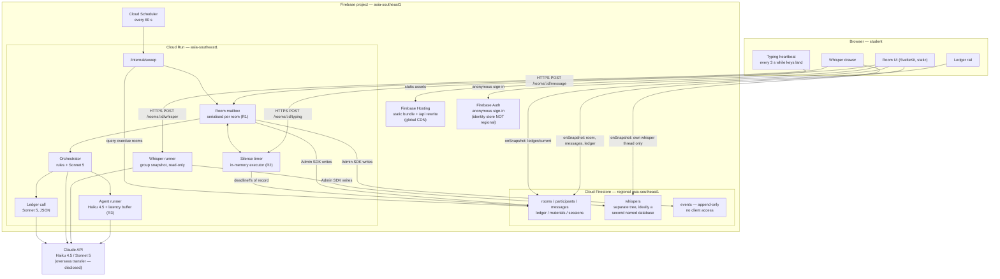

# ChatterED — Architecture on Firebase / Firestore (Singapore)

> **Status: partial draft.** The agent writing this was cut off by the usage limit on 2026-09-13
> after sections B.1–B.2; sections A, C–G were never written. It was also written for a *web app*
> with a Cloud Run orchestrator. The macOS-app decision (#11) moved the Room actor in-process —
> see `architecture-mac.md`, which supersedes this file except for the Firestore mirror shape.
> `architecture-mac.md` also corrects §B.2's "~1 sustained write/second per document" figure,
> which is no longer in Firestore's docs. Kept for the timer-mechanism comparison only.


**Status:** revision of `architecture-options.md` for developer sign-off · **Written:** 13 Sep 2026 · **Owner:** Lucas
**Supersedes:** `architecture-options.md` §A (stack choice), §C.0–C.1 (recommendation, component view), §C.2 (data model), and the timer half of §C.4.
**Carried over unchanged:** §B (LLM cost model and prices), §C.3 (orchestrator loop), §C.4's latency rules, §C.5 (prompt-cache layout and the two agent prompts), §D.1's hand-build/delegate criterion. `architecture-options.md` is **not edited**; where the two disagree, this document wins on infrastructure and that one wins on interaction logic.

## The four decisions this revision implements

| # | Decision (13 Sep 2026) | What it changes |
|---|---|---|
| 1 | **Hosting = Firebase / Firestore, `asia-southeast1` (Singapore)** — data residency beats the brief's Fly.io + Postgres recommendation and beats Cloudflare Durable Objects | §A stack choice is closed. Postgres DDL becomes a Firestore document model (§C). The single-writer room actor survives; its host changes from a Fly machine to one Cloud Run service |
| 2 | **Lecture material = the student pastes/uploads a slide section**; a Concept Pack is extracted at session start | `architecture-options.md` §E Q3 answered as **(a)**. `progress-tracking.md` §3's *elicited pack* is now the A1 path, not the second one. Forces a new session-start flow (§D) and re-opens the Haiku 4.5 4,096-token cache floor (§D.4) |
| 3 | **Silence timer = 45 s, paused while the student is typing, server-authoritative** | `architecture-options.md` §E Q1 answered. `design-brief.md` §D3's two-stage keystroke-aware timer stands; §B.2 of this document makes it authoritative on Cloud Run rather than on a Fly process |
| 4 | **Interviews use Variant A** (quantitative/proof coursework); demo concept = **"PSD Hessian ⇒ convexity"** | `design-brief.md` §H Q1 answered; §G's scripted interaction is the demo script. The worked Concept Pack in §D.2 below is the §G ledger rows (R1–R3), extracted rather than authored |

Already fixed and not re-argued: standalone web app; **Claude Haiku 4.5** for agent turns, **Claude Sonnet 5** for the orchestrator and the ledger; hero mechanic = group chat with Peer (**Ellie**) and Challenger (**Max**); whisper and deliberate latency are supporting features and must stay toggleable.

<!--SECTION-A-->

---

# B. Component view

## B.1 The shape

Four moving parts, one of which is stateful:

- **Firebase Hosting** serves a static SvelteKit build (`adapter-static`). No SSR, so nothing about the app tier is regional or needs to be.
- **Firestore (`asia-southeast1`, regional)** is *both* the durable transcript and the realtime channel. Clients hold `onSnapshot` listeners on the room control doc, `messages`, `ledger/current` and their own whisper thread. There is no WebSocket server to write, no reconnect/resume protocol to write, and no drain-on-deploy problem — Firestore's SDK owns all three. That is the single largest engineering saving of this stack over A(i).
- **One Cloud Run service, `asia-southeast1`** — the **Room orchestrator**. It is the *only* writer to Firestore for room state. It holds the serialised per-room mailbox (R1), the deliberate-latency buffer (R3), the in-memory silence timer (R2), and it is the only principal holding the Anthropic API key.
- **Cloud Scheduler** hits a sweep endpoint every 60 s: the recovery path for timers lost to an instance restart.

Clients **never write** to Firestore. Every mutation is an authenticated HTTPS POST to Cloud Run, which assigns `seq`, enforces consent and rate limits, and writes with the Admin SDK. Firestore security rules are therefore read-only for every client path (§C.4). This keeps the "one writer per room" invariant from `architecture-options.md` R1 exactly as strong as it was on Fly.io.



**Why Firestore and not a WebSocket from Cloud Run.** Cloud Run does support WebSockets, but "WebSockets requests are treated as long-running HTTP requests… subject to request timeouts (currently up to 60 minutes and defaults to 5 minutes)", and "session affinity on Cloud Run provides best effort affinity, new WebSockets requests could still potentially connect to different instances, due to built-in load balancing" (https://docs.cloud.google.com/run/docs/triggering/websockets). Building the hero mechanic on a best-effort-affinity socket would reintroduce exactly the split-brain risk that A(iii) was rejected for. Firestore listeners are the durable, reconnect-safe channel; Cloud Run only ever handles short POSTs plus its own outbound Claude streams.

## B.2 The 45 s typing-aware silence timer, server-authoritative

### The invariant, stated once

> **The deadline in Firestore is the timer. The in-memory `setTimeout` is only a low-latency executor for it.**

Everything below follows from that sentence. It is the same rule as `architecture-options.md` §C.4 ("the deadline is a wall-clock timestamp… written before the in-process `setTimeout` is set"), ported.

The room control doc carries five fields:

```jsonc
{
  "state": "open",                      // open | agent_scheduled | agent_speaking | closed
  "lastActivityTs": "…T07:21:03.412Z",  // bumped by: student message, agent release, typing heartbeat
  "deadlineTs":     "…T07:21:48.412Z",  // = lastActivityTs + SILENCE_MS. Authoritative. Sent to the client.
  "cumulativeIdleMs": 12400,            // idle time NOT reset by typing — drives stage 2 at 90 s
  "timerEpoch": 7                       // monotonic fence; a fire with a stale epoch is discarded
}
```

`SILENCE_MS = 45_000`. The client receives `deadlineTs`, never "seconds remaining"; the countdown ring is cosmetic and a backgrounded tab or a skewed clock changes nothing.

### How "typing" is signalled

A heartbeat **POST to Cloud Run**, not a Firestore document.

- The client posts `POST /rooms/:id/typing {clientTs, textLen}` at most **every 3 s**, and only while the composer has focus **and** a keystroke landed in the last 3 s **and** the composer is non-empty. Sent with `fetch(..., {keepalive: true})` so a tab switch does not strand one.
- The server sets `lastActivityTs = now`, recomputes `deadlineTs = lastActivityTs + 45_000`, re-arms the in-memory timer, and **only persists to Firestore when `deadlineTs` moves by more than 5 s** since the last write. That write-coalescing keeps the room doc under Firestore's ~1 write/second sustained per-document guidance and stops the heartbeat from fanning out a listener read every 3 s.
- `cumulativeIdleMs` is **not** reset by a heartbeat — it accumulates whenever no heartbeat and no message has arrived. Stage 2 of `design-brief.md` §D3 (Ellie's deliberately incomplete scaffold) fires at `cumulativeIdleMs ≥ 90_000`. So "paused while typing" is true of stage 1 and only of stage 1, which is what the brief specifies ("stage 2 at 90 s **cumulative** idle").
- **Extension cap.** A single silence window may be extended by typing for at most 120 s in total. Without it a client that keeps posting heartbeats can hold the mechanic off forever, and the timer is the hero mechanic.
- Heartbeats are logged as `student_typing_start` / `student_typing_stop` (`evaluation-plan.md` §7.1) with `text_len`, which is also the honest audit trail for "was the timer actually paused?".

Two Firestore writes per typing burst instead of ~200 heartbeat documents; the timer state lives in the one place that owns the clock.

### The two candidate mechanisms

| | **Cloud Tasks deadline task** | **In-memory timer in Cloud Run + Firestore recovery record** |
|---|---|---|
| Shape | One task per silence window, `scheduleTime = deadlineTs`, targeting `/internal/fire`. On fire the handler re-reads the room doc: if `deadlineTs` has moved (the student typed), it enqueues a replacement and returns. **Never** delete-and-recreate per keystroke | `setTimeout(deadlineTs - now)` inside the room actor. `deadlineTs` written to Firestore before the timer is set. On boot, query `rooms where state == 'open' and deadlineTs != null` and re-arm; past deadlines fire immediately |
| Survives instance loss | Yes, natively | Only via the recovery record + a sweep |
| Timing accuracy | Best-effort; Cloud Tasks does not promise to-the-second delivery, and each fire is a fresh inbound request that may queue behind the mailbox | Exact to `setTimeout` resolution; runs inside the actor that already owns the room |
| Cost per fire | A task create + an HTTP request, per window | Zero |
| Interaction with the mailbox (R1) | The fire lands as an ordinary HTTP request — with `max-instances=1` it reaches the right process; without it, a second instance could own the same room and produce two writers | Fires *inside* the mailbox. Single-writer by construction |
| Interaction with the latency buffer (R3) | None — the buffer still needs a long-lived in-process turn, so Cloud Tasks removes no requirement | Same process, same lifetime |
| Local dev | No first-party Cloud Tasks emulator in the Firebase Emulator Suite; needs a stub | Plain `setTimeout`, fully testable |
| Extra surface | A queue, its IAM, its retry policy, an idempotency fence for at-least-once delivery | One cron job |

**Recommendation: the in-memory timer, with the Firestore deadline as the record and a 60 s Cloud Scheduler sweep as the recovery trigger.**

The deciding argument is not accuracy, it is that **Cloud Tasks removes no requirement**. The deliberate-latency buffer (R3) and the serialised mailbox (R1) both demand a long-lived in-process room actor no matter what schedules the timer; once that actor exists, `setTimeout` is free and exact, and Cloud Tasks is a second timing system layered on top of it. The sweep is fifteen lines:

```ts
// GET /internal/sweep — Cloud Scheduler, * * * * *, OIDC-authenticated
const overdue = await db.collectionGroup('rooms')
  .where('state', 'in', ['open', 'agent_scheduled'])
  .where('deadlineTs', '<=', Timestamp.now())
  .limit(200).get();
for (const r of overdue.docs) await mailbox(r.id).enqueue({ type: 'silence_deadline', epoch: r.data().timerEpoch });
```

### Failure modes, stated

1. **Cloud Run restarts the instance mid-session.** This is not hypothetical: "Minimum instances can be restarted at any time" and minimum instances "are a best-effort target to keep instances warm and ready" (https://docs.cloud.google.com/run/docs/configuring/min-instances). The in-memory timer dies with it. The sweep re-fires it, **up to 60 s late**. Be honest about the number: it is the same worst case that disqualified Cloudflare DO alarms in `architecture-options.md` §A(ii) — but there it applied to *every* fire, and here it applies only when an instance is lost. Tighten by running the sweep every 60 s with an in-handler 4×15 s loop if the pilot shows it mattering.
2. **An in-flight agent turn is lost with the instance** — the latency buffer held a reply that now never arrives. Mitigate by writing `state: 'agent_scheduled'` with `turnId` and `dueTs` to the room doc *before* the Claude call; the sweep re-runs any `agent_scheduled` room whose `dueTs` is more than 25 s past, and the `turnId` de-duplicates. This is the drain-and-resume path `architecture-options.md` §A(i) flagged as required, and it is required here too.
3. **Two instances own one room.** Prevented by `--max-instances=1`. That makes single-writer a platform guarantee rather than an application one, at the cost of a hard concurrency ceiling (raise `--concurrency` to ~250) and a single point of failure. Acceptable at ≤30 concurrent students; revisit with a per-room lease document (`ownerInstanceId` + TTL) before it is not.
4. **A deploy drops everything.** A Cloud Run revision switch terminates in-flight requests after `SIGTERM` + a grace period. Clients recover because Firestore listeners reconnect on their own, and the sweep re-arms timers within 60 s. Deploy between sessions; do not deploy during the study run.
5. **CPU must be allocated outside requests.** A timer that fires between HTTP requests only runs under **instance-based billing**: "Selecting *instance-based billing* allocates CPU even outside of request processing, letting you execute short-lived background tasks and other asynchronous processing work after returning responses" (https://docs.cloud.google.com/run/docs/configuring/cpu-allocation). Under the default request-based billing the timer silently does not fire. This is a one-flag decision that will otherwise cost a day of debugging.
6. **Clock authority.** Only the server writes timestamps, using Firestore server time. `client_ts` is logged and never used for analysis (`evaluation-plan.md` §7).
7. **Heartbeat loss** (tab backgrounded, flaky network) fails *toward* the timer firing — Ellie posts a content-free nudge that adds no mathematics (`design-brief.md` §D3). That is the safe direction; the opposite failure (a stuck pause) is the one the 120 s cap exists to prevent.
