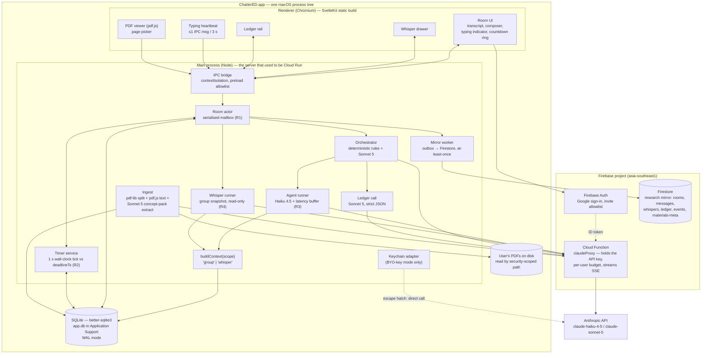
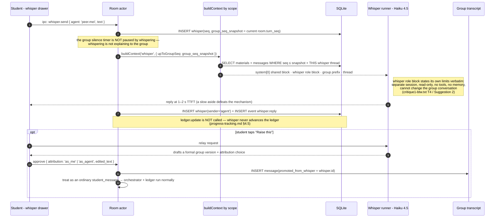

# ChatterED — macOS App Architecture

**Status:** proposal for developer sign-off · **Written:** 13 Sep 2026 · **Owner:** Lucas
**Relationship to the other architecture docs:**

| Document | Status after this one |
|---|---|
| `architecture-options.md` | **Interaction logic still authoritative** — §C.3 orchestrator loop, §C.4 latency rules, §C.5 prompt-cache layout and the two agent prompts, §D.1 hand-build/delegate criterion. Its §A stack comparison and §C.0–C.1 (Fly.io + Postgres) are superseded. Its §C.2 Postgres DDL is *ported*, not discarded (§D below). |
| `architecture-firebase.md` | **Superseded on hosting.** Its §B.2 silence-timer invariant ("the deadline is the timer; `setTimeout` is only a low-latency executor for it") **survives verbatim** and is the single most reused idea in this document. Its Cloud Run room orchestrator is replaced by an in-process one. |
| `progress-tracking.md` | Unchanged. The Concept Pack (§3), the ledger call (§4) and the four hard rules (§4.4) are consumed as-is. |
| `design-brief.md` §D, §G | Unchanged. D3 (two-stage timer, 45 s / 90 s), D4 (per-role latency), D5 (whisper) are the behavioural spec this architecture must deliver. |
| `evaluation-plan.md` §7 | Unchanged. §7.1's event catalogue is the `events` schema in §D below. |
| `competitor-notes.md` | Implication 6 is the product argument for this whole document: *"Local-first fits the segment… a Mac app that reads slides from disk removes the upload step entirely."* |

**Decisions already taken and not re-argued here:** macOS desktop `.app`, DMG drag-install, NUS-internal distribution to a small cohort under an authorisation the developer holds (no App Store); Firebase/Firestore `asia-southeast1` for sync and research event logs; Claude **Haiku 4.5** for agent turns and **Claude Sonnet 5** for the orchestrator and the ledger, via the Anthropic API; the student picks a PDF page range or pastes text and a Concept Pack is extracted at session start; role-playable prototype due **20 Sep 2026**, installable build for Assignment 2.

**Out of scope by instruction:** data residency and compliance. The word "asia-southeast1" appears below only as a Firebase configuration value.

**Verification note.** Facts about Tauri, Electron, Apple notarisation, the Firebase JS SDK and Firestore pricing were checked against primary documentation; each carries its URL. Anything that could not be fetched is marked **UNVERIFIED** and should be re-checked before it is relied on. Model IDs, prices and the Haiku 4.5 cache floor come from the loaded `claude-api` skill (cached 2026-06-24), not from memory.

## Contents

- [A. Shell choice — Tauri 2 vs Electron vs native SwiftUI](#a-shell-choice--tauri-2-vs-electron-vs-native-swiftui)
- [B. Where the Room actor lives now](#b-where-the-room-actor-lives-now)
- [C. Component diagram and the three data flows](#c-component-diagram-and-the-three-data-flows)
- [D. Local data model and Firestore mirror](#d-local-data-model-and-firestore-mirror)
- [E. PDF ingestion, the cache floor, and the concept checklist](#e-pdf-ingestion-the-cache-floor-and-the-concept-checklist)
- [F. Packaging, signing, install](#f-packaging-signing-install)
- [G. Cost per session and per 30 users per month](#g-cost-per-session-and-per-30-users-per-month)
- [H. Build plan](#h-build-plan)
- [I. Open questions for the developer](#i-open-questions-for-the-developer)

---

# A. Shell choice — Tauri 2 vs Electron vs native SwiftUI

## A.0 What NUSSync appears to be built with

Read off `Academia/Sources/sample_ui/photo_2026-09-13 15.34.37.jpeg`:

| Observation | What it implies |
|---|---|
| Window controls (— □ ×) are **right-aligned** in a custom-drawn title bar reading "NUSSync" | Cross-platform shell with a custom frame, and this screenshot was taken on Windows. Not AppKit. |
| Right-hand chat panel renders **display LaTeX** (`f(x+d) = f(x) + \nabla f(x)^T d + …`) inline with prose | A web typesetting stack — KaTeX or MathJax. Neither has a native-Swift equivalent in common use. |
| PDF pane toolbar: zoom `230%`, a `Fit` button, `30 / 46` page counter, pen + four colour swatches, undo/redo, and a "Use built-in viewer" vs "Open" toggle | A **web** PDF viewer, almost certainly `pdf.js` or a wrapper around it. macOS PDFKit's stock UI looks nothing like this. |
| Left rail: Home / Files / What's new / Deadlines / Announcements / Grades / Study / Papers / Settings / Play / Quest, a course list with unread badges, a gamified avatar ("Lv 4"), and a footer reading "Idle · Sync now · Last synced 28m ago" | CSS-driven layout; an app that already owns a **local file cache + a sync loop**, which is the same shape ChatterED needs. |
| Chat panel has a model selector currently reading **`sonnet`**, and the thread is scoped to the open file (`Slides_L07_Unconstrained2.pdf`) | The developer has already built a file-scoped Claude chat surface. ChatterED's room is the *same slot*. |

**Conclusion: NUSSync is a webview-based desktop shell — Electron or Tauri — with a
`pdf.js`-family viewer and a math-rendering web front end. The screenshot cannot distinguish
Electron from Tauri**, and that distinction is the one thing that would change the recommendation
below, so it is Q1 in §I. What the screenshot *does* settle is that NUSSync is **not** native
SwiftUI, which removes the strongest argument option 3 had.

## A.1 The comparison

Scored against the eight criteria in the brief. "Reuse" means: how much of
`architecture-options.md`'s SvelteKit front end and Node room actor survives verbatim.

| | **Tauri 2** (Rust core + SvelteKit webview) | **Electron** (Node main + same SvelteKit) | **Native SwiftUI** |
|---|---|---|---|
| **Pick a PDF from disk** | `open()` from `@tauri-apps/plugin-dialog`; the docs state that "the selected paths are added to the filesystem and asset protocol scopes", so a picked file becomes readable by the `fs` plugin at runtime without a pre-declared static scope ([dialog](https://v2.tauri.app/plugin/dialog/), [JS ref](https://v2.tauri.app/reference/javascript/dialog/), [fs](https://v2.tauri.app/plugin/file-system/)) | `dialog.showOpenDialog` in main, then `fs.readFile`. No scope system to reason about at all | `NSOpenPanel` + a security-scoped bookmark. The most correct model of the three, and the only one where re-opening a file across launches is a solved API |
| **Page-range text extraction** | `pdf.js` in a WKWebView, or a Rust crate (`pdf-extract`, `lopdf`) | `pdf.js` (`pdfjs-dist` legacy build) runs in **Node main**, off the UI thread, writing straight to SQLite. Chromium's own PDF engine is `pdf.js`-derived, so viewer and extractor are one dependency | **PDFKit**: `PDFDocument(url:).page(at:)?.string` is three lines and gives Apple's own text layer. Best extraction quality of the three |
| **Local SQLite** | Official `tauri-plugin-sql` (SQLite/MySQL/Postgres); `Database.load('sqlite:app.db')`; write permission is opt-in (`sql:allow-execute`) ([docs](https://v2.tauri.app/plugin/sql/)) | `better-sqlite3` — synchronous, in-process, transactional, the fastest option and the one the room actor's mailbox wants | GRDB or raw SQLite3. Excellent |
| **Bundle size** | Officially "a minimal Tauri app can be less than 600KB" ([v2.tauri.app/start](https://v2.tauri.app/start/), [tauri.app](https://tauri.app/)). Realistically 8–20 MB for this app | **No official figure exists** — Electron's docs state none (UNVERIFIED). Community measurements for a packaged hello-world land roughly 45–115 MB; budget a **90–150 MB DMG** for ChatterED | 5–15 MB |
| **DMG + signing/notarisation** | `tauri build --bundles app,dmg`; DMG background/window/icon positions configured under `bundle > macOS > dmg` ([docs](https://v2.tauri.app/distribute/dmg/)). Signing via `APPLE_SIGNING_IDENTITY` / `APPLE_CERTIFICATE` / `APPLE_CERTIFICATE_PASSWORD`; notarisation via `APPLE_ID` + `APPLE_PASSWORD` (app-specific) + `APPLE_TEAM_ID`, or App Store Connect API key. "Notarization is required when using a Developer ID Application certificate", and Tauri notarises **and staples** as part of the build ([docs](https://v2.tauri.app/distribute/sign/macos/)) | Forge: `osxSign: {}` ("comes with defaults that work out of the box in most cases") + `osxNotarize` via `@electron/notarize`, three auth modes ([docs](https://www.electronforge.io/guides/code-signing/code-signing-macos)). electron-builder: `mac: { notarize: true }`, "Stapling is performed automatically… You don't need to configure anything extra", and "Notarization requires Hardened Runtime" ([docs](https://www.electron.build/docs/features/code-signing/notarization/)); DMG target keys `background`, `contents`, `window`, `format` ([docs](https://www.electron.build/docs/dmg/)) | Xcode Organizer → Distribute App → Developer ID. The smoothest path, but it needs Xcode and an archive scheme |
| **Streaming / long-lived connections** | Rust `reqwest` SSE in the core, or `fetch` in the webview. The latency buffer would sit in Rust, or in a webview that macOS may throttle when occluded | The Anthropic TypeScript SDK's `.stream()` runs in **Node main**, which is not subject to renderer throttling. The buffered-release pacer from `architecture-options.md` §C.4 is unchanged code | `URLSession` + manual SSE parsing. **There is no official Anthropic Swift SDK** — the `claude-api` skill routes unsupported languages to raw HTTP. You would hand-write streaming, tool-result plumbing, prompt-cache headers and `usage` accounting |
| **Reuse of the web work** | Front end: ~100 %. Room actor/orchestrator: **0 % if written in Rust**, or ~90 % if kept in the webview — and keeping it in the webview is what the timer analysis in §C.3 says not to do | Front end ~100 %, room actor / orchestrator / agent runner / ledger / Anthropic SDK calls ~100 %. `architecture-options.md` §C.3's pseudocode becomes real TypeScript in the main process without a transport change | **~0 %.** Every prompt, every rule, every schema is rewritten |
| **Solo-student velocity with Claude Code** | Good on the web half, materially slower on the Rust half. Rust's compile-error loop is a fine agent workflow but it is a *second* language to review on camera under the A1 "you must understand any code you submit" clause | **Highest.** One language end to end, one debugger, one test runner, and the largest corpus of prior art for exactly this shape | Moderate. Claude Code writes competent SwiftUI, but there is no SDK to lean on for the Claude half, and you cannot reuse a line of the existing design work |
| **Later NUSSync embed** | Clean **iff** NUSSync is Tauri | Clean **iff** NUSSync is Electron; the room UI ports either way, the Node orchestrator does not | Poor — NUSSync is not native (§A.0) |

## A.2 Recommendation

> **Build ChatterED as an Electron app: SvelteKit static build in the renderer, the entire Room
> actor / orchestrator / agent runner / ledger in the Node main process, `better-sqlite3` on disk.
> Keep the room package free of Electron imports so a later move to Tauri, to a server, or into
> NUSSync is a port and not a rewrite.**

The reasoning, in priority order:

1. **The prototype is due in seven days and the deliverable is an *interaction*, not a binary.**
   Everything in `architecture-options.md` §C.3–§C.5 — the mailbox, the anti-dog-pile counter, the
   latency buffer, the cache layout, both agent prompts — is already specified as TypeScript running
   in a Node process. Electron is the only option where that specification *is* the implementation.
   Tauri costs a Rust port of the one subsystem carrying all the design decisions; SwiftUI costs the
   whole thing plus a hand-rolled Anthropic client.

2. **The hero mechanic must not run in a webview.** §C.3 shows three macOS-specific ways a
   renderer-side timer dies: system sleep, occlusion throttling, and relaunch. The fix is a
   wall-clock tick in a non-throttled process. Electron gives that for free in main (plus
   `backgroundThrottling: false` for the renderer's own animation); Tauri gives it only if you write
   the timer in Rust, which is exactly the code you least want to write twice.

3. **Bundle size is the one place Tauri clearly wins, and it is the criterion that matters least
   here.** Tauri's own claim is <600 KB minimal ([v2.tauri.app/start](https://v2.tauri.app/start/))
   against an Electron baseline that has *no official figure* and is empirically 45–115 MB. For
   thirty NUS students on campus network downloading once, a 120 MB DMG is a non-event. If ChatterED
   ever ships beyond the cohort, revisit — that is the trigger in A.3.

4. **Signing and notarisation are a wash.** Both toolchains automate it, both staple automatically,
   both accept the same three Apple auth modes, and both need the same $99/yr membership (§F). This
   criterion does not discriminate.

5. **Firebase is slightly safer on Chromium.** Firestore's offline cache is documented as supported
   "only by the Chrome, Safari, and Firefox web browsers"
   ([docs](https://firebase.google.com/docs/firestore/manage-data/enable-offline)); Firebase
   documents neither Electron nor WKWebView-under-Tauri explicitly (**UNVERIFIED** for both). An
   Electron renderer *is* Chromium, so it sits inside the documented set; Tauri's WKWebView is
   Safari's engine but served over a custom `tauri://` scheme, which is an untested origin for
   IndexedDB persistence. §B.3 removes most of this risk anyway by not depending on the Firestore
   client cache — but on a seven-day clock, "sits inside the documented set" is worth something.

6. **Native SwiftUI is the right answer to a question nobody asked.** It wins on file access and PDF
   extraction and it would be the best-feeling Mac app of the three. It loses on everything the
   assignment is actually graded on, it discards the entire web design corpus, it has no first-party
   Claude SDK, and §A.0 says NUSSync is not native, so it does not even buy the embed story.

## A.3 When to revisit

Port to Tauri (a renderer-preserving, main-process-rewriting move) when **any** of these is true:

- **NUSSync turns out to be Tauri** and the embed becomes a real milestone rather than a someday.
  This is the highest-probability trigger and it is Q1 in §I.
- Distribution widens past the NUS cohort and download size or per-install RAM starts appearing in
  feedback.
- Apple ships a WKWebView/Chromium divergence that makes the 120 MB indefensible for a two-panel
  chat app.

Do **not** port because Rust is nicer. The Room actor is the asset; the shell is a delivery vehicle.

---

# B. Where the Room actor lives now

## B.1 In-process, and the argument is short

> **Recommendation: the Room actor, the silence timer, the orchestrator, the agent runner and the
> ledger all run in the app's Node main process. Firestore receives a mirrored transcript and event
> log. There is no Cloud Run service in the hot path.**

`architecture-firebase.md` bought a Cloud Run service to get four things. Count what a desktop app
already has:

| What Cloud Run was for | On the desktop |
|---|---|
| **R1 — one writer per room.** Guaranteed by `--max-instances=1`, at the cost of a global concurrency ceiling and a single point of failure for the whole cohort | One user, one app, one process. The mailbox is a promise chain; single-writer is not a deployment flag, it is arithmetic |
| **R2 — a durable timer.** In-memory `setTimeout` + a Firestore deadline record + a 60 s Cloud Scheduler sweep, with the honest admission that a lost instance means firing **up to 60 s late** | A 1 s wall-clock tick against a SQLite deadline. Worst case is bounded by *the user's own app being closed*, which is not a failure the study cares about (§B.4) |
| **R3 — the latency buffer.** Needs a long-lived in-process turn, which is why Cloud Tasks was rejected: it "removes no requirement" | The app is the long-lived process, by definition |
| **Holding the Anthropic API key** | This is the **only** one that survives, and it is answered in §B.2 with a function, not a service |

Three further gains that only exist because there is no network in the loop:

- **Latency headroom.** The design spends 9–12 s of *deliberate* hold on a Challenger turn
  (`design-brief.md` §D4), and the rule is that latency is a **floor on visible TTFT, not an added
  delay**. Every millisecond of real infrastructure latency eats that budget. A round trip to Cloud
  Run before the round trip to Anthropic is pure tax on the one number the study manipulates.
- **`architecture-firebase.md` §B.2 failure mode 5 disappears.** That document flags that a Cloud Run
  timer only fires between requests under *instance-based billing*, and that under the default
  request-based billing "the timer silently does not fire" — a one-flag decision costing a day of
  debugging. There is no such flag on a laptop.
- **Deploys stop being an event.** Failure mode 4 ("do not deploy during the study run") becomes
  "ship a build between sessions", which was going to be true anyway.

**What in-process costs.** Multi-device sync is now eventual and one-directional, so a student who
starts on their MacBook and opens their iMac gets a read-only mirror, not a live room. Say that in
the UI. Cross-user rooms — two students in one room, which the design does not have — would need a
server. And the researcher cannot watch a session live; they watch the Firestore mirror, up to one
outbox flush behind.

**The portability rule is unchanged from the web document.** `packages/room` imports no Electron, no
`firebase`, no `better-sqlite3` — it takes `Clock`, `Store`, `Transport` and `LlmClient` interfaces.
That is what makes §A.3's Tauri port, a NUSSync embed, and any future rehost onto Cloud Run all
adapters rather than rewrites.

## B.2 The API key — recommend a thin Cloud Function proxy

Three options, and the middle one is a trap.

| | **A. Ship the key in the app** | **B. Each student enters their own key** | **C. Thin proxy holds one key** |
|---|---|---|---|
| Extractable from the `.app`? | Yes, trivially — `strings` on `app.asar`, or DevTools. Signing and notarisation are integrity checks, not secrecy | n/a | No key ever leaves the server |
| Who pays | The developer, with no way to stop abuse | Each student, with a credit card and an Anthropic account | The developer, with a per-user cap he can actually enforce |
| Friction for a first-year student on day one | None | **Fatal.** Create an Anthropic account, add billing, generate a key, paste it. For a cohort recruited for a 20-minute study this is the whole funnel | Sign in with Google (they already have an NUS account) |
| Spend blast radius | Unbounded until the key is rotated | Per-student | Bounded per user, per day, and per project |
| Study integrity | Fine | **Broken.** Students on different rate limits and different spend caps produce different failure rates — `agent.turn.error` becomes a confound the analysis cannot remove | Uniform for everyone |
| Prompt-cache behaviour | One workspace, shared cache | **Caches are isolated per workspace**, so N students = N cold caches and the §G savings largely evaporate | One workspace, shared cache |
| Effort | 0 | ~half a day of settings UI + Keychain | ~1 day |

> **Recommendation: C — a single Cloud Function (`claudeProxy`) in the Firebase project holds one
> Anthropic API key. The desktop app authenticates with Firebase Auth (Google sign-in, restricted to
> an invited allowlist) and streams through it. Keep B behind a hidden "Developer" setting as an
> escape hatch, storing the key in the macOS Keychain, never in SQLite or `localStorage`.**

For NUS-internal distribution to ~30 invited students under an authorisation the developer holds,
this is the only option that is simultaneously safe, uniform across participants, and installable in
under a minute.

**What the proxy must do, and nothing more:**

1. Verify the Firebase ID token; reject any `uid` not on the allowlist.
2. Read `budget/{uid}` and refuse when the user is over their daily token cap or the project is over
   its monthly cap. Return a typed error the app can render as "today's quota is used up", not a 500.
3. Forward the request body to the Anthropic API with the key attached and **stream the response
   back unmodified**, including `usage` — the app needs `cache_read_input_tokens` and
   `cache_creation_input_tokens` on every message row (`architecture-options.md` §C.5 rule 5).
4. Write the token counts back to `budget/{uid}`. Nothing else. **The proxy must not build prompts,
   must not see the concept pack, and must not log message bodies** — keeping it dumb is what keeps
   the "the app owns the orchestrator" claim true, and it keeps transcript text out of a second
   store.
5. Allowlist the two model ids (`claude-haiku-4-5`, `claude-sonnet-5`) and cap `max_tokens`, so a
   tampered client cannot turn the proxy into a free Claude endpoint.

**Two things to check before committing.** (i) Cloud Functions for Firebase v2 runs on Cloud Run, so
a streaming HTTPS function is expected to work, but **verify incremental response streaming end to
end before building on it** — callable functions in particular are request/response shaped. If it
does not stream cleanly, fall back to a minimal Cloud Run service, which is what
`architecture-firebase.md` already assumed and costs the same. **[UNVERIFIED: streaming from a v2
HTTPS function]** (ii) Set a hard spend limit on the Anthropic workspace as the backstop; the
`budget/{uid}` check is application logic and application logic has bugs.

**Cost of the proxy is ~zero at this scale.** Firebase's free tier covers 2 M function invocations,
400 K GB-seconds and 200 K CPU-seconds per month, with invocations at $0.40/million after that
(https://firebase.google.com/pricing). §G puts the whole cohort at ~5,000 invocations/month.

## B.3 Offline behaviour

Design rule: **the app degrades by feature, never by data loss, and it always says which mode it is
in.** Because SQLite is the authority and Firestore is downstream, nothing in the local record
depends on the network.

| Subsystem | Network down | Notes |
|---|---|---|
| Open a PDF, pick a page range, extract text | **Works** | Local `pdf.js`. Falls back from the Claude-reads-the-PDF path in §E to local extraction, and records `extract_engine: 'pdfjs'` |
| Build the concept pack | **Blocked** | One Sonnet 5 call. Offer the *fixed pack* path (`progress-tracking.md` §3) from a bundled `concepts/*.json` so a demo still runs, and mark `pack_provenance: 'fixed'` |
| Agent turns, whisper, ledger | **Blocked** | The app shows a banner and **pauses the silence timer**. Firing a 45 s nudge that cannot be answered is worse than not firing |
| Read the transcript, the ledger, the recap of a past session | **Works** | Straight from SQLite |
| Research event logging | **Works** | Written to `events` + `outbox` locally; flushed later |
| Firestore mirror | **Deferred** | The outbox drains on reconnect. Deterministic doc ids make replay idempotent |
| Sign-in | **Cached** | Firebase Auth persists a session; only the *first* sign-in needs the network |

**Do not rely on the Firestore client's own offline cache for this.** It exists —
`initializeFirestore(app, {localCache: persistentLocalCache({})})`, with
`persistentMultipleTabManager()` for multi-tab, and the older `enableIndexedDbPersistence` is
formally deprecated ("This function will be removed in a future major release. Instead, set
`FirestoreSettings.localCache` to an instance of `PersistentLocalCache`")
(https://firebase.google.com/docs/firestore/manage-data/enable-offline; deprecation confirmed in the
shipped `@firebase/firestore` type declarations). But it is documented as supported "only by the
Chrome, Safari, and Firefox web browsers", with **no official statement about Electron**
(**UNVERIFIED**), and its write queue has no visibility into consent gating or PII scrubbing. The
`outbox` table in §D does the same job with a schema you can inspect, a retry count you can log, and
a consent filter you can test.

## B.4 Crash and sleep recovery

Two pieces of durable state make recovery mechanical: `rooms.deadline_ts` (+ `timer_epoch`) and
`rooms.pending_turn_id` (+ `pending_turn_due_ts`). Both are written **before** the volatile thing
they describe — the deadline before the timer is armed, the pending turn before the Claude call is
issued. That ordering is the whole design; it is `architecture-firebase.md`'s invariant restated:

> **The row is the timer. The tick is only a low-latency executor for it.**

On every launch, and on every `powerMonitor` `resume`, the recovery pass runs:

```ts
// main/recovery.ts — idempotent; runs on app.ready and on powerMonitor 'resume'
for (const room of store.rooms.openOrScheduled()) {
  const lateBy = Date.now() - Date.parse(room.deadline_ts ?? '');

  // 1. A turn was in flight when we died. Its buffer is gone; the Claude call may or may not
  //    have been billed. Never replay it blind — turnId de-duplicates, but we cannot know
  //    whether tokens were released to the user.
  if (room.pending_turn_id && Date.now() > Date.parse(room.pending_turn_due_ts) + 25_000) {
    events.append(room, 'agent.turn.error', { stage: 'recovery', cause: 'lost_in_flight' });
    store.rooms.clearPendingTurn(room.id);
    room.state = 'open';                      // the orchestrator will re-decide from scratch
  }

  // 2. The deadline passed while we were asleep, quit, or closed.
  if (room.deadline_ts && lateBy > 0) {
    events.append(room, 'timer.fired_late', { late_by_ms: lateBy, cause: causeOf(lateBy) });
    if (lateBy <= 120_000) {
      mailbox(room.id).enqueue({ type: 'silence_deadline', epoch: room.timer_epoch });
    } else {
      // The conversation has moved on in the student's head. A nudge about a 20-minute-old
      // question reads as a broken app, not a patient group.
      store.rooms.rearm(room.id, Date.now() + SILENCE_MS);   // bumps timer_epoch
      ui.showResumeCard(room.id);            // "Welcome back — pick up where you left off?"
    }
  }
}
events.append(null, 'app.resume', { offline_ms, timers_refired, rooms_recovered });
```

Four properties worth defending in the report:

- **`timer_epoch` makes every recovery path idempotent.** A stale enqueued fire is discarded on
  arrival, so running the recovery pass twice (launch *and* an immediate `resume`) is harmless.
- **A lost in-flight turn is never silently replayed.** It is logged as `agent.turn.error` with
  `stage: 'recovery'`, which feeds the fidelity exclusion in `evaluation-plan.md` §8.1. A duplicated
  agent message would be a worse corruption of the transcript than a missing one.
- **The 120 s cap is a design decision, not a timeout.** Beyond two minutes the honest behaviour is
  to re-arm and show a resume card, because the *social* premise of the timer — "the group noticed
  you went quiet" — has expired.
- **`timer.fired_late` is data, not housekeeping.** `evaluation-plan.md` §7.2 requires logging the
  manipulation and not just the intent; a session where the laptop slept mid-explanation is one the
  analysis must be able to identify and exclude.

**Also handle these three macOS realities explicitly:** disable App Nap for the main process while a
room is open; set `backgroundThrottling: false` on the room window so the countdown ring and the
typing indicator keep animating when the app is not frontmost; and treat lid-close as sleep, not as
quit — the recovery pass runs on `resume`, so the student comes back to a correct clock rather than
a timer that "paused" for the length of their lunch.
# C. Component diagram and the three data flows

## C.1 Components

The process boundary is the thing to read off this diagram. Everything inside **Main process** is
Node/TypeScript running outside the webview, so it is not subject to renderer throttling, and it is
where the only copy of the room state lives. Everything inside **Renderer** is the SvelteKit build
from `architecture-options.md`, unchanged except that its transport is Electron IPC instead of a
WebSocket.



Three properties worth stating in the report:

1. **`buildContext(scope)` is the only door into prompt assembly.** The group branch has no code
   path that touches the `whispers` table. This is `architecture-options.md` §C.4's whisper
   invariant, made structural (§D.4 below gives the test).
2. **The Room actor imports neither Electron nor Firestore.** It takes a `Clock`, a `Store` and a
   `Transport` (see §B.1). That is the same portability rule the web document set, and it is what
   makes the NUSSync embed and any future server-side rehost a port rather than a rewrite.
3. **Firestore is downstream of SQLite, never upstream.** The mirror worker drains an outbox table;
   nothing in the hot path awaits a network round-trip to Firestore.

## C.2 Flow 1 — one ordinary turn

```mermaid
sequenceDiagram
  autonumber
  participant U as Student - renderer
  participant M as Room actor - main
  participant DB as SQLite
  participant O as Orchestrator - Sonnet 5
  participant L as Ledger - Sonnet 5
  participant A as Agent runner - Haiku 4.5
  participant P as claudeProxy - Cloud Function
  participant F as Firestore mirror

  U->>M: ipc: room.send { text }
  M->>M: cancel silence timer (bump timerEpoch)
  M->>DB: INSERT message(seq=n) + INSERT outbox + INSERT event message.send
  M-->>U: optimistic append, seq=n
  par judgement runs inside the delay window
    M->>O: decide(policy prefix cached, tail 12 msgs, ledger snapshot)
    O-->>M: {agent: Max, move: probing_assumptions, target: E2}
  and
    M->>L: ledger.update(concept pack cached, current ledger, last 6 msgs)
    L-->>M: {elements[], coverage, suggested_target_element}
  end
  M->>M: enforce §4.4 rules — evidence substring check, monotonic, confidence≥0.6, agreement≠evidence
  M->>DB: UPDATE ledger + INSERT event progress.update
  M-->>U: ledger rail animates (before the reply lands — this is the point)
  M-->>U: typing_start { agent: Max, eta_ms: 9000 } at t=0
  M->>A: run turn (directive appended AFTER the last cache breakpoint)
  A->>P: POST /claudeProxy (stream) + Firebase ID token
  P->>P: budget check, then Anthropic SDK stream
  P-->>A: SSE tokens; first token at t=1.4 s
  A->>A: buffer in memory until release_at = turn_start + 9.0 s (floor, not delay)
  A-->>U: release, then pace at 25 tok/s
  A->>M: complete { ttft_actual_ms: 1400, released_at, usage }
  M->>DB: INSERT message(seq=n+1) + usage + INSERT event agent.turn.dispatched
  M->>DB: UPDATE room.deadlineTs = now + 45 s, timerEpoch++
  M-->>U: deadlineTs (a timestamp, never "seconds remaining")
  M->>F: outbox drain — messages, events, ledger snapshot
```

Two details that are easy to get wrong and expensive to fix later:

- **The orchestrator and the ledger run concurrently, and both finish inside the 9–12 s hold.**
  `progress-tracking.md` §4.1 makes this the strongest argument the latency mechanic has: the delay
  is not dead time, it is the assessment window. Say it in the A1 video.
- **The turn directive is appended after the last `cache_control` breakpoint.** It is the only part
  of the Haiku request that changes every call. Put it before a breakpoint and the whole prefix
  invalidates every turn (`architecture-options.md` §C.5 rule 2).

## C.3 Flow 2 — the silence timer fires

```mermaid
sequenceDiagram
  autonumber
  participant U as Student - renderer
  participant T as Timer service - main, 1 s tick
  participant M as Room actor
  participant DB as SQLite
  participant A as Agent runner - Ellie, Haiku 4.5

  Note over T: every 1000 ms: if now ≥ room.deadlineTs and epoch matches → enqueue
  U-->>M: ipc: room.typing { textLen }  (≤ every 3 s, composer focused + non-empty)
  M->>M: lastActivityTs = now; deadlineTs = now + 45 s
  M->>DB: persist ONLY if deadlineTs moved > 5 s (write coalescing)
  Note over M: cumulativeIdleMs is NOT reset by typing — it drives stage 2 at 90 s
  Note over M: a single window may be extended by typing for at most 120 s
  U--xM: keystrokes stop
  T->>M: enqueue { type: 'silence_deadline', epoch: 7 }
  M->>M: stale-epoch guard; state must be 'open' and expects_reply
  M->>DB: INSERT event silence.timer.fired { filler_agent, fire_count_in_block }
  alt cumulativeIdleMs < 90 s  (stage 1)
    M->>A: Ellie, move = content_free_nudge, target TTFT 3–5 s
    Note right of A: "Still turning it over? Happy to wait —<br/>or I can make the question smaller."<br/>Adds no subject-matter content.
  else cumulativeIdleMs ≥ 90 s  (stage 2)
    M->>A: Ellie, move = incomplete_scaffold, target TTFT 4–6 s
    Note right of A: hedged partial starting point,<br/>never a complete answer
  end
  Note over M: Max never fires the timer (design-brief §D3)
  A-->>U: released reply
  M->>DB: UPDATE deadlineTs = now + 45 s, timerEpoch++
```

**Why a 1 s tick and not `setTimeout(deadline - now)`.** Three macOS-specific failure modes make the
naive version wrong in a desktop app, and none of them existed on Cloud Run:

| Failure mode | What breaks | The tick fixes it because |
|---|---|---|
| Lid closed / system sleep for 4 minutes | `setTimeout` does not advance during sleep on macOS; a 45 s timer fires 4 min late | The tick compares wall clock to a stored timestamp, so on wake the very next tick sees `now > deadlineTs` and fires immediately |
| Window occluded or app backgrounded | Chromium throttles renderer timers hard; a renderer-side timer stalls | The tick runs in the **main** process, which is not throttled (and `backgroundThrottling: false` on the window is belt-and-braces for renderer animation) |
| App quit mid-session and relaunched | In-memory timer is gone | `deadlineTs` was written to SQLite before the timer was armed; §B.4 covers relaunch |

One tick per second across at most a handful of open rooms is free. `timerEpoch` is a monotonic
fence: any fire carrying a stale epoch is discarded, which is what makes typing-extension,
cancellation and re-arming safe without any locking.

## C.4 Flow 3 — one whisper, and the relay



The invariant, stated once so it can be tested (see §D.4):

> **No code path assembles a group-scope prompt that has read the `whispers` table.** The relay is
> not an exception: the relayed text becomes a *new row in `messages`*, authored by the student and
> approved by the student, and the group context builder reads it from there like any other message.

---

# D. Local data model and Firestore mirror

## D.1 SQLite — the authoritative store

`~/Library/Application Support/ChatterED/app.db`, WAL mode, `foreign_keys=ON`. This is
`architecture-options.md` §C.2 ported: same table names, same column names, same event vocabulary,
so a query written against the Postgres version still reads. Changes from that version are marked
**NEW** and are all consequences of being a local-first desktop app.

```sql
PRAGMA journal_mode = WAL;      -- concurrent reader (mirror worker) + single writer (room actor)
PRAGMA foreign_keys = ON;
PRAGMA busy_timeout = 5000;

-- ── Identity ────────────────────────────────────────────────────────────────
-- No column anywhere may hold a name, matric number or NUSNET id.
CREATE TABLE users (
  id            TEXT PRIMARY KEY,             -- uuid v4
  code          TEXT UNIQUE NOT NULL,         -- 'P1'..'Pn' — the only human-facing handle
  firebase_uid  TEXT UNIQUE,                  -- NEW: links the local install to the mirror
  programme     TEXT,
  year_of_study INTEGER,
  gender        TEXT,
  is_test       INTEGER NOT NULL DEFAULT 0,
  created_at    TEXT NOT NULL DEFAULT (strftime('%Y-%m-%dT%H:%M:%fZ','now'))
);

CREATE TABLE consents (
  id           TEXT PRIMARY KEY,
  user_id      TEXT NOT NULL REFERENCES users(id) ON DELETE CASCADE,
  study_id     TEXT NOT NULL,
  version      TEXT NOT NULL,                 -- sha256 of the consent text actually shown
  method       TEXT NOT NULL,                 -- 'in_app' | 'verbal' | 'chat_reply'
  scope        TEXT NOT NULL,                 -- json: {transcript_export, quotes, recording, reuse_a2}
  granted_at   TEXT NOT NULL,
  withdrawn_at TEXT                           -- non-null ⇒ excluded from every mirror and export
);

-- ── Materials: the desktop-specific table ───────────────────────────────────
CREATE TABLE materials (
  id             TEXT PRIMARY KEY,
  module_code    TEXT NOT NULL,               -- 'MA3236'
  title          TEXT NOT NULL,               -- 'Theorem 7.6 — quadratic minimisation'
  source_kind    TEXT NOT NULL                -- NEW
                 CHECK (source_kind IN ('pdf_pages','pasted_text')),
  file_path      TEXT,                        -- NEW: absolute path as chosen in the open panel
  file_bookmark  BLOB,                        -- NEW: macOS security-scoped bookmark, base64
  file_sha256    TEXT,                        -- NEW: detects "the lecturer re-uploaded the deck"
  file_mtime     TEXT,                        -- NEW: cheap staleness check before re-reading
  page_from      INTEGER,                     -- NEW: 1-indexed, inclusive
  page_to        INTEGER,                     -- NEW: 1-indexed, inclusive
  page_count     INTEGER,                     -- NEW: pages in the whole document
  extracted_text TEXT NOT NULL,               -- reading-order text for the selected pages
  extract_engine TEXT NOT NULL,               -- NEW: 'pdfjs' | 'claude-pdf' | 'paste'
  padding_text   TEXT NOT NULL DEFAULT '',    -- NEW: glossary/house-rules used to clear the 4,096 floor
  concept_pack   TEXT NOT NULL,               -- json, progress-tracking.md §3 schema
  pack_provenance TEXT NOT NULL               -- 'fixed' | 'elicited'
                 CHECK (pack_provenance IN ('fixed','elicited')),
  pack_confirmed_at TEXT,                     -- NEW: null until the student ticks the checklist
  token_count    INTEGER NOT NULL,            -- from messages.count_tokens, NOT an estimate
  prefix_sha256  TEXT NOT NULL,               -- byte stability of system[0] is a caching invariant
  created_at     TEXT NOT NULL,
  CHECK (source_kind <> 'pdf_pages' OR (file_path IS NOT NULL AND page_from IS NOT NULL)),
  CHECK (token_count >= 4096)                 -- NEW: Haiku 4.5's cache floor, enforced by the schema
);
```

> The last `CHECK` is the single most useful line in this schema. Haiku 4.5's minimum cacheable
> prefix is **4,096 tokens** — the highest in the current line-up — and a shorter prefix does not
> error, it just silently returns `cache_creation_input_tokens: 0` (`claude-api` skill,
> `shared/prompt-caching.md` § API reference). A constraint that refuses to store an uncacheable
> material turns a three-month billing mystery into a startup failure. §E shows the arithmetic.

```sql
-- ── Agents, rooms, participants ─────────────────────────────────────────────
CREATE TABLE agents (
  key             TEXT PRIMARY KEY,           -- 'peer.mei' | 'challenger.arun' | 'tutee.kai' | 'whisper'
  role            TEXT NOT NULL CHECK (role IN ('peer','challenger','tutee','whisper')),
  display_name    TEXT NOT NULL,
  colour          TEXT NOT NULL,
  prompt_version  TEXT NOT NULL,              -- sha256 of the prompt bundle; goes in every event
  model           TEXT NOT NULL DEFAULT 'claude-haiku-4-5',
  latency_profile TEXT NOT NULL               -- json {ttft_min_ms, ttft_max_ms}
);

CREATE TABLE rooms (
  id                      TEXT PRIMARY KEY,
  module_code             TEXT NOT NULL,
  material_id             TEXT NOT NULL REFERENCES materials(id),
  topic                   TEXT NOT NULL,
  state                   TEXT NOT NULL       -- open|agent_scheduled|agent_speaking|closed
                          CHECK (state IN ('open','agent_scheduled','agent_speaking','closed')),
  turn_seq                INTEGER NOT NULL DEFAULT 0,
  expects_reply           INTEGER NOT NULL DEFAULT 0,
  last_activity_ts        TEXT,
  deadline_ts             TEXT,               -- R2: authoritative. Written BEFORE the timer is armed
  cumulative_idle_ms      INTEGER NOT NULL DEFAULT 0,   -- not reset by typing; drives stage 2 at 90 s
  window_extension_ms     INTEGER NOT NULL DEFAULT 0,   -- capped at 120_000
  timer_epoch             INTEGER NOT NULL DEFAULT 0,   -- monotonic fence
  consecutive_agent_turns INTEGER NOT NULL DEFAULT 0,   -- anti-dog-pile counter (MASG §5.4.4)
  agreement_run           INTEGER NOT NULL DEFAULT 0,   -- NEW: drives safeguard S2's disagreement quota
  last_speaker_id         TEXT,
  pending_turn_id         TEXT,               -- NEW: set before the Claude call; drives crash recovery
  pending_turn_due_ts     TEXT,               -- NEW: idem
  config                  TEXT NOT NULL,      -- json: silence_ms, latency_profile, whisper_enabled…
  created_at              TEXT NOT NULL,
  closed_at               TEXT
);

CREATE TABLE participants (
  id           TEXT PRIMARY KEY,
  room_id      TEXT NOT NULL REFERENCES rooms(id) ON DELETE CASCADE,
  kind         TEXT NOT NULL CHECK (kind IN ('student','agent')),
  user_id      TEXT REFERENCES users(id),
  agent_key    TEXT REFERENCES agents(key),
  display_name TEXT NOT NULL,
  joined_at    TEXT NOT NULL,
  left_at      TEXT,
  CHECK ((kind = 'student') = (user_id IS NOT NULL))
);

CREATE TABLE sessions (
  id              TEXT PRIMARY KEY,
  room_id         TEXT NOT NULL REFERENCES rooms(id) ON DELETE CASCADE,
  user_id         TEXT NOT NULL REFERENCES users(id) ON DELETE CASCADE,
  study_id        TEXT,
  condition       TEXT,                        -- json {audience, whisper, latency}
  latency_profile TEXT NOT NULL,
  silence_ms      INTEGER NOT NULL,
  app_version     TEXT NOT NULL,               -- NEW: desktop builds drift across a cohort
  os_version      TEXT NOT NULL,               -- NEW
  started_at      TEXT NOT NULL,
  ended_at        TEXT,
  end_reason      TEXT,
  summary_text    TEXT,
  summary_usage   TEXT
);

-- ── Conversation ────────────────────────────────────────────────────────────
CREATE TABLE messages (                        -- GROUP transcript only. Whispers are elsewhere.
  id                    TEXT PRIMARY KEY,
  room_id               TEXT NOT NULL REFERENCES rooms(id) ON DELETE CASCADE,
  participant_id        TEXT NOT NULL REFERENCES participants(id),
  seq                   INTEGER NOT NULL,
  body                  TEXT NOT NULL,
  turn_decision_id      TEXT,
  model                 TEXT,
  usage                 TEXT,                  -- json: input, output, cache_read, cache_creation
  latency_target_ms     INTEGER,
  ttft_actual_ms        INTEGER,               -- both, or you cannot verify the manipulation
  released_at           TEXT,
  promoted_from_whisper TEXT,                  -- provenance for the relay
  created_at            TEXT NOT NULL,
  UNIQUE (room_id, seq)
);

CREATE TABLE whispers (                        -- PRIVATE. Never joined into group context.
  id                     TEXT PRIMARY KEY,
  room_id                TEXT NOT NULL REFERENCES rooms(id) ON DELETE CASCADE,
  thread_id              TEXT NOT NULL,
  student_participant_id TEXT NOT NULL REFERENCES participants(id),
  agent_participant_id   TEXT NOT NULL REFERENCES participants(id),
  seq                    INTEGER NOT NULL,
  sender                 TEXT NOT NULL CHECK (sender IN ('student','agent')),
  body                   TEXT NOT NULL,
  group_seq_snapshot     INTEGER NOT NULL,     -- exactly what the group had said by then (T1–T3)
  promoted_message_id    TEXT REFERENCES messages(id),
  usage                  TEXT,
  created_at             TEXT NOT NULL,
  UNIQUE (thread_id, seq)
);

CREATE TABLE turn_decisions (
  id                    TEXT PRIMARY KEY,
  room_id               TEXT NOT NULL REFERENCES rooms(id) ON DELETE CASCADE,
  trigger               TEXT NOT NULL,         -- student_message|silence|open|promote
  chosen_participant_id TEXT REFERENCES participants(id),   -- NULL = deliberate silence
  move_type             TEXT,
  target_element_id     TEXT,                  -- NEW: the ledger element this turn is aimed at
  probe_type            TEXT,                  -- one of Xu et al.'s five Socratic types
  rationale             TEXT,
  decided_by            TEXT NOT NULL,         -- 'rule:no_dogpile' | 'model:claude-sonnet-5'
  usage                 TEXT,
  created_at            TEXT NOT NULL
);

-- ── Ledger (progress-tracking.md §4) ────────────────────────────────────────
CREATE TABLE ledger (
  id               TEXT PRIMARY KEY,
  session_id       TEXT NOT NULL REFERENCES sessions(id) ON DELETE CASCADE,
  element_id       TEXT NOT NULL,              -- 'E1'..'E6' from the concept pack
  level            INTEGER NOT NULL CHECK (level BETWEEN 0 AND 4),
  level_proposed   INTEGER NOT NULL,           -- what the model asked for, before the gates
  confidence       REAL,
  evidence_text    TEXT,                       -- MUST be a verbatim substring of a student message
  evidence_msg_id  TEXT REFERENCES messages(id),
  misconceptions_open     TEXT NOT NULL DEFAULT '[]',
  misconceptions_resolved TEXT NOT NULL DEFAULT '[]',
  updated_at       TEXT NOT NULL,
  UNIQUE (session_id, element_id)
);

CREATE TABLE ledger_history (                  -- NEW: every proposal, accepted or not
  id             INTEGER PRIMARY KEY AUTOINCREMENT,
  session_id     TEXT NOT NULL REFERENCES sessions(id) ON DELETE CASCADE,
  message_id     TEXT NOT NULL,
  element_id     TEXT NOT NULL,
  level_before   INTEGER NOT NULL,
  level_proposed INTEGER NOT NULL,
  level_after    INTEGER NOT NULL,
  gate           TEXT,                         -- null | 'evidence_check_failed' | 'low_confidence'
                                               -- | 'agreement_not_evidence' | 'monotonic'
  created_at     TEXT NOT NULL
);

CREATE TABLE rubric_scores (
  id            TEXT PRIMARY KEY,
  session_id    TEXT NOT NULL REFERENCES sessions(id) ON DELETE CASCADE,
  dimension     TEXT NOT NULL,
  score         INTEGER NOT NULL CHECK (score BETWEEN 0 AND 3),
  justification TEXT NOT NULL,
  scored_by     TEXT NOT NULL,
  created_at    TEXT NOT NULL
);

-- ── Instrumentation and sync ────────────────────────────────────────────────
CREATE TABLE events (                          -- append-only. Never UPDATE, never DELETE.
  id         INTEGER PRIMARY KEY AUTOINCREMENT,
  room_id    TEXT REFERENCES rooms(id) ON DELETE CASCADE,
  session_id TEXT REFERENCES sessions(id) ON DELETE CASCADE,
  seq        INTEGER NOT NULL,                 -- monotonic per session, gap-detectable
  actor      TEXT NOT NULL,                    -- student|peer|challenger|tutee|whisper|system
  type       TEXT NOT NULL,                    -- evaluation-plan.md §7.1 vocabulary, verbatim
  envelope   TEXT NOT NULL,                    -- json: condition, concept_id, prompt_version, app_version
  payload    TEXT NOT NULL DEFAULT '{}',
  client_ts  TEXT,
  server_ts  TEXT NOT NULL                     -- the main process's clock; the only one analysed
);
CREATE INDEX idx_events_session ON events (session_id, seq);

CREATE TABLE outbox (                          -- NEW: the whole sync design, in one table
  id          INTEGER PRIMARY KEY AUTOINCREMENT,
  collection  TEXT NOT NULL,                   -- 'messages'|'whispers'|'events'|'ledger'|'rooms'|'sessions'|'materials'
  doc_path    TEXT NOT NULL,                   -- deterministic → idempotent set()
  op          TEXT NOT NULL CHECK (op IN ('set','merge','delete')),
  body        TEXT NOT NULL,                   -- json, already redacted for the mirror
  attempts    INTEGER NOT NULL DEFAULT 0,
  last_error  TEXT,
  enqueued_at TEXT NOT NULL,
  sent_at     TEXT
);
CREATE INDEX idx_outbox_pending ON outbox (sent_at, id) WHERE sent_at IS NULL;
```

**Event vocabulary** is `evaluation-plan.md` §7.1 unchanged (`session.start`, `consent.recorded`,
`material.open`, `message.send`, `agent.turn.plan`, `agent.turn.scheduled`, `agent.turn.dispatched`,
`agent.turn.error`, `silence.timer.set/.cancelled/.fired`, `whisper.open/.send/.reply/.close`,
`progress.update`, `progress.view`, `teachback.*`, `withdraw.request`, `session.end`, …) plus three
desktop-only additions:

| **NEW** event | When | Fields |
|---|---|---|
| `app.resume` | The app comes back from sleep or relaunch | `offline_ms`, `timers_refired`, `rooms_recovered` |
| `timer.fired_late` | A deadline was already past when the tick first saw it | `late_by_ms`, `cause` (`sleep`\|`relaunch`\|`quit`) |
| `sync.flush` | Outbox drained | `docs`, `bytes`, `queued_ms_p50`, `failures` |

`timer.fired_late` is not housekeeping: `evaluation-plan.md` §7.2 requires logging the manipulation
and not just the intent, and a laptop that slept for four minutes is an exclusion criterion the
analysis needs to be able to see.

## D.2 Firestore mirror

Firestore is a **write-mostly research sink and a sync channel**, never the hot path. The app is
fully usable with the network off; the mirror catches up later.

| Firestore path | Written by | Contents | Mirrored? |
|---|---|---|---|
| `users/{uid}` | app | `code`, `programme`, `year_of_study`, `gender`, `app_version` | Yes |
| `users/{uid}/consents/{consentId}` | app | as SQLite | Yes |
| `materials/{materialId}` | app | **metadata only**: `module_code`, `title`, `source_kind`, `page_from/to`, `page_count`, `token_count`, `extract_engine`, `pack_provenance`, `prefix_sha256`, `concept_pack` | **`file_path`, `file_bookmark` and `extracted_text` are NOT mirrored** |
| `rooms/{roomId}` | app | control doc: `state`, `deadlineTs`, `timerEpoch`, `turn_seq`, `topic`, `material_id` | Yes |
| `rooms/{roomId}/messages/{seq}` | app | group transcript + `usage`, `latency_target_ms`, `ttft_actual_ms` | Yes, consent-gated |
| `rooms/{roomId}/turn_decisions/{id}` | app | orchestrator audit trail incl. `decided_by` | Yes |
| `sessions/{sessionId}` | app | as SQLite, minus free text | Yes |
| `sessions/{sessionId}/ledger/{elementId}` | app | current levels + evidence | Yes, consent-gated |
| `sessions/{sessionId}/ledger_history/{n}` | app | every proposal and the gate that stopped it | Yes |
| `sessions/{sessionId}/events/{seq}` | app | the §7.1 envelope + payload | Yes (see the two-sink rule below) |
| **`whispers_private/{uid}/threads/{threadId}/turns/{seq}`** | app | whisper turns | **Separate top-level tree** — see §D.4 |
| `budget/{uid}` | **Cloud Function only** | running token spend, daily/monthly caps | n/a |

Rules that make this safe and cheap:

1. **Deterministic document ids.** `rooms/{roomId}/messages/{seq}` is derived from data the app
   already has, so a retried `set()` is idempotent and at-least-once delivery is harmless. Never
   `add()`.
2. **Nothing is read back in the hot path.** No `onSnapshot` on the transcript — the renderer reads
   SQLite through IPC. Firestore listeners exist for exactly one thing: the researcher's dashboard.
   This is why Firestore *reads* are ~0 in §G.
3. **Two sinks, one rule.** Message *text* lives in `messages`; the event stream lives in `events`
   and never contains message bodies (`evaluation-plan.md` §7.2). The event stream can then be
   shared for analysis without shipping transcripts.
4. **Consent gate is applied at the outbox, not at Firestore.** If `consents.scope.transcript_export`
   is false or `withdrawn_at` is set, the outbox writer emits the *operational minimum* only
   (`evaluation-plan.md` §7.4: `session.start`, `session.end`, `agent.turn.error`, counts). A
   withdrawal after the fact enqueues `op: 'delete'` rows for every mirrored doc for that user and
   hard-deletes locally. **Test the withdrawal path before the study, not after someone asks.**
5. **Security rules are read-only for clients** on everything except `whispers_private/{uid}/**`,
   which is `read, write: if request.auth.uid == uid`. The app writes with a user credential, so the
   rules are the enforcement point; there is no Admin SDK on the desktop (a service-account key in a
   shipped `.app` is a key you have given away).
6. **Write coalescing on `rooms/{roomId}`.** The room control doc changes on every typing
   heartbeat, so the mirror only flushes it when `deadlineTs` moves by more than 5 s or `state`
   changes — the same coalescing rule as `architecture-firebase.md` §B.2.
   **Correction to that document:** the familiar "~1 sustained write per second per document"
   figure is *not* in current Firestore documentation. Best Practices now says "The exact maximum
   rate that an app can update a single document depends highly on the workload" and tells you to
   load-test; the documented adjacent numbers are 500 writes/s to a collection with a
   sequentially-indexed field, and the 500/50/5 ramp-up rule
   (https://firebase.google.com/docs/firestore/best-practices). Coalescing is still the right
   design — one write per second per room is wasteful whatever the ceiling is — but do not cite
   the 1/s number as a limit.

## D.3 What is deliberately *not* in Firestore

- **The PDF itself, and its path.** The file stays on the student's disk. `file_path` can contain a
  name (`/Users/lucastan/Desktop/…`), which is exactly the identifier the study is not allowed to
  hold. Mirror `file_sha256` and the page range instead — enough to say "the same pages" without
  saying whose.
- **`extracted_text`.** It is copyrighted lecture material and it is reconstructible from
  `file_sha256` + page range by anyone entitled to the deck.
- **Anything under `whispers` in the same tree as `messages`.** See below.

## D.4 The whisper invariant, as code and as a test

`critique1-btw.txt` T4 established that the failure mode is not "the private channel leaked" but
"the harness never told the side channel what it was, so it *claimed* it could write back". Two
mechanisms, one structural and one prompt-level, and one test that fails the build.

**Structural.** There is exactly one context builder, and its scope is a required parameter:

```ts
// src/room/context.ts — the ONLY module allowed to import the whispers repository.
type Scope = { kind: 'group' } | { kind: 'whisper'; threadId: string; upToGroupSeq: number };

export function buildContext(db: Store, roomId: string, scope: Scope): AnthropicMessagesRequest {
  const shared = sharedBlock(db, roomId);                    // system[0], cache breakpoint 1
  if (scope.kind === 'group') {
    const group = db.messages.forRoom(roomId);               // whispers repo is NOT in scope here
    return assemble(shared, roleBlock(...), group);
  }
  const prefix = db.messages.forRoomUpToSeq(roomId, scope.upToGroupSeq);   // read-only snapshot
  const thread = db.whispers.forThread(scope.threadId);
  return assemble(shared, whisperRoleBlock(), prefix, thread);
}
```

Enforce it with a lint rule (`no-restricted-imports`: nothing outside `context.ts` may import
`repos/whispers`), which turns the invariant into a compile-time property rather than a habit.

**Prompt-level.** `whisperRoleBlock()` states, in the agent's own system prompt: *you are a separate,
read-only, tool-less session; you cannot change the group conversation, edit anything, or remember
this later; if the student wants this raised, offer to draft it for them to send.* That is
`critique1-btw.txt` Suggestion 2 implemented verbatim, and the drawer shows the matching one-line
notice on open, which is the other half of the same suggestion.

**The test that must exist** (`architecture-options.md` §D.1 already names it as non-delegable):

```ts
test('group context never contains whisper content', async () => {
  const { db, roomId, threadId } = await seedRoom();
  const canary = 'ZZQX-CANARY-9137-whisper-only-string';
  await db.whispers.insert({ threadId, sender: 'student', body: canary, groupSeqSnapshot: 3 });
  await db.whispers.insert({ threadId, sender: 'agent',   body: `re: ${canary}`, groupSeqSnapshot: 3 });

  const group = buildContext(db, roomId, { kind: 'group' });
  expect(JSON.stringify(group)).not.toContain(canary);

  // and the mirror must not cross the streams either
  const outbox = await db.outbox.pending();
  const groupDocs = outbox.filter(o => o.collection === 'messages' || o.collection === 'events');
  expect(JSON.stringify(groupDocs)).not.toContain(canary);

  // the whisper builder DOES see it, and sees the group prefix only up to the snapshot
  const w = buildContext(db, roomId, { kind: 'whisper', threadId, upToGroupSeq: 3 });
  expect(JSON.stringify(w)).toContain(canary);
  expect(JSON.stringify(w)).not.toContain(await db.messages.bodyAtSeq(roomId, 4));
});
```

The canary string matters: asserting on a real sentence passes accidentally when the assembler is
broken in a way that drops content. Run it in CI and run it again against the packaged app's
`app.asar` in the pre-release check.

---

# E. PDF ingestion, the cache floor, and the concept checklist

## E.1 Two tracks, because they have different jobs

Extraction is usually treated as one problem. It is two, and conflating them is what produces a
concept pack full of space-separated glyph runs from a maths deck.

| | **Track 1 — the session record** | **Track 2 — the concept pack** |
|---|---|---|
| Job | Store what the student selected, so the transcript is interpretable and the prefix is byte-stable | Understand the slides well enough to propose 3–5 ledger elements with criteria and misconceptions |
| Needs | Determinism, offline, zero cost, exact page attribution | Comprehension of layout, equations, figures |
| Engine | **`pdf.js` (`pdfjs-dist`) in the Node main process**, `page.getTextContent()` per page in the range | **Claude reads the pages directly** — split with `pdf-lib`, send as a `document` content block to Sonnet 5 |
| Failure mode | Maths and multi-column layouts come out scrambled — tolerable, because this text is a *record*, not a prompt for reasoning | None locally; needs the network. Falls back to Track 1's text (§B.3) |
| Stored as | `materials.extracted_text`, `extract_engine = 'pdfjs'` | `materials.concept_pack`, and `extract_engine = 'claude-pdf'` when Track 2 also supplied the prose |

**Why Track 2 exists at all.** The screenshot's MA3236 deck is the worst case for text extraction:
Theorem 7.6 is three display equations, a `Range(Q)` set condition and a `Null(Q)` term.
`getTextContent()` returns positioned glyph runs with no reading order and no notion of a fraction
bar; a half-x-transpose-Q-x term typically arrives as `1 2 x T Qx`. A concept pack built on that
will invent elements. Sending the actual page to Claude sidesteps the entire problem: PDF input is
supported as
`{"type": "document", "source": {"type": "base64", "media_type": "application/pdf", "data": ...}}`
placed **before** the text block in the user content, base64 with no newlines, up to 32 MB per
request (`claude-api` skill, Document & File Input). Three to eight slide pages is nowhere near any
limit.

Two API details that will otherwise cost an afternoon:

- Use **structured outputs** (`output_config: {format: {...}}`) for the pack, matching
  `progress-tracking.md` §3's schema. Do **not** also enable document `citations` — citations are
  incompatible with `output_config.format` and return a 400.
- **Sonnet 5, not Haiku**, for this call. It is one-shot, it must be reliable at strict JSON, and it
  is the same model already chosen for orchestration and the ledger.

**Why not a Rust/Node native PDF library or a bundled `pdftotext`.** Poppler gives better text than
`pdf.js`, but shipping a helper binary inside a notarised `.app` means hardened-runtime entitlements
for the helper and a second thing to sign; and it still does not solve maths. It buys quality on the
axis that matters least (Track 1) and nothing on the axis that matters most (Track 2). Skip it.

**Page-range selection UX.** The `pdf.js` viewer is already on screen for the picker, so the range is
chosen by scrolling — "start here" / "end here" — not by typing numbers. Store `page_from`/`page_to`
1-indexed inclusive, plus `page_count`, `file_sha256` and `file_mtime`, so "the lecturer re-uploaded
the deck and everything shifted by a page" is detectable rather than mysterious.

## E.2 The token arithmetic, and why a 3–8 page slide selection does not cache

**Haiku 4.5's minimum cacheable prefix is 4,096 tokens** — the highest of any current model, higher
than Sonnet 5's 1,024, and *not* monotonic across generations (`claude-api` skill,
`shared/prompt-caching.md` § API reference). Below it, `cache_control` is silently ignored:
`cache_creation_input_tokens: 0`, no error, and a bill that looks nothing like the cost model.

**Measure, do not estimate.** Every number below is a planning figure; the real one comes from
`client.messages.count_tokens` on the assembled `system[0]`, stored in `materials.token_count`. Never
`tiktoken` — it is a different tokenizer and it will be wrong in exactly the 3,900–4,200 band where
it matters.

Planning densities, at roughly 1.3 tokens/word, with LaTeX and symbol runs tokenising far worse than
prose:

| Content type | Tokens/page | Example |
|---|---:|---|
| Maths lecture slide | **~200** | The MA3236 Theorem 7.6 slide: ~50 words plus 3 display equations |
| Text-heavy slide | ~400 | A bulleted definitions slide |
| Prose page (notes, textbook) | ~850 | 550–750 words |

Selected material alone:

| Selection | Maths slides | Text slides | Prose |
|---|---:|---:|---:|
| 3 pages | 600 | 1,200 | 2,550 |
| 5 pages | 1,000 | 2,000 | 4,250 |
| 8 pages | 1,600 | 3,200 | 6,800 |

**Only prose selections of five pages or more clear 4,096. Every realistic slide selection misses —
by a factor of four at the low end.** This is the single most important operational fact in this
document.

The fix is not to pad with filler. `system[0]` already has to carry blocks that are byte-stable, that
both agents share, and that genuinely improve the agents' behaviour:

| Fixed block in `system[0]` (before any material) | ~tokens | Source |
|---|---:|---|
| Module frame, group house rules, the turn-taking contract (rules 1–7) | 450 | `design-brief.md` §D2 |
| Anti-pressure safeguards S1–S8, common text | 380 | `design-brief.md` §D6 |
| Level scale 0–4 with Bloom anchors | 220 | `progress-tracking.md` §3.1 |
| Module notation / glossary appendix | 500 | authored once per module |
| **Confirmed Concept Pack** — 5 elements, each with label, 4 level criteria, 2+ misconceptions, 5 probe seeds | 1,300 | `progress-tracking.md` §3 |
| Concept statement plus the scenario the student is explaining | 150 | session setup |
| **Fixed subtotal** | **~3,000** | |

So the material must contribute **at least 1,100 tokens** to clear the floor and **at least 1,600**
to hit the 4,600 target (a ~12 % margin, because token counts drift when the pack is edited):

| Content type | Pages needed for the 4,600 target |
|---|---|
| Maths slides (~200/pg) | **8** |
| Text slides (~400/pg) | **4** |
| Prose (~850/pg) | **2** |

**The rule to implement** — one function, called once, after the checklist is confirmed:

```ts
const FLOOR = 4096, TARGET = 4600;

async function ensurePrefixFloor(m: Material): Promise<Material> {
  let n = await countTokens(assembleSharedBlock(m));         // messages.count_tokens

  // 1. Widen the page range outward inside the same document. Adjacent slides ARE the
  //    lecture context, so this improves the prompt as well as clearing the floor.
  while (n < TARGET && canWiden(m)) {
    m = widenByOnePage(m);
    n = await countTokens(assembleSharedBlock(m));
  }

  // 2. Still short (a 6-page handout, a pasted paragraph): attach the module glossary appendix.
  if (n < TARGET) {
    m.padding_text = glossaryFor(m.module_code);
    n = await countTokens(assembleSharedBlock(m));
  }

  // 3. Genuinely cannot reach it. Proceed, but never silently.
  if (n < FLOOR) {
    m.cache_eligible = false;
    events.append('material.cache_ineligible', { token_count: n, floor: FLOOR });
    ui.warn('This selection is too short to cache. Sessions on it cost roughly 3x more.');
  }

  m.token_count = n;
  m.prefix_sha256 = sha256(assembleSharedBlock(m));
  return m;                                  // the CHECK constraint in §D enforces the rest
}
```

**What clearing the floor is worth.** Over one session the shared block is read by every Haiku call —
18 group turns plus 4 whisper turns — against a single write. With a 5-minute TTL, cache writes cost
1.25x and reads 0.1x, so break-even is two requests; at 22 requests the prefix is paid for eleven
times over. Concretely, on a 4,600-token `system[0]` at Haiku's $1.00/MTok input:

| | Uncached | Cached |
|---|---:|---:|
| 22 calls x 4,600 shared tokens | 101,200 tok -> **$0.1012** | 1 write (4,600 at 1.25x) + 21 reads (96,600 at 0.1x) -> **$0.0154** |

**About $0.086 per session, roughly 85 % off the shared block, for one function call.** And turns are
about 40 s apart while a cache read refreshes the entry's timer, so the **default 5-minute TTL is
strictly cheaper than the 1-hour TTL** (which costs 2x to write and buys nothing here).

Two invariants that keep this true, both already in the schema: nothing volatile may appear before
the last breakpoint — no timestamp, no request id, no unsorted `JSON.stringify`, no randomised agent
ordering — and `system[0]` must be **byte-identical** for Ellie, Max and the whisper agent, so the
second caller reads the first caller's entry. `materials.prefix_sha256` is the guard; assert it
matches on every turn and log `usage.cache_read_input_tokens` on every message row. A sustained zero
means a silent invalidator, and it will cost 3x before anyone notices.

## E.3 "Confirm the concept checklist"

This is the session-start gate. It exists for three reasons and it is worth the ~60 seconds it
costs: it makes the ledger *the student's* rubric rather than a model's guess, it is the
`pack_provenance: "elicited"` path that `progress-tracking.md` §3 says to build second, and it is the
moment the cached prefix is frozen and hashed.

```mermaid
sequenceDiagram
  autonumber
  participant U as Student
  participant V as pdf.js viewer
  participant I as Ingest - main
  participant S as Sonnet 5
  participant DB as SQLite

  U->>V: open PDF, scroll, mark start and end pages
  V->>I: filePath, pageFrom, pageTo
  I->>I: pdf-lib split to a pages-only PDF; pdf.js to extracted_text (Track 1)
  I->>S: document block (base64 PDF) + structured-output schema (Track 2)
  S-->>I: title, elements[3..5] with id, label, learner_label, criteria 1-4, misconceptions, 5 probe seeds
  I->>I: validate 3-6 elements, at least 1 misconception each, all 5 probe-seed keys present
  I-->>U: CHECKLIST - "Is this what you're about to explain?"
  Note over U: per row keep / rename / drop / add-my-own;<br/>the level-3 criterion is shown inline;<br/>title and concept statement editable
  U->>I: confirm
  I->>I: ensurePrefixFloor() - widen pages, attach glossary, or warn
  I->>DB: INSERT material (token_count, prefix_sha256, pack_provenance='elicited', pack_confirmed_at)
  I->>DB: INSERT ledger rows, all at level 0
  Note over DB: the room cannot open until pack_confirmed_at IS NOT NULL
```

Rules for the step:

- **3–5 rows, never more.** Four to six is the authoring band in `progress-tracking.md` §3; anything
  above six "reads as a checklist of doom and cannot be scanned during a live chat".
- **Show the level-3 criterion, not the level-1 one.** The student should see what "applied" looks
  like before they start, because that is the target the agents will push toward. Showing level 1
  makes the task look trivial.
- **Editing a row is expected, not exceptional.** If nobody ever edits, the checklist is theatre —
  log `element_edited` / `element_dropped` / `element_added` counts and check them in the pilot.
- **The pack is frozen at confirmation.** `prefix_sha256` is computed here and asserted on every
  subsequent turn. Mid-session edits are not supported in A2; they would invalidate the cache and
  break the ledger's monotonicity guarantee at the same time.
- **Fixed packs skip the whole step.** Study A loads a committed, hashed `concepts/<id>.json`
  (`pack_provenance: 'fixed'`), because two participants must face the same rubric or the ledger is
  not a comparable measure. The checklist is the deployment and Study B path. Build the file loader
  first — it is ten lines and it unblocks the A1 demo.

---

# F. Packaging, signing, install

## F.1 Build pipeline to a DMG

Six steps, one command. `electron-builder` rather than Forge, because its `dmg` target is
configurable in one block and its notarisation story is a single boolean.

```
1. pnpm --filter renderer build        # SvelteKit adapter-static -> dist/renderer
2. tsc -p main && tsc -p preload       # main process + preload, both to dist/
3. electron-rebuild                    # better-sqlite3 against Electron's ABI (native module!)
4. vitest run                          # incl. the whisper-leak canary test from §D.4
5. electron-builder --mac dmg --universal
      -> signs with Developer ID Application (hardened runtime + entitlements)
      -> notarizes (notarize: true)
      -> staples automatically
6. firebase deploy --only hosting      # publishes ChatterED-<ver>.dmg + latest.json
```

Notes on the steps that bite:

- **Step 3 is not optional.** `better-sqlite3` is a native module and must be rebuilt against
  Electron's Node ABI, not the system Node's. Forgetting it produces a `NODE_MODULE_VERSION`
  mismatch that only appears in the packaged app, never in `electron .`.
- **Step 4 runs against the packaged bundle too.** Add a smoke check that unpacks `app.asar` and
  greps for the whisper canary and for any string matching an API key prefix. Two minutes of CI, and
  it is the check that stops the one mistake that cannot be walked back.
- **Universal binary, one download.** An arm64+x64 universal DMG roughly doubles the payload
  (budget ~150–250 MB) but removes the entire class of "I downloaded the wrong one" support
  conversations. At 30 users, one link beats a smaller file.
- **DMG appearance** is configured under electron-builder's top-level `dmg` key — `background`,
  `contents` (the icon x/y positions that make the drag-to-Applications arrow work), `window`, and
  `format` (default `UDZO`) — https://www.electron.build/docs/dmg/. Set `contents` explicitly; the
  default layout is what makes a DMG look homemade.
- **Entitlements.** Hardened Runtime is mandatory for notarisation
  (https://www.electron.build/docs/features/code-signing/notarization/). Electron/V8 additionally
  need JIT-related entitlements in most configurations (`com.apple.security.cs.allow-jit` and
  friends) — **verify against your build before the first release**; a missing entitlement produces
  an app that notarises fine and then crashes on launch for everyone but you. **[UNVERIFIED: exact
  entitlement set for Electron 3x on macOS 26]**
- **No App Sandbox.** This is not an App Store build, so the app can read any path the user picks.
  That is why `dialog.showOpenDialog` + an absolute path is sufficient; `materials.file_bookmark` in
  §D is future-proofing for a sandboxed build and for surviving a file move, not a requirement now.

## F.2 Signing and notarisation — three options, costed

| | **1. Developer ID + notarisation (recommended)** | **2. Unsigned, with right-click guidance** | **3. Self-signed / ad-hoc certificate** |
|---|---|---|---|
| Money | **$99/yr** Apple Developer Program (https://developer.apple.com/programs/enroll/; fee waivers exist for education/nonprofit, worth one email to the department) | $0 | $0 |
| One-time time | ~half a day: enrol and wait for Apple's verification, create the Developer ID Application certificate, generate an App Store Connect API key (or an app-specific password), wire `APPLE_API_KEY`/`APPLE_API_KEY_ID`/`APPLE_API_ISSUER`/`APPLE_TEAM_ID` — or `APPLE_ID`/`APPLE_APP_SPECIFIC_PASSWORD`/`APPLE_TEAM_ID` — into the build environment | ~0 | ~1 hour, and it buys nothing (below) |
| Per-release time | 5–15 min of wall clock for the notarisation round trip; stapling is automatic, "You don't need to configure anything extra" (https://www.electron.build/docs/features/code-signing/notarization/) | 0 | 0 |
| What the student sees | Double-click the DMG, drag to Applications, launch. Nothing else | **`Apple cannot check "<name>" for malicious software`** with only *Move to Trash* and *Done*. They must then open **System Settings > Privacy & Security**, press **Open Anyway**, and confirm again, after which macOS saves the app as an exception (https://support.apple.com/en-us/102445) | Identical to column 2 — Gatekeeper trusts Apple-issued Developer ID certificates, not certificates you made |
| Support load at n=30 | ~0 | ~30 conversations, several of them mid-session on study day | ~30 |
| Study risk | None | Real. A participant whose first two minutes are spent fighting a malware warning is not in the frame of mind the pre-test assumes, and "did the app scare you" is not a covariate you can control for | Same |

**Recommendation: option 1, and start the enrolment today.** The $99 is the cheapest risk reduction
in the whole project. Apple's verification step is not instantaneous, so the enrolment is a
lead-time item, not a build-day item — that alone is the argument for doing it before the code
exists. Note also that macOS Catalina and later "requires software to be notarized" by default
(https://support.apple.com/en-us/102445), so this is not an optional polish step for a 2026 macOS
cohort.

**Use option 2 only for the A1 internal demo build**, where the audience is the developer and the
camera. Give the guidance as *System Settings > Privacy & Security > Open Anyway*, not as
"right-click and choose Open" — the right-click shortcut has been narrowed in recent macOS releases
and Apple's own page now documents the Settings route. Never tell students to run
`xattr -d com.apple.quarantine`; asking undergraduates to disable a security control in Terminal is
a bad look in a document that also asks them for informed consent.

## F.3 Auto-update — no for Assignment 1, a version *check* for Assignment 2

> **Recommendation: do not ship an auto-updater. Ship a launch-time version check against a JSON
> file on Firebase Hosting, and let the student choose to download.**

Reasoning:

1. **A silent update during a study is a confound.** `app_version` is in the event envelope
   (`evaluation-plan.md` §7) precisely because builds drift across a cohort. An updater that moves
   participants between builds mid-run makes that field a liability rather than a control.
2. **At n=30 with a known cohort, "there's a new build, here's the link" in the group chat is a
   working distribution channel.** An updater is infrastructure that exists to reach people you
   cannot message.
3. **Auto-update on macOS has a signing dependency.** Squirrel.Mac-based updaters generally require
   the app to be signed for updates to install at all, so an updater does not remove the
   Developer ID decision — it stacks on top of it. **[verify before building]**

The version check is fifteen lines:

```jsonc
// https://chattered.web.app/latest.json  — deployed with the DMG
{ "version": "0.5.1", "min_supported": "0.4.0",
  "notes": "Ledger rail; typing-aware timer",
  "dmg_url": "https://chattered.web.app/ChatterED-0.5.1.dmg" }
```

On launch, compare with `app.getVersion()`. Below `min_supported`, block with "please update" — that
is the lever that stops a stale build from writing a schema the mirror cannot parse. Above it, show
a dismissible banner. Log both as events so you can tell who is on what.

If a real updater is wanted later, the path is `electron-updater` pointed at a `generic` HTTPS
provider (the same Firebase Hosting bucket). Do it after the study, not before.

## F.4 First run

Six screens, in this order. The ordering is deliberate: nothing that costs the student anything
happens before they know what the app is.

| # | Screen | What it does | Why here |
|---|---|---|---|
| 1 | **What this is** | One paragraph, two agent avatars, and the **pacing disclosure** verbatim: *"Replies here are deliberately paced so you get room to think first. You can speed this up in Settings."* | `design-brief.md` §D4 is explicit that undisclosed pacing shades into performative deliberation. Disclosing it on screen 1 is the mitigation, and it is cheap |
| 2 | **Sign in with Google** | Firebase Auth, restricted to an invited allowlist. **Open the OAuth flow in the system browser with a loopback redirect, not in an embedded `BrowserWindow`** — Google blocks embedded-webview OAuth. **[verify the exact flow against the current Firebase Auth guidance before building]** | This is what makes §B.2's proxy possible: no API key on the student's machine, no billing setup, one click |
| 3 | **Consent** | Two independent checkboxes: *use the app* and *contribute my session to the research*. Stores a `consents` row with a sha256 of the exact text shown. Declining research is not declining the app | `evaluation-plan.md` §9.1 and §7.4 — a non-consenting user still gets the app, and the mirror drops to the operational minimum |
| 4 | **Participant code** (Study A only) | `P1`..`Pn`, entered by the researcher, not typed by the student. Skipped entirely in deployment | The code is the only human-facing handle in the schema; the real-name mapping never touches this machine |
| 5 | **Choose your slides folder** | One `showOpenDialog({ properties: ['openDirectory'] })`. Store the path; use it as the default location for every later PDF picker and to populate a "recent decks" list | Removes the upload step, which `competitor-notes.md` implication 6 identifies as the segment's actual pain. Also: NUSSync already caches course PDFs locally, so this folder may literally be NUSSync's cache — see Q1 in §I |
| 6 | **Pick a deck and a page range** | Straight into §E.3's checklist | The first session should start from a real slide, not a sample |

Also handled on first run and thereafter: **the file moved.** Before every session, compare
`file_mtime` and `file_sha256`. On a mismatch, do not silently re-extract — the page numbers may have
shifted. Show "this deck has changed since you last used it" and re-run the picker. Silent
re-extraction is how a study ends up with two participants who think they saw the same pages.

There is **no API key screen.** A hidden Settings > Developer panel exposes a "use my own Anthropic
key" field that writes to the macOS Keychain and bypasses the proxy (§B.2 option B), for the
developer's own testing and as the escape hatch if the proxy is down on demo day.

---

# G. Cost per session and per 30 users per month

## G.1 Prices used

From the loaded `claude-api` skill (cached 2026-06-24). Exact model ids, no date suffixes.

| Model | ID | Context | Input $/MTok | Output $/MTok | Cache read (0.1x) | Cache write 5-min (1.25x) | Min cacheable prefix |
|---|---|---|---:|---:|---:|---:|---:|
| Claude Haiku 4.5 | `claude-haiku-4-5` | 200K | $1.00 | $5.00 | $0.10 | $1.25 | **4,096 tok** |
| Claude Sonnet 5 | `claude-sonnet-5` | 1M | $2.00 | $10.00 | $0.20 | $2.50 | 1,024 tok |

Firestore free tier, verified: **1 GiB stored, 50,000 document reads/day, 20,000 writes/day, 20,000
deletes/day, 10 GiB/month egress** (https://firebase.google.com/pricing,
https://firebase.google.com/docs/firestore/pricing). Unit prices beyond it, documented for the
**nam5 North America multi-region** example: reads $0.06/100K, writes $0.18/100K, deletes $0.02/100K,
storage $0.18/GiB/month, egress $0.12/GB
(https://firebase.google.com/docs/firestore/billing-example). **The asia-southeast1 unit rates are
UNVERIFIED** — the regional table at https://cloud.google.com/firestore/pricing would not render for
automated fetching. Check it manually before quoting a Singapore number; it does not change the
conclusion below, because the workload sits inside the free allowance either way.

Cloud Functions for Firebase free tier, verified: **2 M invocations/month, 400 K GB-seconds,
200 K CPU-seconds, 5 GB outbound**, then $0.40/million invocations
(https://firebase.google.com/pricing).

## G.2 Assumptions for one 20-minute session

Carried from `architecture-options.md` §B.2, adjusted for the desktop build: the orchestrator now
runs only on student messages (its §B.6 lever 2), the ledger is a separate Sonnet 5 call per
`progress-tracking.md` §4, and PDF ingestion is a new one-shot call (§E).

| # | Assumption | Value |
|---|---|---|
| S1 | Session length | 20 min |
| S2 | Student messages | 12 |
| S3 | Agent group turns (2 agents, incl. openers and ~5 silence fills) | 18 |
| S4 | Whisper turns | 4 |
| S5 | Orchestrator calls, Sonnet 5 (student messages only) | 12 |
| S6 | Ledger calls, Sonnet 5 (one per student message) | 12 |
| S7 | PDF ingestion / concept pack, Sonnet 5, ~5 slide pages as a `document` block | 1 |
| S8 | End-of-session recap + rubric, Sonnet 5 | 2 |
| S9 | `system[0]` shared block, post-`ensurePrefixFloor` | 4,600 tok |
| S10 | Role block per agent | 600 tok |
| S11 | Group transcript, 0 -> end / mean | 3,400 / 1,700 tok |
| S12 | Turn directive (after the last breakpoint, never cached) | 120 tok |
| S13 | Agent reply, ~80 words | 130 output tok |
| S14 | Ledger JSON out (5 elements with evidence and rationale) | 450 output tok |
| S15 | Slide page as a PDF document block | ~2,000 tok/page |

**49 model calls per session.** Cache layout is `architecture-options.md` §C.5 unchanged: breakpoint
1 after the shared block (byte-identical for Ellie, Max and the whisper agent, so the second caller
reads the first caller's entry), breakpoint 2 after the role block, breakpoint 3 walking forward over
the transcript, and the volatile turn directive after all of them.

## G.3 Per session

| Component | Model | Calls | **$ uncached** | **$ cached** |
|---|---|---:|---:|---:|
| Agent group turns | Haiku 4.5 | 18 | $0.1381 | **$0.0369** |
| Whisper turns | Haiku 4.5 | 4 | $0.0318 | **$0.0138** |
| Orchestrator | Sonnet 5 | 12 | $0.0744 | **$0.0515** |
| Ledger | Sonnet 5 | 12 | $0.1188 | **$0.0940** |
| PDF ingestion + concept pack | Sonnet 5 | 1 | $0.0350 | $0.0350 |
| End-of-session recap + rubric | Sonnet 5 | 2 | $0.0332 | $0.0332 |
| **Total** | | **49** | **$0.431** | **$0.264** |

**About $0.26 per session with caching, $0.43 without — a 39 % saving.**

Read the *shape*, not just the total:

- **Caching saves 73 % on the Haiku agent turns** — many calls over one large stable prefix, the
  ideal case, and the reason §E's floor rule exists. It saves almost nothing on the two-call recap
  pair, which barely clears break-even, and nothing at all on ingestion, which is one call.
- **The ledger is now the largest single line at 36 % of the cached bill** — a bigger share than all
  22 Haiku calls combined. That is a direct consequence of S14: 450 output tokens x 12 calls x
  $10/MTok is $0.054, over a fifth of the session. Emitting **only changed elements** instead of all
  five drops S14 to ~180 and takes the session to **~$0.23**, a 12 % cut for a one-line prompt and
  schema change. Do this first.
- The saving is smaller than the web document's 66 % because the Sonnet-side work (orchestrator,
  ledger) is dominated by per-call unique context — transcript tails and the current ledger — which
  cannot be cached by construction.

## G.4 Per 30 users per month

"Active user" = a student who runs at least one session that month. Thirty is the NUS-internal
cohort size.

| Scenario | Sessions/user/mo | Sessions/mo | Uncached | **Cached** |
|---|---:|---:|---:|---:|
| Light (one revision session a fortnight) | 2 | 60 | $25.88 | **$15.86** |
| **Base (weekly, one module)** | **4** | **120** | **$51.76** | **$31.73** |
| Heavy (two modules, weekly) | 8 | 240 | $103.51 | **$63.46** |

### Firestore and Cloud Functions at the same volume

Per session the app mirrors roughly **400 documents** (30 messages, 8 whisper turns, 17 turn
decisions, ~25 ledger updates, ~60 ledger-history rows, ~180 events, ~40 coalesced room-control
writes, plus session and material docs) and **reads essentially nothing** — the renderer reads
SQLite, and Firestore reads happen only when the researcher opens the dashboard or runs an export.
Storage is ~100 KB/session.

| | Base (120 sessions/mo) | Heavy (240 sessions/mo) | Free allowance |
|---|---:|---:|---|
| Firestore writes | 48,000/mo = **1,600/day** | 96,000/mo = 3,200/day | 20,000/day |
| Firestore reads (export only) | ~48,000/mo = 1,600/day | ~96,000/mo = 3,200/day | 50,000/day |
| Firestore storage | +12 MB/mo (~144 MB/yr) | +24 MB/mo | 1 GiB |
| Function invocations | ~5,900/mo | ~11,800/mo | 2,000,000/mo |
| Function GB-seconds (256 MiB, ~200 s/session) | ~6,000/mo | ~12,000/mo | 400,000/mo |

**Firestore and the proxy cost $0 at this scale, with an order of magnitude of headroom on every
axis.** Two caveats worth writing down: the project must be on the **Blaze** plan regardless, because
outbound network calls from a Cloud Function are not permitted on the free plan — Blaze keeps the
same no-cost allowances and bills only the excess; and if the mirror ever *did* exceed the free tier,
48,000 writes at the documented nam5 rate is $0.086/month, so the conclusion is robust to the
unverified regional pricing.

### All-in

| Line | Base, 30 users, per month |
|---|---:|
| Claude API (cached) | **$31.73** |
| Firestore + Cloud Functions | **$0.00** |
| Apple Developer Program, amortised ($99/yr) | **$8.25** |
| **Total** | **~$40/month** |

**The Assignment 2 study is far smaller.** At Xu et al.'s cell size (n = 24) plus pilots and dry
runs, call it 40 sessions: **$10.58 cached, $17.25 uncached.** Even a 5x overrun stays under $55.
Cost is not a risk for the study. It is a risk for the thing after the study, which is why the cache
layout and the `budget/{uid}` cap in §B.2 go in from day one — retrofitting a byte-stable prefix
means rewriting every prompt.

## G.5 Levers, in the order worth pulling

1. **Clear the 4,096 floor** (§E.2). Free, mechanical, and the difference between the cached column
   and the uncached one on 22 of the 49 calls.
2. **Emit only changed ledger elements.** ~12 % of the session, one schema change.
3. **Batch the end-of-session recap and rubric.** They are not latency-sensitive; the Batch API is
   50 % off. Worth ~$0.017/session, so only bother once volume is real.
4. **Do not run Xu et al.'s three-call pipeline literally.** Their screening and assessment stages
   are separate calls per turn; the orchestrator's single structured decision folds both in, so a
   group turn is one Haiku call, not three. This is already assumed above — it is roughly a 3x
   saving that would otherwise be invisible because it never appears as a line item.
5. **Verify, do not assume.** Persist `usage.cache_read_input_tokens` and
   `cache_creation_input_tokens` on every message row and put a hit-rate number on the dev
   dashboard. A sustained zero on the agent turns means a silent invalidator and a 3x bill.

---

# H. Build plan

## H.1 Hand-build vs delegate to a coding agent

The Assignment 1 brief is explicit — *"You must check that your prototype accurately represents the
intended interaction and understand any code, prompts, configurations, and claims you submit"* — and
one of the five video marks is for individual ownership. The split criterion is unchanged from
`architecture-options.md` §D.1: **anything carrying a design decision is hand-owned; anything that is
plumbing is delegated.** What follows is that table with the macOS-specific rows added.

| Hand-build / hand-own (Lucas writes or rewrites every line) | Delegate to a coding agent (Lucas reviews) |
|---|---|
| The two agent prompts and their safeguards, and the whisper role block's self-description | Electron scaffold, `electron-builder` config, entitlements plist, DMG layout |
| The orchestrator's deterministic rules: `MAX_CONSECUTIVE_AGENT_TURNS`, cooldowns, rescue selection, the S2 disagreement quota | The IPC bridge, preload allowlist, `contextIsolation` wiring |
| The Sonnet 5 decision schema and its move vocabulary | SQLite migrations generated from the §D DDL; the repository layer |
| **Silence-timer semantics**: when it arms, what pauses it, the 120 s extension cap, what stage 2 does | **The 1 s tick loop and the recovery pass**, once the semantics are written down |
| **The 120 s late-fire cut-off and the resume card's wording** | `powerMonitor` wiring, App Nap suppression, `backgroundThrottling` |
| The latency policy table and the floor-not-delay rule | The buffered stream and the 25 tok/s pacer |
| **`ensurePrefixFloor`'s policy** — widen pages, then glossary, then warn | `pdf-lib` splitting, `pdfjs-dist` extraction, `count_tokens` plumbing |
| **The concept-checklist copy and what a student is allowed to edit** | The checklist UI component |
| **The whisper scope rule** and the canary test's assertions | The whisper drawer UI, the relay draft flow's plumbing |
| The four ledger hard rules (§4.4) — especially the verbatim-evidence check | The ledger repository, `ledger_history` writes |
| **What the proxy is allowed to see** (§B.2 rule 4) | The proxy function itself, budget bookkeeping, Firebase security rules |
| Consent copy, the withdrawal path, and the operational-minimum filter | The outbox drain, retry/backoff, PII scrubber regexes |
| Every number in §G and every claim in the report | Tests, CI, the version-check banner, fixtures, the transcript player |

Two standing rules, both carried over: every delegated module ships with a test the agent wrote and
**Lucas read** — particularly the whisper canary in §D.4 — and if Lucas cannot explain a file on
camera, it does not go in the ZIP.

**One macOS-specific addition.** Native-module and packaging failures (`electron-rebuild`,
entitlements, notarisation) are the highest-value delegation in the project: they are pure
trial-and-error against tool output, they carry no design content, and they will otherwise eat a day
that belongs to the interviews. Delegate them without hesitation — but read the resulting config
files, because `osxSign`/`notarize` settings are exactly the kind of thing that silently ships an
unsigned build.

## H.2 To a role-playable prototype by 20 Sep 2026

Today is 13 Sep. **The critical path is the interviews, not the code** — they are the rubric hard
requirement worth 4.0 marks and they have not been run. Everything below is sized to protect them.

| When | Milestone | Done means |
|---|---|---|
| **13–14 Sep** | **M0 — decisions locked** | This document signed off; Q1–Q3 in §I answered; the fixed concept pack for the demo concept (*PSD Hessian implies convexity*, per `architecture-firebase.md` decision 4) authored and committed as `concepts/psd-hessian-convexity-v1.json`; both agent prompts drafted **by hand** |
| **14–18 Sep** | **M1 — interviews (blocking, 4.0 marks)** | 3 or more usable sessions per `interview-guide.md`; consent logged; the §D3 timer-tolerance number collected. *Nothing in the build may slip this.* |
| 14 Sep | M0b — Apple enrolment started | Submitted, because verification has lead time (§F.2). It does not block A1; it blocks A2's installer |
| 15 Sep | M2 — shell + UI | `electron-builder` project boots; SvelteKit renderer in place; room layout, two agent avatars with distinct colours, composer with the disabled/muted generating state, typing indicator, countdown ring, ledger rail. Static data, no model calls |
| 15–16 Sep | M3 — local ingestion | `pdf.js` viewer, page-range picker, `pdf-lib` split, Sonnet 5 concept-pack extraction, the confirm-checklist screen, `ensurePrefixFloor` with a real `count_tokens` call. **Verify the floor arithmetic in §E.2 against an actual deck — this is the number most likely to be wrong** |
| **16–18 Sep** | **M4 — role-playable prototype** | One Electron app. Real Haiku 4.5 group turns and real Sonnet 5 orchestration + ledger, in-process room actor, real latency buffer, working 45 s / 90 s timer with the 1 s tick, whisper drawer against the same in-memory room. **SQLite for materials and transcript; no Firestore, no Auth, no proxy** — the dev build reads the API key from the Keychain. This satisfies Step 4 |
| 17 Sep | **M4b — fallback, non-negotiable** | A scripted transcript player that replays a hand-written ideal session with correct timings and a live-looking ledger rail. Two hours of work; if the API misbehaves on recording day the video still happens |
| 19–20 Sep | M5 — video | 10 minutes: walk the interface, run one complete multi-turn interaction, explain one design decision (recommend: **the delay is the assessment window** — the ledger call runs inside the 9–12 s hold, `progress-tracking.md` §4.1) and one limitation (recommend: the untested 45 s default, and no persistence beyond this machine) |
| 20–22 Sep | M6 — report | 2,000 words in Steps 1–4 order. §A of this document collapses into Step 3's architecture overview; §H.1 answers "which parts will you build yourself" verbatim |

**Deliberately out of scope for A1** — none of it earns A1 marks: signing and notarisation, the DMG,
Firebase Auth, the `claudeProxy` function, the Firestore mirror, the consent flow, the whisper relay,
the Theo teach-back round, export, and auto-update.

## H.3 To an installable DMG for Assignment 2

Eight weeks. The ordering puts a working installer in students' hands **before** the pilot, so the
pilot tests the thing that ships.

| Week | Milestone | Done means |
|---|---|---|
| W1 | **Persistence, complete** | The full §D schema migrated; the room actor rehydrates from SQLite on launch; `events` written on every action with the §7.1 envelope; `packages/room` imports no Electron, no Firestore, no `better-sqlite3` (the portability escape hatch) |
| W2 | **Auth + proxy** | Firebase Auth Google sign-in with an invite allowlist; `claudeProxy` streaming end to end with `usage` preserved and `budget/{uid}` enforced; the API key removed from every developer machine except the Keychain escape hatch |
| W3 | **Signed, notarised DMG** | `electron-builder --mac dmg --universal` with `notarize: true`; a *different* Mac downloads it, drags it, and launches with no Gatekeeper prompt. Version check + `latest.json` on Firebase Hosting. **Do this in W3, not W7** — the first notarisation always fails for a reason nobody predicts |
| W4 | **Timing and recovery, verified** | The 1 s tick against a persisted deadline; typing pause with the 120 s cap; `cumulativeIdleMs` driving stage 2 at 90 s; the recovery pass tested against sleep, force-quit and relaunch; `timer.fired_late` and `app.resume` in the log; `latency_target_ms` vs `ttft_actual_ms` charted |
| W5 | **Whisper, complete; mirror live** | Scope-aware context builder + the canary test in CI *and* against the packaged `app.asar`; relay-to-group with student approval, dual attribution and provenance; the outbox draining to Firestore with the consent gate and the operational-minimum filter; **the withdrawal path tested end to end** |
| W6 | **Ledger, rubric, export; pilot n=3** | Ledger call with all four §4.4 hard rules in the handler; end-of-session recap and rubric; consent-gated export; PII scrubber failing loudly. Pilot: tune `SILENCE_MS` against the interview median, verify the latency manipulation the way Tan et al. did (median TTFT per participant), and confirm **cache hit rate above 90 %** on agent turns |
| W7 | **Study run** | Conditions assigned per `sessions.condition`; DMG distributed and installed ahead of session 1; daily export sanity check; no deploys during the run |
| W8 | **Analysis** | Export to notebook; interaction-pattern coding after Xu et al. §4.5.2; ledger validation per `progress-tracking.md` §8.3; report |

**Two gates that should stop the train if they fail.** (1) End of W3: if a clean Mac cannot install
and launch the DMG without a warning, stop feature work and fix it — an installer problem discovered
in W7 costs participants. (2) End of W6 pilot: if the cache hit rate on agent turns is not above
90 %, the §G cost model is wrong and something in `system[0]` is not byte-stable; find it before the
study rather than explaining it afterwards.

---

# I. Open questions for the developer

Six, ordered by how much they block. Q1–Q3 should be answered before M0 closes on 14 Sep.

**Q1 — Is NUSSync built on Electron or on Tauri, and where does it cache course PDFs on disk?**
Blocks: §A.3 (the only trigger that would flip the shell recommendation) and §F.4 screen 5. If
NUSSync is Electron, the later embed is a renderer route plus a main-process module and the
recommendation in §A.2 is doubly safe. If it is Tauri, budget a Rust port of the room actor for the
embed and consider paying that cost now rather than twice. Separately: if NUSSync already keeps
synced course PDFs in a known folder, ChatterED's "choose your slides folder" step should default to
it, which turns a setup screen into a one-click confirmation.

**Q2 — Go/no-go on the $99 Apple Developer Program enrolment this week, and under whose team?**
Blocks: §F.2 and W3 of §H.3. It does not block Assignment 1. It does decide whether thirty students'
first contact with ChatterED is a double-click or a malware warning, and enrolment verification has
lead time, so the decision is due now even though the need is weeks away. Also worth one email:
whether NUS or the department already holds a Developer ID team the project can be added to, and
whether an education fee waiver applies.

**Q3 — Does the silence timer pause while the student is *reading the slide pane*, or only while
they are typing?** Blocks: the §C.3 heartbeat definition and `design-brief.md` §D3's "idle means no
keystrokes" rule. The app already emits `material.open` with a `dwell_ms` (Xu et al.'s
material-review measure), so it *can* tell reading from disengaging — which the web version could
not. A student re-reading Theorem 7.6 for forty seconds is doing exactly what the design wants, and
nudging them for it punishes the careful. Against: reading is also the most plausible avoidance
behaviour, and a timer that any activity suppresses stops being a timer. Recommend a middle setting
— reading extends stage 1 but still accumulates `cumulativeIdleMs`, so stage 2 arrives on schedule —
but this is a design call, and it is a clean A/B for A2.

**Q4 — Whisper partner: does the student choose which agent to whisper to, or is it always Ellie?**
Blocks: the whisper drawer UI and the whisper role block. `design-brief.md` §D5 leaves it open and
`architecture-options.md` §C.4 defaults to "the student picks". Whispering to Max — asking the
sceptic privately what they are actually driving at — is a different and more interesting act than
whispering to the peer, and it is the version that produces the better exit-interview quote. But two
whisper threads doubles the surface the canary test has to cover and adds a condition to the study
design. Recommend: student picks, both threads supported, and if the pilot shows nobody whispers to
Max, fix it as a default rather than removing the capability.

**Q5 — Should the ledger call emit the full five-element matrix every turn, or only the elements
whose level changed?** Blocks: nothing, but it is 12 % of the per-session cost (§G.5 lever 2) and it
changes what the rail can animate. Full matrix is simpler, is what `progress-tracking.md` §4.3
specifies, and makes "no change" an explicit, auditable model output rather than an absence.
Changed-only is cheaper and makes the rail's animation trivially derivable. Recommend changed-only
plus a `reviewed: ["E1","E2",...]` array, which keeps the audit property at a fraction of the tokens.

**Q6 — Is a read-only mirror on a second Mac acceptable, or does a student need a live room across
devices?** Blocks: whether §B's local-first recommendation holds. Everything in this document assumes
one student, one Mac, one authoritative SQLite file, with Firestore as a downstream mirror. If a
student must be able to close their MacBook mid-session and resume on an iMac with a live timer, the
room actor has to move back to a server and most of §B's argument reverses. For a 20-minute study
session this seems clearly out of scope — but it is worth saying out loud now rather than discovering
it in W7.
