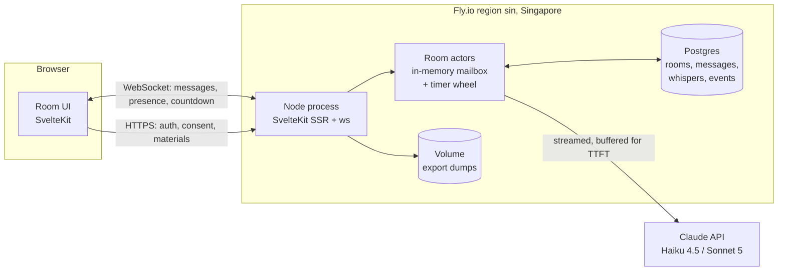
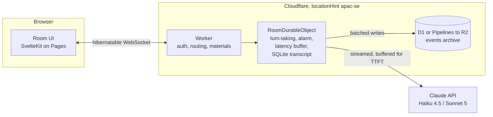
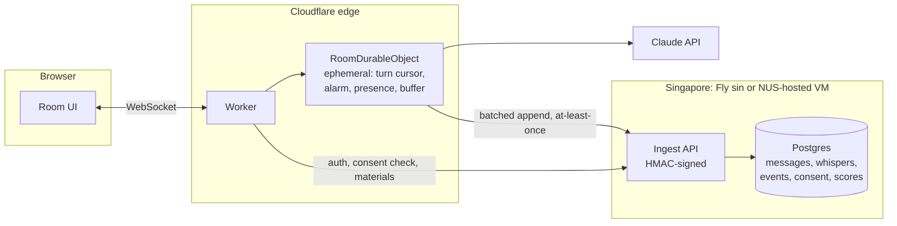
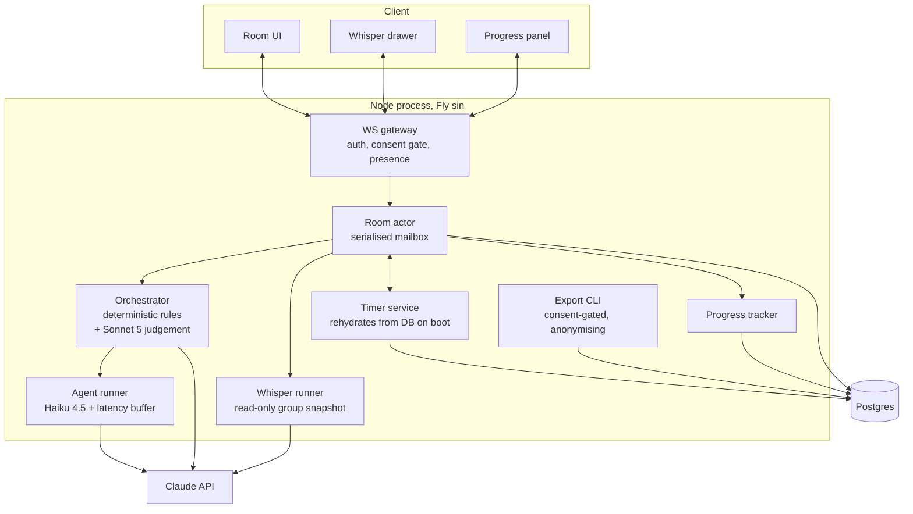
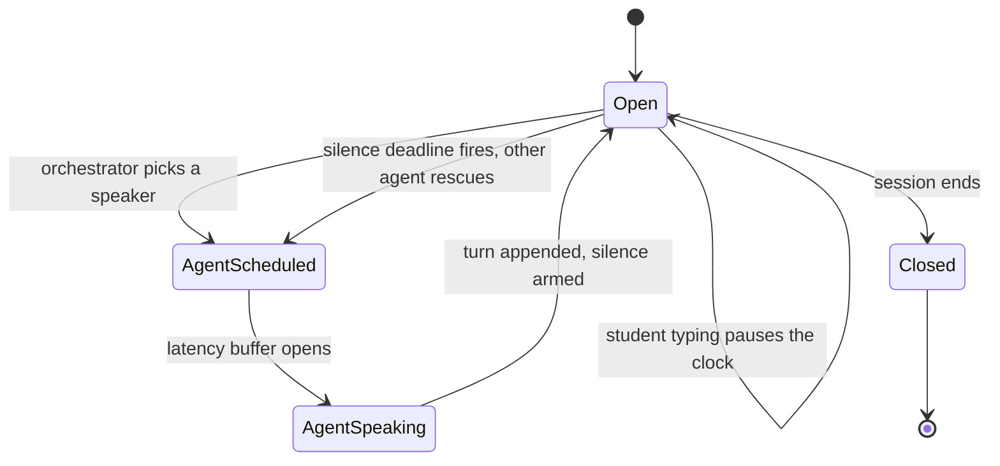
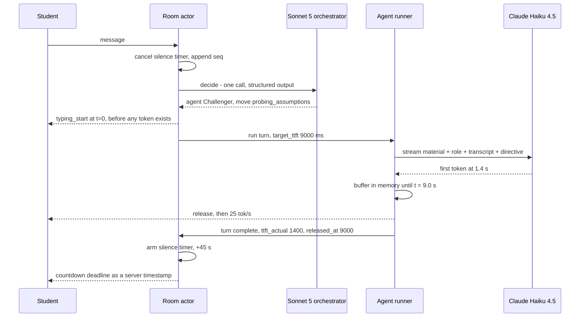
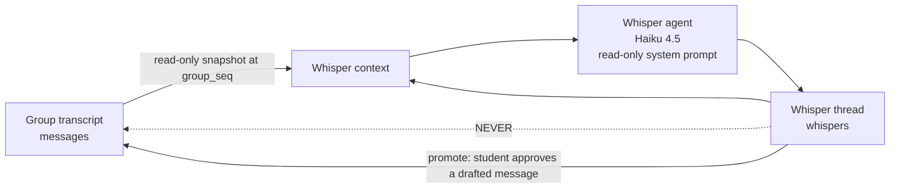

# ChatterED — Architecture Options

**Status:** proposal for developer sign-off · **Written:** 13 Sep 2026 · **Owner:** Lucas
**Consumers:** Assignment 1 Step 3 ("Implementation Plan", part of the 4.0-mark *Learning Design and Chosen Approach* band) and the Assignment 2 build.

## What this document assumes is already decided

These came in as fixed and are **not** re-argued below. They are restated only because the
architecture is shaped by them.

| Decision | Consequence for this document |
|---|---|
| Standalone web app (possible later NUSSync embed) | Everything must be reachable over HTTPS/WSS from a browser; the room API must be embeddable in an iframe or a desktop-app panel later |
| Claude API — **Haiku 4.5** for agent turns, **Sonnet 5** for orchestration and summaries | Cost model in §B is built on these two only; Haiku 4.5's 4,096-token cache minimum drives the prompt layout in §C.5 |
| Hero mechanic = group chat with a silence timer | The room, not the message, is the unit of state. Single-writer-per-room is the central constraint |
| Whisper side channel and deliberate latency are *supporting* | They must be cleanly removable/toggleable — they are also the obvious study conditions |
| Telegram / Discord bots out of scope | No bot-platform adapter layer |

## Sources this is built on

- `Academia/Sources/_text/who-you-explain-to-matters.txt` §4.1 + Appendix A — Xu et al. (CHI '26) Peer and Challenger agent designs and their verbatim prompts. Their per-turn pipeline is **screening → assessment → response generation**, all three as separate GPT-4o calls, with replies constrained to ~80 words.
- `Academia/Sources/_text/MASG_multi-agents-are-social-groups.txt` §3.2, §5.4.2, §5.4.4 — Song et al.: agents must show *unity and cohesion* (name each other, build on each other's points) to read as a group; but users report feeling "ganged up on" and "the odd one out". Three agents already produced hints of this; five produced reactance. **Two agents plus the student is the right group size, and anti-dog-pile is a safety requirement, not a polish item.**
- `Academia/Sources/_text/response-latency-task-type.txt` §3.2 — Tan et al. enforce latency **server-side**: the back end "initiated a streamed GPT-4o response but buffered output in memory until the designated TTFT (2 s, 9 s, or 20 s) had elapsed. After this TTFT delay, tokens were released at a fixed rate of 25 tokens/s (40 ms inter-token interval)." Interactive controls were disabled and visually muted during generation, with a pulsing cursor as the pending-output signal. This is exactly the mechanism §C.4 replicates.
- `Academia/Sources/_text/critique1-btw.txt` — the `/btw` whisper mechanic, tested T1–T5. Findings that become requirements: whisper has **read-only access to information already in the main conversation** (T1–T3); whisper leaves **no memory in the main agent** (T4); and whisper **over-promised capabilities it did not have** (T4, Interaction 2), which the critique's *Suggestion 2* fixes by telling the whisper agent in its own prompt that it is separate, read-only and tool-less. *Suggestion 1* — let the whisper agent raise a point into the main thread **with user permission** — is the "promote to group" feature.
- `docs/research/cloudflare-do-limits.md` — treated as verified; not re-researched. §8 (no Singapore jurisdiction) and the alarm-jitter line in §1 are the two facts that move the recommendation.
- `docs/research/interview-guide.md` — consent wording, participant-code scheme (P1…P5), and the "programme / year / gender, never names or IDs" rule that the data model has to enforce structurally.
- `Academia/Sources/sample_ui/photo_2026-09-13 15.34.37.jpeg` — NUSSync. A desktop-shell app: left course rail (MA3236, MA3270, CS4246…), a Files pane with a PDF viewer, and a right-hand **Claude chat panel scoped to the open file** with a model selector. Two things follow. (1) NUSSync already holds the lecture material ChatterED needs as its cached prefix — a later embed can pass a `material_id` instead of re-uploading a deck. (2) The natural embed shape is a **panel/route**, same slot as the existing chat, so ChatterED's room UI should be a self-contained component behind an HTTP+WS API rather than a full-page app.
- `claude-api` skill (loaded) — model IDs and pricing in §B; the Haiku 4.5 cache-minimum trap in §C.5.

`docs/research/design-brief.md` did not exist at the time of writing. Where this document
assumes a design decision that belongs to the brief, it is flagged and repeated in §E.

---

## 0. What the mechanics actually demand of the architecture

Before comparing stacks, here is the forcing function each of the seven mechanics applies. The
column on the right is what eliminates options.

| # | Mechanic | Hard architectural requirement |
|---|---|---|
| R1 | Multi-agent turn-taking, no dog-piling | **Exactly one writer per room.** Two agents deciding to speak concurrently is the failure mode; it cannot be prevented by optimistic locking after the fact because the LLM call has already been paid for and the user has already seen a "typing…" indicator |
| R2 | Server-authoritative silence timer surviving reloads | A **durable deadline** (row in a DB, or DO alarm) plus an in-process scheduler that rehydrates from it on boot. Client-side `setTimeout` is disqualified outright |
| R3 | Deliberate latency + typing presence | The server must **hold a streaming response in a buffer** and release it on its own clock (Tan et al. §3.2.3). This means a long-lived server-side process per in-flight turn, and a push channel to the client |
| R4 | Whisper side channel | **Two visibility scopes over one room.** Context assembly must be scope-aware by construction, not by filtering after the fact |
| R5 | Progress tracking + rubric | Structured state derived from the transcript, updated during the session, not only at the end |
| R6 | Research logging, exportable, anonymisable, consent-gated | Append-only event log with server timestamps; export path separate from the app path; **Singapore data residency is a live question** (`cloudflare-do-limits.md` §8) |
| R7 | Cost control | Prompt caching requires a **byte-stable prefix**, which constrains the prompt layout and forbids timestamps / per-request IDs / unsorted JSON anywhere before the last breakpoint |

R1 + R2 + R3 together say: *the room is a stateful actor with a mailbox and a clock*. Every option
below is a different way of buying that actor.

---

# A. Three candidate stacks

## A(i) — SvelteKit (or Next.js) + small Node server, Postgres, Singapore VPS / Fly.io `sin`

One process owns an in-memory `Room` object per active room; Postgres is the durable record.
Rooms are actors in a `Map<roomId, Room>`; every mutation goes through the room's serialised
mailbox, which gives R1 for free. Timers are `setTimeout` **plus** a persisted
`rooms.silence_deadline_at`, re-armed on boot — R2. The latency buffer is just an async generator
holding tokens — R3.



**Pros**

- Fastest path to a working demo for anyone who already writes TypeScript. No new runtime model, no new CLI, local dev is `pnpm dev` + a local Postgres.
- **Data residency is a checkbox, not an argument.** Fly.io lists `sin` (Singapore) as a region; a
  Singapore VPS is even more explicit. This is the single biggest differentiator for an NUS
  ethics conversation (`cloudflare-do-limits.md` §8: Cloudflare has only `eu`, `us`, `fedramp`
  jurisdictions — location hints are best-effort and DO ids are logged elsewhere regardless).
- Postgres gives real SQL for the study analysis: window functions over `events`, joins to
  consent, `COPY … TO` for export. No second analytics store needed.
- Timers are ordinary code with ordinary tests. No alarm-jitter semantics to reason about.
- Trivially debuggable: one process, one log stream, `psql`.

**Cons**

- **One process is a single point of failure and a scaling ceiling.** Room actors live in memory,
  so horizontal scaling needs sticky routing (consistent hashing on `room_id`) or a Redis-backed
  lock. Fine at study scale, real work later.
- A deploy kills every open WebSocket and every in-flight buffered turn. Needs an explicit
  drain-and-resume path (see §C.4) or you accept dropped turns during releases.
- You own uptime, TLS renewal (mostly automatic on Fly), backups, and Postgres upgrades.
- Cold-start / scale-to-zero is off the table if timers must fire — the process has to stay up.

**Time to first demo:** ~1–2 days to a room with two agents talking and a working timer.
**Production readiness:** good for ≤ a few hundred concurrent rooms on one machine; needs a
sticky-routing story before it is genuinely multi-instance. **7/10.**

**Cost:** Fly `shared-cpu-1x` 1 GB ≈ **$5.92/mo**, plus Managed Postgres (plan-dependent) and
volumes at **$0.15/GB-mo**. Budget **$12–25/mo**.

---

## A(ii) — Cloudflare Workers + Durable Objects (one DO per room)

The DO *is* the room actor. Input gates make read-then-write sequences atomic without explicit
transactions (`cloudflare-do-limits.md` §6) — R1 comes from the platform. `ctx.storage.setAlarm()`
is the silence timer — R2. The WebSocket Hibernation API keeps idle rooms free.



**Pros**

- The strongest conceptual fit on the list: a DO is *exactly* "single-writer stateful actor with a
  clock and a socket set". R1, R2 and R4 all fall out of the model rather than being built.
- Hibernation economics are excellent for a chat app that is mostly idle: duration charges do not
  accrue while hibernated; the docs' worked example is **$20.65/mo for 100 rooms × 100 sockets**
  vs $142.95 non-hibernating. At study scale we sit inside the included quotas — effectively the
  **$5/mo** Workers Paid minimum.
- No servers, no TLS, no deploy-window socket massacre to plan for (though a runtime redeploy
  *does* terminate WebSockets — clients must reconnect and resume, §5).
- Streaming LLM calls are fine: wall clock is unlimited while a caller stays connected, I/O wait
  does not count against the 30 s CPU limit, and the 6-connection cap only applies while awaiting
  headers, so it does not cap concurrent streams (§5).

**Cons**

- **No Singapore data residency, and this is the deciding fact.** §8 is explicit: jurisdictions are
  `eu` / `us` / `fedramp` only; `locationHint: "apac-se"` is best-effort, honoured only on the first
  `get()`, and DO ids are logged elsewhere for billing regardless. If the NUS ethics review asks
  "where does the transcript live", the honest answer is "probably Singapore, no guarantee".
- **Alarm jitter fights the hero mechanic.** Alarms "can be delayed by up to a minute due to
  maintenance or failures while failover takes place" (§1). A 45–60 s silence timer that fires at
  105 s is a broken interaction. Mitigable (client-side countdown from a server timestamp, server
  stays authoritative) but it is a mitigation, not an absence of a problem.
- **Alarms defeat hibernation.** §3: "Alarms, requests, setTimeout/setInterval all prevent
  hibernation." A room with an armed silence timer is an awake room, so the headline hibernation
  saving applies to *idle* rooms, not *waiting* ones. The economics are still fine; the mental
  model people carry into this decision is wrong.
- Learning curve during the tightest week of the semester: wrangler, bindings, DO lifecycle,
  hibernation attachment serialisation (≤16,384 bytes), `blockConcurrencyWhile`, local dev via
  Miniflare. All learnable; none free.
- The event archive needs a second system: D1 (30 s query cap, $0.75/GB-mo), Analytics Engine
  (**3-month retention — unsuitable as the sole archive for a longitudinal study**, §7), or
  Pipelines→R2. Writing from the DO to D1 blocks hibernation per write, so it must be batched.

**Time to first demo:** ~3–5 days if DOs are new. **Production readiness:** highest ceiling of the
three; scales to thousands of rooms with no thought. **8/10 technically, 5/10 for *this* study**
because of residency. **Cost:** ~**$5/mo** at study scale.

---

## A(iii) — Hybrid: Cloudflare front (Pages + Worker + DO) + Singapore Postgres for study data

Realtime coordination stays in a DO. Everything the ethics form cares about — transcripts,
whispers, the event log, consent, the participant-code map — is written to a Postgres in
Singapore. The DO holds *ephemeral* room state (turn cursor, deadline, presence, in-flight
buffer) and a rolling transcript window it needs for prompt assembly; the durable record is
south of the equator.



**Pros**

- Genuinely gets both: edge realtime with DO's single-writer guarantee, *and* a defensible
  "study data is stored in Singapore" statement.
- The Singapore side is a plain HTTP ingest + Postgres — small, boring, easy to hand to an LLM
  coding agent, easy to hand to an ethics reviewer.
- Sets up the future cleanly: if ChatterED outgrows the study, the edge tier already scales and
  only the ingest tier needs attention.

**Cons**

- **Two deploy targets, two secret stores, two log streams, two failure modes, one week before a
  deadline.** This is the real cost and it is not small.
- Split-brain risk: the DO's rolling window and Postgres's transcript are the same data in two
  places. Needs a clear rule (§C: Postgres is the record of truth; the DO window is a cache with
  a monotonic `seq` and idempotent replay) and a reconciliation job, or the study data quietly
  diverges from what the student saw.
- Each ingest call from the DO is a subrequest that blocks hibernation (§7) — must be batched on
  the alarm or on turn boundaries.
- At-least-once delivery means the ingest endpoint must be idempotent on `(room_id, seq)`.
- Still doesn't fully answer residency: the DO holds the transcript window and the in-flight
  message in memory and in DO SQLite, outside Singapore, for the duration of the session. It is a
  *much* better answer than A(ii), not a perfect one.

**Time to first demo:** ~4–6 days. **Production readiness: 8/10**, once the reconciliation and
idempotency work is genuinely done. **Cost:** ~$5 (CF) + $12–25 (Singapore tier) = **$17–30/mo**.

---

## Comparison

| | A(i) Node + Postgres @ `sin` | A(ii) Workers + DO | A(iii) Hybrid |
|---|---|---|---|
| Single-writer per room (R1) | In-process actor mailbox — you build it, ~40 lines | Platform guarantee via input gates | Platform guarantee |
| Durable timer (R2) | DB deadline + `setTimeout`, exact | DO alarm, **up to 60 s jitter** | DO alarm, same jitter |
| Latency buffer (R3) | Trivial | Fine; keeps DO awake and billable | Fine |
| Whisper scoping (R4) | Application-level | Application-level | Application-level |
| Event archive (R6) | Same Postgres | D1 / R2 (AE unusable: 3-mo retention) | Singapore Postgres |
| **Singapore residency (R6)** | **Yes, contractual** | **No** | **Mostly — study data yes, live room state no** |
| Deploy kills sockets | Yes, needs drain | Yes on runtime redeploy | Yes on runtime redeploy |
| Ops surface | 1 app + 1 DB | 0 servers | 2 tiers |
| Infra $/mo at study scale | $12–25 | ~$5 | $17–30 |
| Time to first demo | **1–2 days** | 3–5 days | 4–6 days |
| Production readiness | 7/10 | 8/10 (5/10 for this study) | 8/10 |
| Risk to the 20 Sep prototype | **Low** | Medium | High |

---

# B. LLM cost

## B.1 Prices and caching rules used

From the `claude-api` skill (cached 2026-06-24). **Use only these exact IDs; do not append date
suffixes.**

| Model | ID | Context | Input $/MTok | Output $/MTok | Cache read (0.1×) | Cache write 5 m (1.25×) | Min cacheable prefix |
|---|---|---|---:|---:|---:|---:|---:|
| Claude Haiku 4.5 | `claude-haiku-4-5` | 200K | $1.00 | $5.00 | $0.10 | $1.25 | **4,096 tok** |
| Claude Sonnet 5 | `claude-sonnet-5` | 1M | $2.00 | $10.00 | $0.20 | $2.50 | 1,024 tok |

Two rules that shape §C:

1. **Haiku 4.5's minimum cacheable prefix is 4,096 tokens** — the highest in the current lineup,
   and *higher than Sonnet 5's*. A prefix shorter than that silently does not cache: no error,
   just `cache_creation_input_tokens: 0`. A 2,500-token lecture excerpt would produce a cost table
   that looks like the "cached" column and a bill that looks like the "uncached" column.
2. Cache reads refresh the entry's timer, and turns here are ~40 s apart, so the **default 5-minute
   TTL is strictly cheaper than the 1-hour TTL** (which costs 2× to write). Use the default.

## B.2 Assumptions for one 20-minute session

Anchored on Xu et al.'s interaction phase (20 min, five explain rounds, replies constrained to
~80 words) and scaled up for two agents plus silence-timer fills.

| # | Assumption | Value |
|---|---|---|
| A1 | Session length | 20 min |
| A2 | Student messages | 12 |
| A3 | Agent group turns (2 agents, incl. ~2 openers and ~5 silence fills) | 18 |
| A4 | Whisper turns | 4 |
| A5 | Orchestrator decisions (Sonnet 5): 1 per student message + 1 per silence deadline | 17 |
| A6 | End-of-session calls (learner summary + rubric score) | 2 |
| A7 | Agent reply ≈ 80 words | 130 output tok |
| A8 | Student message ≈ 60 words | 85 tok |
| A9 | **Lecture material block** (one lecture section / slide extract) | **4,500 tok** — deliberately over the 4,096 floor |
| A10 | Per-role system prompt + safeguards | 600 tok |
| A11 | Transcript, 0 → end / mean | 3,400 / 1,700 tok |
| A12 | Orchestrator policy prefix (rules + rubric + agent cards) | 1,200 tok |

Caching layout assumed (details in §C.5): breakpoint 1 after the **shared** material block
(byte-identical for both agents, so the second agent reads the first agent's entry), breakpoint 2
after the role block, breakpoint 3 walking forward over the transcript.

## B.3 Per-session cost

| Component | Model | Calls | Uncached input tok | Output tok | **$ uncached** | Effective input tok cached | **$ cached** |
|---|---|---:|---:|---:|---:|---:|---:|
| Agent group turns | Haiku 4.5 | 18 | 122,400 | 2,340 | **$0.1341** | 23,615 | **$0.0353** |
| Whisper turns | Haiku 4.5 | 4 | 33,600 | 600 | **$0.0366** | 3,640 | **$0.0066** |
| Orchestrator | Sonnet 5 | 17 | 40,800 | 1,360 | **$0.0952** | 7,140 | **$0.0279** |
| Summary + rubric | Sonnet 5 | 2 | 17,400 | 1,400 | **$0.0488** | 11,745 | **$0.0375** |
| **Total** | | **41** | **214,200** | **5,700** | **$0.3147** | **46,140** | **$0.1073** |

**≈ $0.31 per session uncached, ≈ $0.11 cached — a 66 % saving.**

Note the shape: caching saves 74 % on the Haiku agent turns (many calls over one big stable
prefix — the ideal case) but only 23 % on the summary pair (two calls; barely past break-even).
If you only instrument one thing, instrument the agent turns.

## B.4 Per 100 active users per month

"Active user" = a student who runs at least one session that month.

| Scenario | Sessions/user/mo | Sessions/mo | Uncached | **Cached** |
|---|---:|---:|---:|---:|
| Light (one revision session a fortnight) | 2 | 200 | $63 | **$21** |
| **Base (weekly, one module)** | **4** | **400** | **$126** | **$43** |
| Heavy (two modules, weekly) | 8 | 800 | $252 | **$86** |

Add infrastructure from §A: **$43 + $12–25 ≈ $55–68/mo all-in for 100 weekly users on A(i)**.

**Assignment 2's user study is much smaller.** At Xu et al.'s cell size (n = 24) plus pilots and
dry runs, call it 40 sessions: **≈ $4.30 cached, ≈ $12.60 uncached.** Even a 5× overrun stays under
$25. *Cost is not a risk for the study; it is a risk for the thing after the study.* Build caching
in from day one anyway, because retrofitting a stable prefix means rewriting every prompt.

## B.5 Sensitivity: what happens when the lecture material grows

The screenshot shows a 46-page MA3236 deck. If someone drops a whole deck in (~15,000 tokens
instead of A9's 4,500):

| | Uncached | Cached |
|---|---:|---:|
| Per session | **$0.59** | **$0.17** |
| Per 100 users/mo (base) | **$235** | **$69** |

Uncached cost is roughly linear in material size; cached cost is almost flat. This is the
argument for §C.5, and also the argument for **extracting the relevant section rather than
shipping the whole deck** — which is a pedagogy decision as much as a cost one.

## B.6 Other levers, in the order worth pulling

1. **Caching** (above) — free, biggest win, do it first.
2. **Shrink the orchestrator.** At 17 Sonnet calls it is 30 % of the cached bill for a job that is
   mostly a policy table. §C.3 pushes the hard rules into deterministic code and calls Sonnet 5
   only where judgement is actually needed. Moving to a Sonnet call *only on student messages*
   (12, not 17) takes the cached total to ≈ $0.10.
3. **Do not run the Xu et al. three-call pipeline literally.** Their screening and assessment
   stages are separate model calls per turn. §C.5 folds both into the orchestrator's single
   structured decision, so a group turn is *one* Haiku call, not three. That is roughly a 3×
   saving on agent turns before caching is considered.
4. Batch API (50 % off) for the end-of-session summary and rubric — they are not latency
   sensitive. Worth ~$0.02/session; only bother once volume is real.

## B.7 The NUS SoC GPU cluster — study-only, not production

The machine has working automated access to the NUS SoC Slurm cluster (H200/H100/A100; see
`~/.claude/CLAUDE.md` and `~/soc-cluster/README.md`). It is worth one paragraph and no more. The
`gpu` partition caps jobs at **3 hours** (`gpu-long` reaches 3 days at lower priority and higher
billing), concurrency is capped at 12 GPUs / 16 running jobs, and a prior check found that
**compute nodes cannot SSH back to the login node** — which kills the reverse-tunnel pattern you
would otherwise use to expose a served model through a stable public ingress. Combined with
time-boxed, preemptible allocations and no persistent public endpoint, it cannot serve a live web
app that real students hit at unpredictable hours; a 3-hour ceiling alone disqualifies it for
Assignment 2's deployment. Where it *is* genuinely useful: **offline, study-only work** — batch
qualitative coding of transcripts with a local model, embedding/clustering of student
explanations, automated rubric-scoring ablations, and a "what would this cost on an open-weights
peer agent" comparison for the report. Two cautions if you do: participant transcripts leaving
the Singapore Postgres for cluster storage is a **new data flow that the consent wording in
`interview-guide.md` §2 does not currently cover**, and there is no shared weights cache, so
pre-download with `HF_HOME=$HOME/hf-cache` on the login node, never inside a GPU job.

---

# C. Recommended architecture

## C.0 The recommendation

> **Build A(i) — SvelteKit + Node + Postgres on Fly.io `sin` — with the room logic written as a
> transport- and storage-agnostic `Room` actor, so that A(iii) is a port and not a rewrite.**

Reasoning, in priority order:

1. **The 20 Sep prototype is seven days away and the interviews have not been run yet.** The
   interviews are the rubric hard requirement (≥3 real students, 4.0 marks) and they are the
   actual critical path. Architecture must consume the *least* of that week. A(i) is 1–2 days;
   A(ii) is 3–5.
2. **Residency.** `cloudflare-do-limits.md` §8 is unambiguous and A(ii) cannot answer "where does
   this student's transcript live" with a guarantee. For an NUS study shipping to real students,
   a defensible one-sentence answer is worth more than the elegance of the DO model.
3. **Alarm jitter.** The silence timer *is* the hero mechanic. Building it on a primitive
   documented as possibly late by up to a minute means the demo's centrepiece has a platform-level
   failure mode you have to talk around.
4. **Two agents, ~30 concurrent users.** Every advantage A(ii) has — global distribution,
   hibernation economics, unlimited horizontal room scaling — is an advantage at a scale this
   project will not reach during the study. Paying for it now is paying in the wrong currency
   (time).
5. **Porting later is cheap if you design for it now.** The DO programming model *is* the actor
   model. Keep `Room` free of `pg` and `ws` imports and A(iii) is a new adapter, not a rewrite.

**Revisit and port to A(iii) when any of these becomes true:** sustained > 200 concurrent rooms;
users outside Singapore where edge latency shows; the single Fly machine's uptime becomes a
complaint; or the NUSSync embed needs the room API at multiple points of presence.

## C.1 Component view



## C.2 Data model

Postgres DDL, deliberately portable to SQLite / DO SQLite (no arrays, no exotic types beyond
`jsonb` → `TEXT` on SQLite).

```sql
-- ── Identity: there is no column anywhere that can hold a name or a student ID. ──
CREATE TABLE users (
  id             UUID PRIMARY KEY,
  code           TEXT UNIQUE NOT NULL,          -- 'P1'..'Pn'; the ONLY human-facing handle
  programme      TEXT,                          -- rubric fields from interview-guide.md §3
  year_of_study  SMALLINT,
  gender         TEXT,
  is_test        BOOLEAN NOT NULL DEFAULT FALSE,
  created_at     TIMESTAMPTZ NOT NULL DEFAULT now()
);
-- Real-name ↔ code mapping lives OUTSIDE this database and outside the repo
-- (encrypted note on the researcher's device), per interview-guide.md §2.

CREATE TABLE consents (
  id            UUID PRIMARY KEY,
  user_id       UUID NOT NULL REFERENCES users(id) ON DELETE CASCADE,
  study_id      TEXT NOT NULL,
  version       TEXT NOT NULL,                  -- hash of the consent text shown
  method        TEXT NOT NULL,                  -- 'in_app' | 'verbal' | 'chat_reply'
  scope         JSONB NOT NULL,                 -- {transcript_export, quotes, recording, reuse_a2}
  granted_at    TIMESTAMPTZ NOT NULL,
  withdrawn_at  TIMESTAMPTZ                     -- non-null ⇒ excluded from every export
);

-- ── Rooms and membership ──
CREATE TABLE materials (
  id           UUID PRIMARY KEY,
  module_code  TEXT NOT NULL,                   -- 'MA3236'
  title        TEXT NOT NULL,
  source_ref   TEXT,                            -- 'Slides_L07_Unconstrained2.pdf p.28-31'
  content_text TEXT NOT NULL,
  token_count  INT NOT NULL,                    -- MUST be > 4096 or Haiku caching no-ops
  sha256       TEXT NOT NULL                    -- byte stability is a caching invariant
);

CREATE TABLE agents (                            -- versioned config, never inline literals
  key            TEXT PRIMARY KEY,              -- 'peer.mei', 'challenger.arun'
  role           TEXT NOT NULL CHECK (role IN ('peer','challenger')),
  display_name   TEXT NOT NULL,
  colour         TEXT NOT NULL,                 -- MASG §3.2: distinct colours aid attribution
  prompt_version TEXT NOT NULL,
  model          TEXT NOT NULL DEFAULT 'claude-haiku-4-5',
  latency_profile JSONB NOT NULL
);

CREATE TABLE rooms (
  id                       UUID PRIMARY KEY,
  module_code              TEXT NOT NULL,
  material_id              UUID NOT NULL REFERENCES materials(id),
  topic                    TEXT NOT NULL,        -- the concept being explained
  state                    TEXT NOT NULL,        -- 'open'|'agent_scheduled'|'agent_speaking'|'closed'
  turn_seq                 BIGINT NOT NULL DEFAULT 0,
  expects_reply            BOOLEAN NOT NULL DEFAULT FALSE,
  silence_deadline_at      TIMESTAMPTZ,          -- R2: durable, survives restart
  consecutive_agent_turns  SMALLINT NOT NULL DEFAULT 0,  -- R1: anti-dog-pile counter
  last_speaker_id          UUID,
  config                   JSONB NOT NULL,       -- silence_ms, latency_profile, whisper_enabled…
  created_at               TIMESTAMPTZ NOT NULL DEFAULT now(),
  closed_at                TIMESTAMPTZ
);

CREATE TABLE participants (                      -- students AND agents; turn-taking stays uniform
  id          UUID PRIMARY KEY,
  room_id     UUID NOT NULL REFERENCES rooms(id) ON DELETE CASCADE,
  kind        TEXT NOT NULL CHECK (kind IN ('student','agent')),
  user_id     UUID REFERENCES users(id),        -- null for agents
  agent_key   TEXT REFERENCES agents(key),      -- null for students
  display_name TEXT NOT NULL,
  joined_at   TIMESTAMPTZ NOT NULL DEFAULT now(),
  left_at     TIMESTAMPTZ,
  CHECK ((kind='student') = (user_id IS NOT NULL))
);

CREATE TABLE sessions (
  id             UUID PRIMARY KEY,
  room_id        UUID NOT NULL REFERENCES rooms(id) ON DELETE CASCADE,
  user_id        UUID NOT NULL REFERENCES users(id) ON DELETE CASCADE,
  study_id       TEXT,
  condition      TEXT,                           -- study arm: 'full'|'no_whisper'|'no_latency'…
  latency_profile TEXT NOT NULL,
  silence_ms     INT NOT NULL,
  started_at     TIMESTAMPTZ NOT NULL,
  ended_at       TIMESTAMPTZ,
  end_reason     TEXT,                           -- 'completed'|'abandoned'|'timeout'|'withdrawn'
  summary_text   TEXT,                           -- learner-facing, Sonnet 5
  summary_usage  JSONB
);

-- ── Conversation ──
CREATE TABLE messages (                          -- GROUP transcript only. Whispers are elsewhere.
  id                    UUID PRIMARY KEY,
  room_id               UUID NOT NULL REFERENCES rooms(id) ON DELETE CASCADE,
  participant_id        UUID NOT NULL REFERENCES participants(id),
  seq                   BIGINT NOT NULL,
  body                  TEXT NOT NULL,
  turn_decision_id      UUID,                    -- why this speaker spoke
  model                 TEXT,
  usage                 JSONB,                   -- input/output/cache_read/cache_creation tokens
  latency_target_ms     INT,                     -- what the policy asked for
  ttft_actual_ms        INT,                     -- what the model did  → §C.4 verification
  released_at           TIMESTAMPTZ,             -- when the buffer opened
  promoted_from_whisper UUID,                    -- critique1 Suggestion 1 provenance
  created_at            TIMESTAMPTZ NOT NULL DEFAULT now(),
  UNIQUE (room_id, seq)
);

CREATE TABLE whispers (                          -- PRIVATE student ↔ one agent. Never joined into
  id                    UUID PRIMARY KEY,        -- the group context by any code path.
  room_id               UUID NOT NULL REFERENCES rooms(id) ON DELETE CASCADE,
  thread_id             UUID NOT NULL,           -- one thread per (student, agent) pair
  student_participant_id UUID NOT NULL REFERENCES participants(id),
  agent_participant_id   UUID NOT NULL REFERENCES participants(id),
  seq                   BIGINT NOT NULL,
  sender                TEXT NOT NULL CHECK (sender IN ('student','agent')),
  body                  TEXT NOT NULL,
  group_seq_snapshot    BIGINT NOT NULL,         -- T1–T3: exactly what the group had said by then
  promoted_message_id   UUID REFERENCES messages(id),
  usage                 JSONB,
  created_at            TIMESTAMPTZ NOT NULL DEFAULT now(),
  UNIQUE (thread_id, seq)
);

CREATE TABLE turn_decisions (                    -- orchestrator audit trail; "nobody" is a decision
  id            UUID PRIMARY KEY,
  room_id       UUID NOT NULL REFERENCES rooms(id) ON DELETE CASCADE,
  trigger       TEXT NOT NULL,                   -- 'student_message'|'silence'|'open'|'promote'
  chosen_participant_id UUID REFERENCES participants(id),  -- NULL = deliberate silence
  move_type     TEXT,                            -- 'elaborate'|'focus'|'tentative_idea'
                                                 -- |'clarify'|'assumptions'|'evidence'
                                                 -- |'implications'|'alternatives'|'handback'
  rationale     TEXT,
  decided_by    TEXT NOT NULL,                   -- 'rule:no_dogpile' | 'model:claude-sonnet-5'
  usage         JSONB,
  created_at    TIMESTAMPTZ NOT NULL DEFAULT now()
);

-- ── Study instrumentation ──
CREATE TABLE events (                            -- append-only. Never UPDATE, never DELETE.
  id         BIGSERIAL PRIMARY KEY,
  room_id    UUID REFERENCES rooms(id) ON DELETE CASCADE,
  session_id UUID REFERENCES sessions(id) ON DELETE CASCADE,
  actor      TEXT NOT NULL,                      -- 'student'|'peer'|'challenger'|'system'
  type       TEXT NOT NULL,                      -- see the event vocabulary below
  payload    JSONB NOT NULL DEFAULT '{}',
  client_ts  TIMESTAMPTZ,                        -- may be skewed; keep both
  server_ts  TIMESTAMPTZ NOT NULL DEFAULT clock_timestamp()
);
CREATE INDEX ON events (session_id, server_ts);

CREATE TABLE progress (                          -- R5: what was explained, what was probed
  id               UUID PRIMARY KEY,
  session_id       UUID NOT NULL REFERENCES sessions(id) ON DELETE CASCADE,
  concept_key      TEXT NOT NULL,                -- from the material's concept list
  state            TEXT NOT NULL CHECK (state IN
                     ('unmentioned','asserted','explained','probed','resolved')),
  evidence_message_id UUID REFERENCES messages(id),
  updated_at       TIMESTAMPTZ NOT NULL DEFAULT now(),
  UNIQUE (session_id, concept_key)
);

CREATE TABLE rubric_scores (
  id            UUID PRIMARY KEY,
  session_id    UUID NOT NULL REFERENCES sessions(id) ON DELETE CASCADE,
  dimension     TEXT NOT NULL,   -- 'coverage'|'causal_reasoning'|'precision'
                                 -- |'response_to_challenge'|'self_correction'
  score         SMALLINT NOT NULL CHECK (score BETWEEN 0 AND 3),
  justification TEXT NOT NULL,   -- quote the message it is based on
  scored_by     TEXT NOT NULL,   -- 'model:claude-sonnet-5' | 'human:researcher'
  created_at    TIMESTAMPTZ NOT NULL DEFAULT now()
);
```

**Event vocabulary** (keep it small and stable; adding a type later is fine, renaming one is not):
`session_start`, `consent_granted`, `consent_withdrawn`, `material_opened`, `student_typing_start`,
`student_typing_stop`, `student_message`, `orchestrator_decision`, `agent_turn_scheduled`,
`agent_typing_start`, `agent_first_token`, `agent_released`, `agent_message`, `silence_armed`,
`silence_fired`, `silence_cancelled`, `whisper_opened`, `whisper_message`, `whisper_promoted`,
`whisper_closed`, `progress_updated`, `reconnect`, `session_end`.

**Consent gating and anonymisation (R6).** Three mechanical rules, not policy prose:

1. The app writes `messages` / `events` unconditionally — it cannot function otherwise — but
   **nothing leaves the database except through a view** that inner-joins a live consent row:
   ```sql
   CREATE VIEW export_sessions AS
   SELECT s.* FROM sessions s
   JOIN consents c ON c.user_id = s.user_id
    AND c.withdrawn_at IS NULL
    AND (c.scope->>'transcript_export')::boolean;
   ```
   The export CLI is only permitted to read `export_*` views. Enforce with a distinct DB role that
   has no `SELECT` on base tables.
2. Withdrawal is `UPDATE consents SET withdrawn_at = now()` plus a hard-delete job over that
   user's `messages` / `whispers` / `events`. Test it before the study, not after someone asks.
3. The exporter runs a scrub pass over every free-text field (names, emails, matric-number
   patterns `A\d{7}[A-Z]`, NUSNET `e\d{7}`) and fails loudly on a hit rather than silently
   redacting — a hit means the app leaked somewhere it shouldn't.

## C.3 The orchestrator loop

Design principle: **hard rules are code, judgement is Sonnet 5.** The rules are the ones you must
be able to guarantee (R1: never two agents at once, never a pile-on); a model cannot guarantee
them and paying Sonnet 5 to re-derive them 17 times a session is the cost problem in §B.6.

This also collapses Xu et al.'s pipeline. Their *screening* and *assessment* stages (§4.1.2,
§4.1.3) become the orchestrator's single structured decision, whose output is injected into the
Haiku call as a turn directive — so a group turn is one generation call, not three.

```
# One serialised mailbox per room. Every handler runs to completion before the next starts;
# that single fact is R1.

CONST MAX_CONSECUTIVE_AGENT_TURNS = 2      # MASG §5.4.4: do not let them gang up
CONST SILENCE_MS                  = 45_000 # study variable; developer's intent said 60 s (see §E)
CONST TYPING_GRACE_MS             = 15_000

on student_message(room, text):
    cancel_silence(room)
    seq = append_message(room, student, text)
    room.consecutive_agent_turns = 0
    emit(events, 'student_message')
    update_progress(room, seq)                       # cheap: keyword + last decision, no model call
    decide_and_maybe_speak(room, trigger='student_message')

on silence_deadline(room):
    if room.state != 'open' or not room.expects_reply: return
    emit(events, 'silence_fired')
    # Exactly one rescue per unanswered question. The rescuer is the agent who did NOT ask.
    decide_and_maybe_speak(room, trigger='silence', force_other_agent=True)

on agent_turn_complete(room, msg):
    room.consecutive_agent_turns += 1
    if msg.ends_with_question_to_student:
        arm_silence(room, now() + SILENCE_MS)        # persisted to rooms.silence_deadline_at
    else if room.consecutive_agent_turns < MAX_CONSECUTIVE_AGENT_TURNS
            and last_decision.wants_followup:
        decide_and_maybe_speak(room, trigger='open') # the one place agents talk to each other
    else:
        arm_silence(room, now() + SILENCE_MS)

func decide_and_maybe_speak(room, trigger, force_other_agent=False):
    # ── Layer 1: deterministic gates. No model call. Cheap, testable, guaranteed. ──
    if room.state == 'agent_speaking':  return record(None, 'rule:busy')
    if room.consecutive_agent_turns >= MAX_CONSECUTIVE_AGENT_TURNS and trigger != 'student_message':
        return record(None, 'rule:no_dogpile')

    eligible = [a for a in room.agents if not on_cooldown(a)]
    if force_other_agent: eligible = [a for a in eligible if a != room.last_speaker_id]

    addressed = detect_direct_address(room.last_message)     # "@Mei", "Arun, what about…"
    if addressed in eligible:
        choice = {agent: addressed, move: 'respond_to_address'}
        decided_by = 'rule:addressed'
    elif len(eligible) == 0:
        return record(None, 'rule:all_on_cooldown')
    elif len(eligible) == 1 and trigger == 'silence':
        choice = {agent: eligible[0], move: 'tentative_idea_then_handback'}
        decided_by = 'rule:sole_rescuer'
    else:
        # ── Layer 2: judgement. ONE Sonnet 5 call, structured output. ──
        choice = sonnet5_decide(
            policy_prefix   = ROOM_POLICY,           # cached, 1,200 tok, byte-stable
            agent_cards     = [peer_card, challenger_card],
            transcript_tail = last_n_messages(room, 12),
            progress        = progress_snapshot(room),
            allowed_moves   = MOVES_FOR[trigger],
            allow_silence   = (trigger == 'open'),
        )   # → {agent | null, move_type, address_to, wants_followup, rationale,
            #    progress_delta[]}
        decided_by = 'model:claude-sonnet-5'

    d = record(choice, decided_by)
    if choice.agent is None: return d                # deliberate silence, logged as a decision

    room.state = 'agent_scheduled'
    schedule_agent_turn(room, choice, decision_id=d.id)

func schedule_agent_turn(room, choice, decision_id):
    target_ms = latency_policy(choice.agent.role, choice.move_type, room.config.latency_profile)
    broadcast(room, {type: 'typing_start', agent: choice.agent, eta_ms: target_ms})
    emit(events, 'agent_typing_start')
    room.state = 'agent_speaking'
    spawn(run_agent_turn(room, choice, target_ms, decision_id))   # §C.4
```

Three properties this buys, each of which is worth a sentence in the report:

- **"Nobody speaks" is a first-class, recorded outcome.** Silence is a design choice about who owns
  the thinking, and the log can show how often the agents chose to stay out of the way.
- **`decided_by` distinguishes rule from model.** During analysis you can say what fraction of
  turn-taking was deterministic, which is the honest answer to "how much of this is the LLM?"
- **Agent-to-agent turns exist but are capped at one.** Enough for the cohesion MASG §5.4.2 calls
  for ("Those are valid points, Bella"); not enough for the pile-on §5.4.4 warns about.

## C.4 Timer, latency, and whisper

### Silence timer (R2)



- The deadline is a **wall-clock timestamp in `rooms.silence_deadline_at`**, written before the
  in-process `setTimeout` is set. On boot, `SELECT … WHERE silence_deadline_at IS NOT NULL AND
  state <> 'closed'` re-arms every room; deadlines already in the past fire immediately.
- The server **sends the deadline, not the remaining seconds**, so the client's countdown ring is
  cosmetic and the server stays authoritative even if the tab was backgrounded or the clock skewed.
- **The clock pauses while the student is typing.** `student_typing_start` pushes the deadline to
  `max(deadline, now + TYPING_GRACE_MS)` and keeps pushing while keystrokes arrive. Without this,
  the mechanic punishes exactly the students it is meant to help — the slow, careful explainers.
  This is a design claim worth testing in the pilot, and the alternative (hard deadline) is a clean
  A/B.
- After two consecutive unanswered questions the orchestrator de-escalates: the next agent move is
  forced to a low-demand one (`focus` or `tentative_idea`), never another probe. MASG §5.4.4.

### Deliberate latency (R3) — replicating Tan et al. §3.2.3



Implementation rules:

- **Latency is a floor on visible TTFT, not an added delay.** `release_at = turn_started_at +
  target_ttft`. If the model's first token arrives after `release_at`, release immediately.
  Otherwise you compound model latency with design latency and land past Tan et al.'s 20 s
  stress level.
- **Hard ceiling of 20 s** on total visible wait, whatever the policy says.
- Release at **25 tokens/s (40 ms inter-token)** after the gate opens — the paper's exact rate.
  Keep it configurable; it is a study variable.
- Log both `latency_target_ms` and `ttft_actual_ms` on the message. Tan et al. verified their
  manipulation with each participant's median TTFT; you must be able to do the same.
- The buffer lives on the server, so a reload mid-turn shows the same pending state rather than
  skipping the delay. On reconnect the client asks for `seq > last_seen` and gets either the
  released message or a `typing_start` with the remaining ETA.
- Mirror the paper's UI treatment: disable and visually mute the composer during generation, with
  a pulsing indicator. That the *student* can't type while an agent is composing is also what makes
  the group feel like a group.

Proposed policy table — **defaults to be tuned in the pilot, not settled here**:

| Role | Move | Target TTFT | Why |
|---|---|---:|---|
| Peer | acknowledgement, `focus` | 2–4 s | Tan et al.'s low anchor; keeps conversational flow |
| Peer | `elaborate`, `tentative_idea` | 4–6 s | Visibly composing, still under the 8–9 s strain band |
| Challenger | any Socratic probe | 8–12 s | The paper's mid-range; the beat *is* the signal that the question was considered |
| Either | silence-timer rescue | 3–5 s | Must read as a rescue, not a stall |
| Whisper agent | any | 2–3 s | Invisible whispering is "episodic and ephemeral"; a slow aside defeats the point |

### Whisper (R4) — the `/btw` mechanic



Mapping each critique finding to a mechanism:

| Finding in `critique1-btw.txt` | Mechanism |
|---|---|
| T1–T3: read-only access to what the main conversation already holds | `whispers.group_seq_snapshot` pins the exact group prefix visible to that whisper turn. The whisper agent gets the material block and the group transcript **up to that seq** and nothing else — no tools, no fetch |
| T4: no memory reaches the main agent | Enforced **by construction**: `buildContext(scope)` takes `'group' \| 'whisper'` and the group branch has no code path that reads `whispers`. Backed by a test that asserts the assembled group prompt contains no whisper body |
| T4 / Interaction 2: over-promised capabilities (Suggestion 2) | The whisper system prompt states plainly: *you are a private side channel; you cannot change the group conversation, edit anything, or remember this later; if the student wants this raised, offer to draft it for them to send.* Plus a one-line UI notice on opening the drawer — the critique asks for both |
| Suggestion 1: raise the point into the main thread, with permission | "Raise this" → the whisper agent drafts a **formal** version of the informal exchange → the student edits and confirms → it is posted as the **student's** group message with `promoted_from_whisper` provenance → the orchestrator treats it as a normal `student_message` |

Two open design calls, both in §E: whether whispering shows *any* group presence signal (default:
none — invisibility is the feature) and whether the whisper partner is the student's choice or
always the Peer (default: the student picks; a whisper to the Challenger is a different and
interesting act).

## C.5 Prompt-caching strategy and the two agent prompts

Render order is `tools` → `system` → `messages`; any byte change invalidates everything after it.
The layout below is chosen so that the *shared* block comes first and is therefore shared across
both agents' cache entries.

```
┌─ system[0] ── SHARED, byte-identical for Peer, Challenger and whisper ──────────┐
│  Module frame: "MA3236 Non-Linear Programming, Lecture 7."                      │
│  Lecture material excerpt (materials.content_text, ≥4,096 tok — see below)      │
│  The concept under discussion + the scenario the student is explaining          │
│  Group rules: two agents + one student; ~80-word replies; never give the answer │
│                                            ◄── cache_control breakpoint 1       │
├─ system[1] ── ROLE BLOCK, per agent ────────────────────────────────────────────┤
│  Persona + move framework + tone + safeguards (verbatim structure below)        │
│                                            ◄── cache_control breakpoint 2       │
├─ messages ── group transcript, speaker-labelled, one running block ─────────────┤
│  [Student] …  [Peer/Mei] …  [Challenger/Arun] …                                 │
│                                            ◄── cache_control breakpoint 3       │
│                                                (walks forward each turn)        │
└─ FINAL, UNCACHED ── the orchestrator's turn directive ──────────────────────────┘
   move_type, who to address, whether to hand back, one-line rationale
```

**Five rules that make this actually cache:**

1. **`system[0]` must exceed 4,096 tokens** or Haiku 4.5 caches nothing — silently, with no error.
   `materials.token_count` is a column for this reason; add a startup assertion. If a lecture
   section is genuinely shorter, pad the shared block with the module glossary and the rubric
   definition rather than shipping an uncacheable prompt.
2. **Nothing volatile before breakpoint 3.** No `new Date()`, no request id, no `Math.random()`
   agent ordering, no `JSON.stringify` of an unsorted object. This is why the turn directive — the
   one thing that changes every call — is *after* the last breakpoint.
3. **Both agents share `system[0]` byte-for-byte**, so the Challenger's first call reads the entry
   the Peer's call wrote. `materials.sha256` guards against a stray whitespace edit breaking it.
4. **Default 5-minute TTL.** Turns are ~40 s apart, and a read refreshes the timer, so the cache
   stays warm for the whole session; the 1-hour TTL costs 2× to write and buys nothing here.
5. **Verify, don't assume.** Persist `usage.cache_read_input_tokens` and
   `usage.cache_creation_input_tokens` on every `messages` row and put a hit-rate number on the
   dev dashboard. A sustained zero means a silent invalidator, and it will cost 3× before anyone
   notices.

### The Peer agent (after Xu et al. §4.1.2 / Appendix A)

- **System prompt = role + safeguards.** Persona: supportive, collaborative, constructive.
  Task: one natural continuous reply of ~80 words combining (1) acknowledgement of the student's
  contribution and (2) one or two peer actions — *ask for elaboration* when the answer is correct
  but thin; *suggest a focus area* when it is broad or off-track; *offer a tentative idea* when it
  is partially correct. Tone: collegial, encouraging, focused on co-construction.
  **Group additions ChatterED needs and Xu et al. did not:** address the Challenger by name when
  building on their point (MASG §5.4.2 cohesion), and occasionally side with the student against
  the Challenger (§5.4.4 minority influence, the antidote to feeling ganged up on).
  **Safeguards:** never supply the explanation the student is meant to produce; never reveal the
  material verbatim as an answer key; never claim a capability you do not have (the T4 lesson,
  applied to all agents, not just whisper); stay within the module; if the student expresses
  distress or asks for academic-integrity help, drop the persona and surface the escalation line.
- **Cached prefix = lecture material + transcript**, per the layout above.
- **Turn directive** (uncached, from the orchestrator) supplies the move the screening/assessment
  stages would have produced: `{move: "elaborate", address: "student", handback: true}`.

### The Challenger agent (after Xu et al. §4.1.3 / Appendix A)

- **System prompt = role + safeguards.** Persona: calm, neutral, precise, respectful — an
  intellectual sparring partner strengthening the student's reasoning by testing it. ~80 words:
  (1) briefly restate or synthesise the student's key point to show active listening, then (2)
  **one** Socratic question of a type selected by the directive — clarification / probing
  assumptions / probing reasons and evidence / probing implications / probing alternative
  viewpoints. **Questioning only; never provide your own solution.**
  **Safeguards:** one question per turn, never a barrage; if the student has been challenged twice
  without progress, the orchestrator forces a softer move and the Challenger acknowledges rather
  than probes; never sarcastic; never imply the student is failing.
- Note the deliberate asymmetry with the Peer: the Challenger is the slow agent (§C.4), which is
  the whole design bet — a Socratic question that arrives after a beat reads as considered.

### The orchestrator (Sonnet 5)

Its cached prefix is the **policy block** (rules, move vocabulary, agent cards, rubric definition —
1,200 tokens, comfortably over Sonnet 5's 1,024 minimum), *not* the lecture material. Keeping the
material out is what makes the 17 calls affordable. It uses structured outputs
(`output_config.format`) rather than prose, and returns the turn directive plus a `progress_delta`
that the tracker applies to the `progress` table — so R5 is a by-product of turn-taking rather than
a separate pass.

---

# D. Build plan

## D.1 Hand-build vs LLM-coding-agent-build

The Assignment 1 brief is explicit: *"You must check that your prototype accurately represents the
intended interaction and understand any code, prompts, configurations, and claims you submit"*,
and 1 of the 5 video marks is for individual ownership. That is the actual split criterion —
**anything that carries a design decision is hand-owned; anything that is plumbing is delegated.**

| Hand-build / hand-own (Lucas writes or rewrites every line) | Delegate to an LLM coding agent (Lucas reviews) |
|---|---|
| The two agent prompts and their safeguards (§C.5) | SvelteKit scaffold, routing, layout, component shells |
| The orchestrator's deterministic rules — `MAX_CONSECUTIVE_AGENT_TURNS`, cooldowns, rescue selection | WebSocket gateway plumbing, reconnect/resume, heartbeat |
| The Sonnet 5 decision schema and its allowed move vocabulary | Drizzle/Prisma schema + migrations generated from the §C.2 DDL |
| Silence-timer semantics: when it arms, what pauses it, what happens on the second unanswered question | The timer *service* (rehydrate-on-boot, cancel, reschedule) once the semantics are written down |
| The latency policy table and the floor-not-delay rule | The buffering stream implementation and the 25 tok/s pacer |
| Whisper visibility rules and the promote flow's wording | The whisper drawer UI, the countdown ring, presence indicators |
| The rubric: dimensions, 0–3 anchors, what counts as evidence | The export CLI, the PII scrubber regexes, the consent-gated views |
| Consent copy and the withdrawal path | Tests, CI, Dockerfile, `fly.toml`, seed data |
| Every number in §B and every claim in the report | Charts, fixtures, the transcript-player fallback |

Two standing rules: (1) every delegated module ships with a test the agent wrote and **Lucas read**
— particularly `assert(groupPrompt does not contain any whisper body)`; (2) if Lucas cannot explain
a file on camera, it does not go in the ZIP.

## D.2 Milestones — Assignment 1 (role-playable prototype by 20 Sep)

The critical path is **the interviews**, not the code. Everything below is sized to protect them.

| When | Milestone | Done means |
|---|---|---|
| **13–14 Sep** | **M0 — decisions locked** | This document signed off; `design-brief.md` agrees with it; one module + one lecture concept chosen (the MA3236 Theorem 7.6 material in the screenshot is a ready-made candidate); both agent prompts drafted **by hand** |
| **14–18 Sep** | **M1 — interviews (blocking, 4.0 marks)** | ≥3 usable sessions per `interview-guide.md`; consent logged; rubric fields filled. *Nothing in the build may be allowed to slip this.* |
| 15–16 Sep | M2 — UI shell | Room layout, two agent avatars with distinct colours, composer with the disabled/muted generating state, typing indicator, countdown ring. Static data, no server |
| **16–18 Sep** | **M3 — role-playable prototype** | One SvelteKit app + one server route. Real Haiku 4.5 calls, real Sonnet 5 decision, in-memory room, real latency buffer, working silence timer (in-process is fine). Whisper drawer working against the same in-memory room. **No database.** This is enough to satisfy Step 4 |
| 17 Sep | **M3b — fallback, non-negotiable** | A scripted transcript player that replays a hand-written ideal session with correct timings. If the API misbehaves on recording day, the video still happens. Two hours of work; buys the whole deliverable |
| 19–20 Sep | M4 — video | 10-min recording: walk the interface, run one complete multi-turn interaction, explain one design decision (recommend: the silence timer as an ownership mechanism) and one limitation (recommend: no persistence yet, and the untested 45 s default) |
| 20–22 Sep | M5 — report | 2,000 words in Steps 1–4 order. §A of this document collapses into Step 3's architecture overview; §D.1 answers "which parts will you build yourself" verbatim |

**Deliberately out of scope for A1:** Postgres, auth, the event log, export, consent flow, progress
persistence, deployment, and the whisper-promote flow. All of them are Assignment 2 work and none
of them earn A1 marks.

## D.3 Milestones — Assignment 2 (usable deployment)

| Week | Milestone | Done means |
|---|---|---|
| W1 | Persistence | §C.2 schema migrated; rooms rehydrate from Postgres; `events` written on every action; the `Room` actor has no `pg` import (the A(iii) escape hatch) |
| W2 | Server-authoritative timing | Deadline in the DB, re-armed on boot; reload mid-turn resumes correctly; typing-pause implemented; `latency_target_ms` / `ttft_actual_ms` logged and charted |
| W3 | Whisper, complete | Scope-aware context builder + the leak test; promote-to-group with student approval and provenance |
| W4 | Progress, rubric, export | `progress` updated from the orchestrator's `progress_delta`; end-of-session Sonnet 5 summary + rubric; consent-gated export views; PII scrubber; withdrawal path **tested** |
| W5 | Pilot, n = 3 | Tune `SILENCE_MS` and the latency table against real behaviour; verify the latency manipulation the way Tan et al. did (median TTFT per participant); verify cache hit rate > 90 % on agent turns |
| W6 | Deploy + ethics | Fly `sin`, backups, one-page data-flow doc naming the Claude API as the only egress; ethics sign-off |
| W7 | Study run | Conditions assigned per `sessions.condition`; daily export sanity check |
| W8 | Analysis | Export → notebook; interaction-pattern coding after Xu et al. §4.5.2; report |

---

# E. Open questions for the developer

Ordered by how much they block. The first four should be answered before M0 closes.

1. **Silence timer default.** Your original intent says one minute. Tan et al. treat 20 s as an
   attentional stress ceiling *for waiting on a machine*, but this is a person thinking, which is
   different. I have proposed **45 s with a typing-pause**. Is the pause right, or does the
   pressure of a hard deadline do pedagogical work you want to keep? This is the cleanest A/B in
   the whole design.
2. **Data residency: how hard is the constraint?** The entire A(i)-vs-A(ii) recommendation turns on
   it (`cloudflare-do-limits.md` §8). Does the CS3249 study need ethics/IRB review at all, and does
   the reviewer care where a transcript is stored? If the honest answer is "nobody will ask", A(ii)
   becomes competitive again on ops cost and I would want to re-run the comparison.
3. **Where does lecture material come from?** NUSSync already holds per-course PDFs. Options:
   (a) the student pastes/uploads a section, (b) ChatterED ships pre-prepared sections for one
   module, (c) it reads from NUSSync. (b) is the only one that fits the A1 window, but (a) or (c)
   is the product. Also: **is redistributing NUS lecture slides through your app licensed?**
4. **Who are the two agents to a student?** Named personas with avatars (MASG used cartoon avatars
   with distinct colours and gender balance) or labelled roles ("Peer", "Challenger")? Named
   personas increase the group feeling the whole design depends on and also increase the
   anthropomorphism you may not want to defend in the report.
5. **Should the student ever see the orchestrator?** A visible "Mei is deciding whether to jump in"
   is honest and might reduce the "ganged up" feeling; it also breaks the group-chat illusion. My
   default is to hide it and log it.
6. **Whisper partner: student's choice, or always the Peer?** Whispering to the *Challenger* — "am
   I actually wrong here?" — is arguably the most interesting interaction in the product, and also
   the riskiest.
7. **Does whispering show any signal in the group?** Default is none. But `/btw`'s value in Dennis
   et al. partly came from *others knowing side-channels exist*.
8. **Rubric dimensions.** I have proposed coverage / causal reasoning / precision / response to
   challenge / self-correction, scored 0–3. These need to match the learning goal in the design
   brief, and they are what the A1 rubric means by "a clear mechanism for tracking student
   progress". Yours to write.
9. **Study conditions for A2.** Full system vs no-whisper vs no-latency vs single-agent? Each arm
   multiplies the participants you need. Xu et al. used n = 24 per cell; two arms at n = 24 is
   probably the ceiling of what you can recruit at NUS in a semester.
10. **Auth.** NUS SSO, magic link, or a participant code typed in? A code is fastest and matches
    the pseudonymity model; SSO is what a real deployment needs. Recommend a code for A2 and
    defer SSO to the NUSSync embed.
11. **Does an agent ever get the last word?** Right now a session ends when the student closes it.
    A closing move — the Peer summarising what the group figured out — is cheap and might matter
    more for perceived learning than anything upstream.
12. **Session cap.** Nothing currently stops a room running for two hours and a 40k-token
    transcript. Recommend a soft cap at 25 min with a "wrap up?" prompt, and a hard context
    guard that summarises and truncates the transcript prefix (which invalidates the cache once —
    budget for it).
