# ChatterED — independent UX review

> **Reviewer.** Senior product designer, independent expert review. 15 Sep 2026.
> **Build.** `app/` at today's working tree, run with `npm run dev` (Electron 44, Svelte 5),
> driven over the Chrome DevTools Protocol; screenshots captured with `Page.captureScreenshot`
> and saved to `docs/research/ui-review/`.
> **Vaults exercised.** The developer's live vault
> (`OneDrive-NationalUniversityofSingapore`, 4,753 files, 5 topics) for the as-found state, then
> `/Users/lohzh/ChatterED/Academia` with `Sources` promoted for the scripted walkthrough.
> **Yardsticks.** `docs/research/product-design.md` (§A principles, §B screens, §C group chat,
> §D ledger), `app/docs/STATUS.md`, and the NUSSync reference screenshot
> (`Academia/Sources/sample_ui/photo_2026-09-13 15.34.37.jpeg`).
> **Nothing in the app was changed.** This is an assessment; no source edits, no commits.

**Headline.** The engineering under this app is well ahead of the interaction design. The room,
the ledger, the whisper pane, the timer and the viewers all exist and work. But the *shell* has
drifted away from the spec in a way that makes the product unrecognisable as the thing
`product-design.md` describes: **ChatterED's hero screen is a group chat, and the app you launch
into is a file browser with no chat in it and a thousand square pixels of nothing where the chat
should be.** Every one of the developer's four complaints is a symptom of the same root cause —
the Library was rebuilt (issue #22) as a two-column vault browser and the third pane, the one
that carries the product, was never added back.

---

## A. Walkthrough

Every image below is in `docs/research/ui-review/`. The "first-time student" notes are written as
the internal monologue of a second-year NUS undergrad who installed this because a friend said it
helps you revise — someone who has used ChatGPT, Notion and Obsidian, and who has never read the
spec.

### A0 · First run — three cards

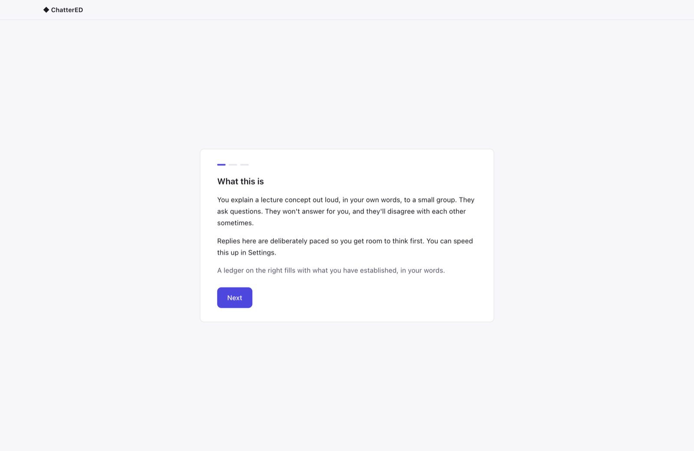

`00-first-run.png` · `00b-first-run-2.png` · `00c-first-run-3.png` — the cards are **What this
is**, **Who answers**, **Choose your slides folder**.

> *"Three paragraphs of text before I've seen anything. Who is 'they'? It says a ledger fills 'on
> the right' — the right of what? Card two is about Claude Code and API keys; I don't know what
> that is and I don't know if I'm allowed to click Next."*

Against `product-design.md` §B7, cards 2 and 3 are the wrong two cards. The spec's card 2 is
**"Who you'll be talking to"** — Ellie and Max, one sentence each, their monogram avatars, and the
sentence *"They'll disagree with each other on purpose."* The spec's card 3 is **"About the
pacing"**, with a live fake `Max is thinking… 9s` indicator running inside the card and the speed
control underneath, *"so the learner changes it before they have ever felt it."* Neither ships.
What ships instead is a backend-selection card — developer plumbing promoted to the second thing a
student ever sees — and a folder picker whose copy still says **"slides folder"** even though
issue #22 changed the concept to a whole vault root.

**And the folder you pick in first run is thrown away.** Choosing `~/ChatterED/Academia` on card 3
and pressing **Start** lands you here:

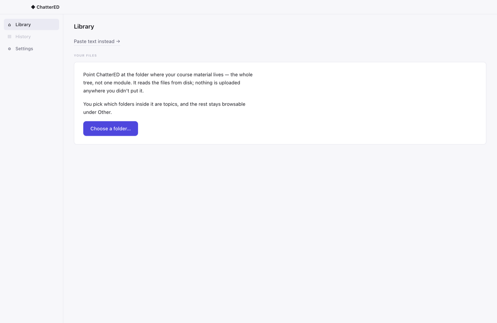

> *"I literally just told it where my files are. Why is it asking me again, with different words?"*

First run writes `settings.slides_folder`; the Library reads `vaults`. The one job of the first-run
flow does not carry. (Nielsen #4, consistency; the spec's §B7 "first-run incomplete" state was
meant for a learner who *skipped* the picker, not one who used it.)

### A1 · Library, as the developer found it

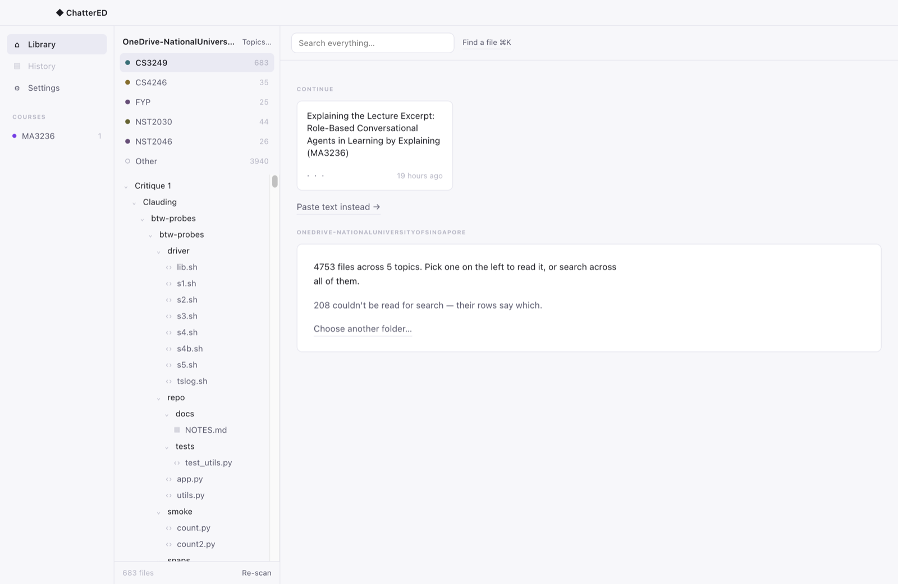

`01-library-asfound.png` — the developer's own vault, reproduced exactly: a 168px nav column
holding **Library / History (greyed) / Settings** and a `COURSES` list with one stale
`MA3236 · 1`; a 244px vault column with the root name truncated to
`OneDrive-NationalUnivers…`, a `Topics…` link, six topic rows and a file tree; a header with
**Search everything…** *and* **Find a file ⌘K**; and then **908 × 790 pixels of off-white with one
card in the top-left corner.**

> *"OK — files. Where's the app? There's a 'Continue' card about something called
> 'Explaining the Lecture Excerpt…' — is that a document or a conversation? There is no Start
> button, no New session, nothing that says what this thing does. The biggest thing on screen is
> empty space."*

This single screenshot contains three of the developer's four complaints and it is the most
important image in this review. The first column does not do much **because there is nothing for
it to do** — three destinations, one of them disabled. The chat is missing **because the Library
was never given the third pane**. And the emptiness is not a spacing bug; it is the shape of the
hole where the product is supposed to be.

### A2 · Library on the test vault

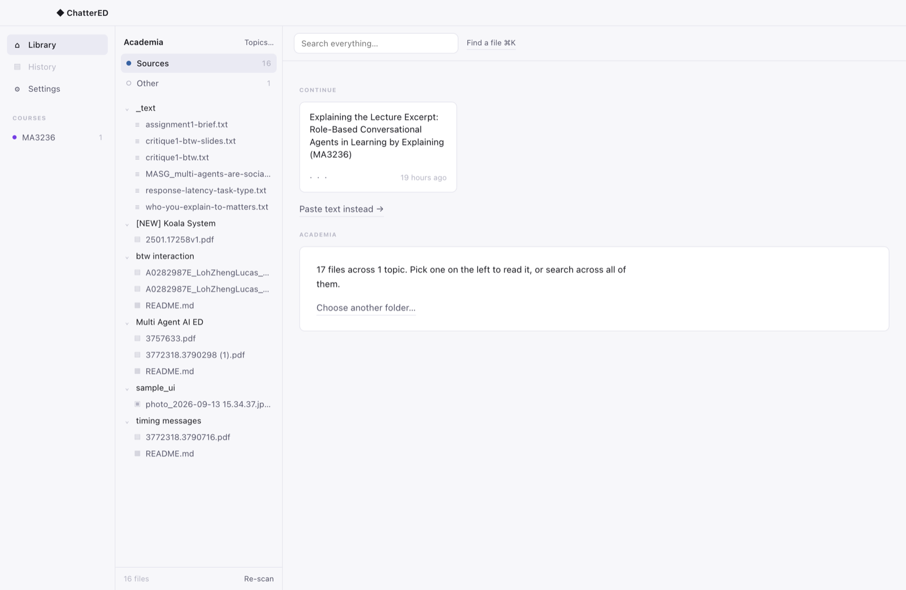

`02-library-academia.png` (`Academia`, `Sources` promoted, 16 files) and
`02b-library-fresh-no-courses.png` (same vault on a clean database).

The clean-database shot proves where the stale course comes from: with no sessions in the DB the
`COURSES` heading disappears entirely, so the nav rail is three rows in a 168px column. The
`MA3236 · 1` in the developer's build is a *session* record — and
`SessionSetup.svelte:11` reads `let moduleCode = $state(from?.moduleCode ?? 'MA3236');`. Every
session ever started in this app without an explicit module is stamped **MA3236**, whatever vault
it came from. The stale course row is not stale data; it is a hard-coded default leaking into the
sidebar.

> *"Why does it think I take MA3236? I've never opened a maths file."*

`08-topic-sheet.png` shows the topic picker — this part is good: clear copy, "nothing is hidden
either way", a count per candidate. The card behind it, though, reads *"17 files across 0 topics.
Pick one on the left to read it"* when there are no topics to pick.

### A3 · A document open

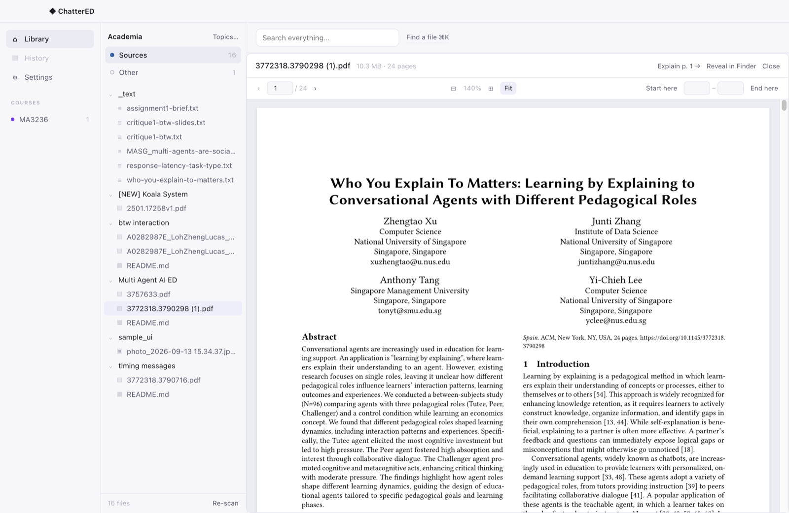

`03-document-paper.png` — the Xu et al. paper, 24 pages. Header: name, `10.3 MB · 24 pages`, then
three same-sized 11px grey text links at the far right: **Explain p. 1 →**, **Reveal in Finder**,
**Close**. Toolbar: `‹ 1 / 24 ›`, `⊟ 140% ⊞`, **Fit**, then `Start here [ ] – [ ] End here`.

> *"'Explain p. 1' — explain it to who? It's the same size as 'Close', so it can't be the main
> thing. And what are those two empty boxes for?"*

The spec's primary action for this screen is a **right-aligned primary `Explain this` button**
(§B1). Here the single most important control in the app is styled identically to the window-close
affordance next to it. Nielsen #6 (recognition over recall) and basic action hierarchy.

`05-page-range-marked.png` shows the range after **Start here** / **End here** — the marked page
gets an indigo outline, which is correct and nicely done (§C2 rule 2, a rule not a tint). But the
two number fields carry no label and no `of 24`, and before you press anything they are empty
boxes that read as an unfilled form.

### A4 · "Fit" does not fit — reproduced and measured

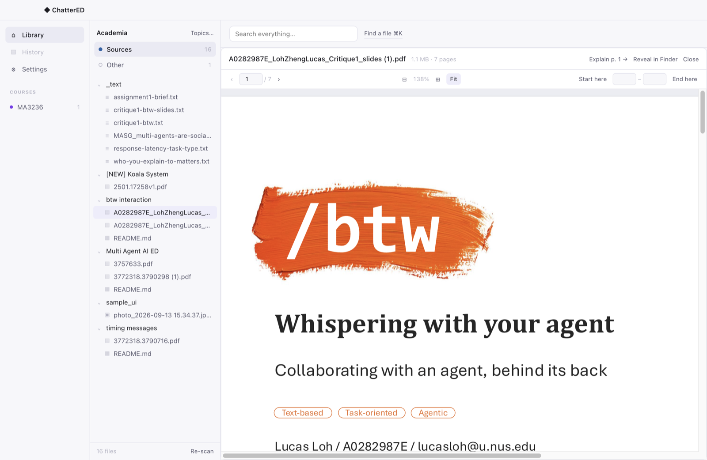

`04-fit-does-not-fit.png` — a 16:9 slide deck, **Fit** active (indigo), 138%, and the page is cut
off at the right with a horizontal scrollbar along the bottom.

Measured live over CDP at that exact moment:

| | value |
|---|---|
| viewer scroll container `clientWidth` | **891 px** |
| its `scrollWidth` | **1345 px** |
| page box width | 1346 px |
| label says | `Fit`, `138%` |

The page is rendered **151% of the width it is being asked to fit into.** The same measurement on
the ACM paper gives `891 / 891` — no overflow. The cause is one line,
`app/src/renderer/components/PdfViewer.svelte`:

```js
const scale = $derived.by(() => {
  if (!fit) return zoom;
  if (width <= 0) return 1;
  return Math.min(3, Math.max(0.4, (width - 48) / 612)); // 612pt = US Letter, close enough to A4
});
```

`612` is hard-coded. "Fit" only fits documents that happen to be US-Letter portrait. A 960 pt
16:9 deck overflows by exactly 960/612 = 1.57×; the developer's `Lecture-mdp.pdf` at "169%" is the
same arithmetic. The component already knows the real page size — it stores it in `base` — and
simply does not use it. `base.w` instead of `612` is a one-line fix.

### A5 · Session setup

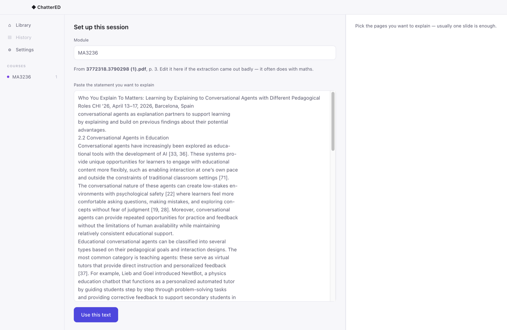

`06-session-setup-step1.png` — pressing **Explain p. 3 →** throws the PDF away and replaces it with
a `<textarea>` full of raw pdf.js output, hyphenation artefacts and all. The right third shows one
orphan sentence: *"Pick the pages you want to explain — usually one slide is enough."* — the
spec's **empty** step-1 copy, still on screen after the pages have been picked.

> *"Wait, where did my paper go? Am I supposed to read this wall of text and check it? And it
> still wants me to pick pages — did it not take them?"*

§B2 is explicit: the source pane keeps the PDF at the chosen range on the left two-thirds, and the
right third becomes the setup card with a `①──②` step indicator. Neither the document nor the step
indicator is here. The **Module** field is pre-filled `MA3236` on a clean install of a vault
called Academia.

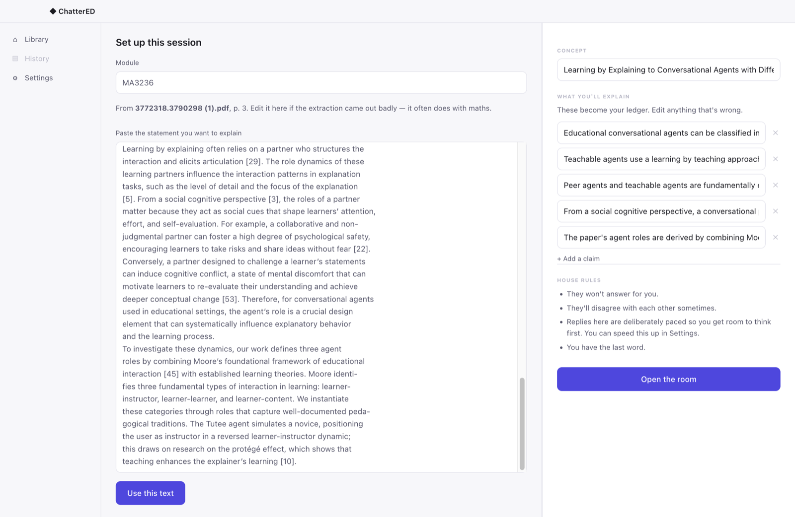

`09-setup-step2-claims.png` — after ~65 s of *"Pulling the claims out of your slide…"* (no
progressive reveal; §B2 says the title arrives first and animates in, rows follow), five claim
rows appear as **single-line inputs that clip their own contents**:

- `Educational conversational agents can be classified in` ▸ cut off
- `Teachable agents use a learning by teaching approach` ▸ cut off
- concept title `Learning by Explaining to Conversational Agents with Diffe` ▸ cut off

> *"I'm being asked to confirm five things I can't read."*

This is the screen the spec calls *"the load-bearing one — those claims become the ledger rows,
and confirming them is the learner's first act of ownership."* The learner cannot perform the act
because the content is invisible. There are no drag handles (§B2 specifies `⠿` reordering), and
the short `learner_label` that the ledger rail will actually display is never surfaced for editing
at all.

### A6 · The room — and it is good

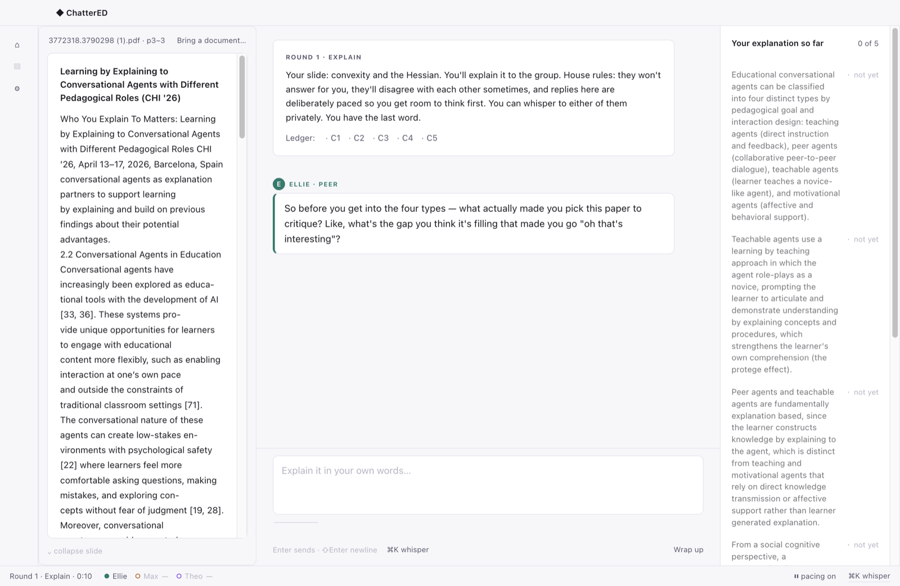

`10-room-open.png` · `11-room-thinking.png` · `12-room-reply.png`.

The room is the part of this app that was built to the spec. The nav rail collapses to 56px icons;
the source pane sits left with a `⌄ collapse slide` control; the thread carries the round card,
small-caps `ELLIE · PEER` labels, a teal 3px left rule, right-aligned indigo-tinted learner blocks;
the composer says `Enter sends · ⇧Enter newline` with `⌘K whisper` and `Wrap up` in the footer; the
status bar reads `Round 1 · Explain · 1:15  Ellie ● Max — Theo —  ⏸ pacing on  ⌘K whisper`. The
45-second silence nudge fired on cue and rendered as the spec's labelled divider —
`45s quiet · Ellie stepped in   don't do this` — with Ellie's content-free line underneath. Every
§C10 shortcut (`⌘K`, `⌘L`, `⌘\`, `⌘.`, `Esc`, `⌘⇧S`) is wired. This is genuinely strong work.

Three things break it:

1. **The round card names the wrong concept.** It opens *"Your slide: convexity and the Hessian."*
   on a session about pedagogical agent roles. `app/src/room/actor.ts:461` returns
   `roundCard: SCRIPT_ROUND_CARD` unconditionally — the PSD/Hessian demo script's text, in every
   real session. The first sentence a learner reads in the hero screen is about someone else's
   lecture.
2. **The ledger rail is a wall of prose.** Each row is the full extracted claim — 40 to 60 words.
   Measured: rail 264 px wide, `scrollHeight` 1362 px against `clientHeight` 792 px, so **570 px of
   the rail is below the fold**, including the Bloom ladder and `[hide]`. §D1's whole argument for
   a live rail is that *"it can be scanned in the half-second a learner can spare mid-sentence."*
   You cannot scan this in ten seconds.
3. **The source pane shows a text dump, not the slide.** `SourcePane.svelte` renders
   `material.extractedText` in a `<p>`: `"...explored as educa- tional tools with the development
   of AI [33, 36]. These systems pro- vide..."`. §B0 is explicit — *"Centre: the slide you are
   explaining"* — and §C6's arbiter move (*"Your slide (p. 31) says X"*, click to scroll the source
   pane) is not implementable against a paragraph of joined-up hyphenated text.

### A7 · Whisper — the best screen in the app

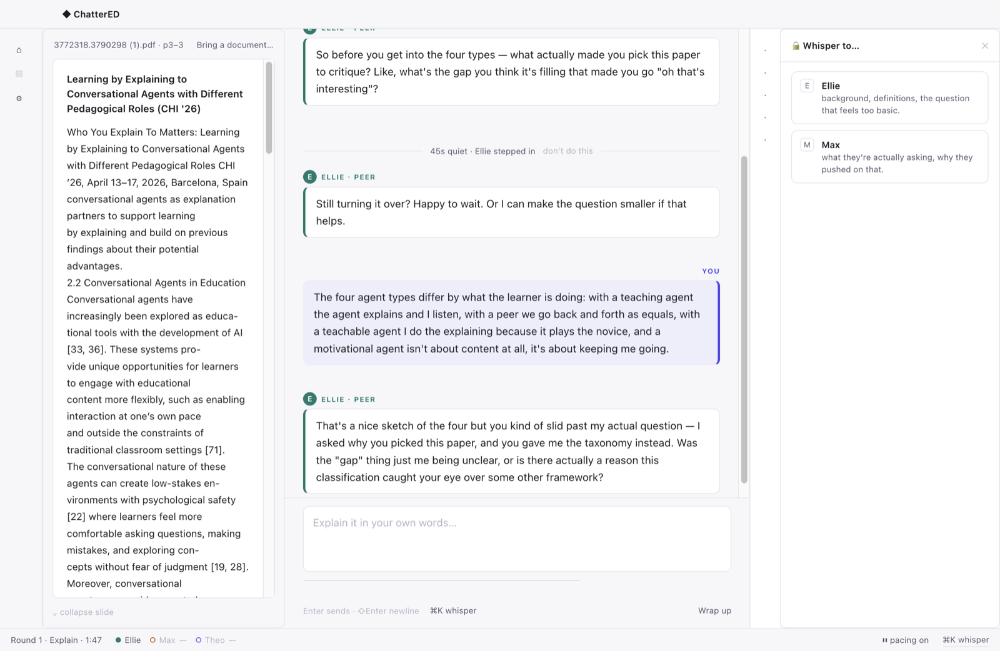
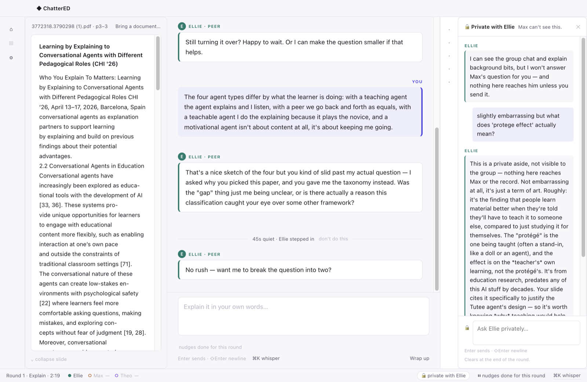

`13-whisper.png` (⌘K picker: `Ellie — background, definitions, the question that feels too basic.`
/ `Max — what they're actually asking, why they pushed on that.`) and `14-whisper-open.png`.

Header `🔒 Private with Ellie · Max can't see this`, the limits statement as the first message,
a lock glyph in the composer, `Clears at the end of the round.` pinned under it, and a
`🔒 private with Ellie` chip in the status bar. The ledger collapses to its 40px strip beside it
and the group thread keeps running, unblurred, exactly as §C7 argues it must. This is the app's
most novel component and it is the most faithfully built.

Two small things: the 40px ledger strip's glyphs are so low-contrast they read as dust
(`14-whisper-open.png`, x ≈ 1225), and the one-keystroke `E` / `M` picker shortcut is implemented
but never shown in the picker.

### A8 · Wrap up and recap

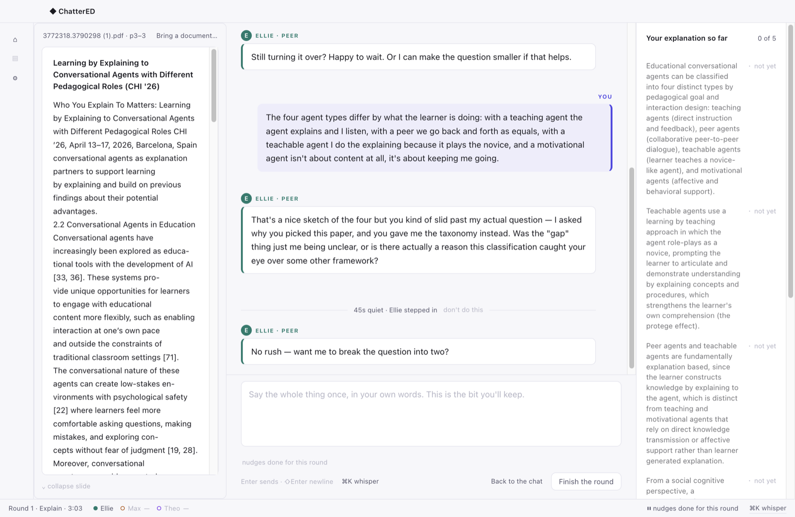

`15-closing-mode.png` — **Wrap up** switches the composer to a 4-row box with the placeholder
*"Say the whole thing once, in your own words. This is the bit you'll keep."* and the button
becomes **Back to the chat**. Correct per §C9.

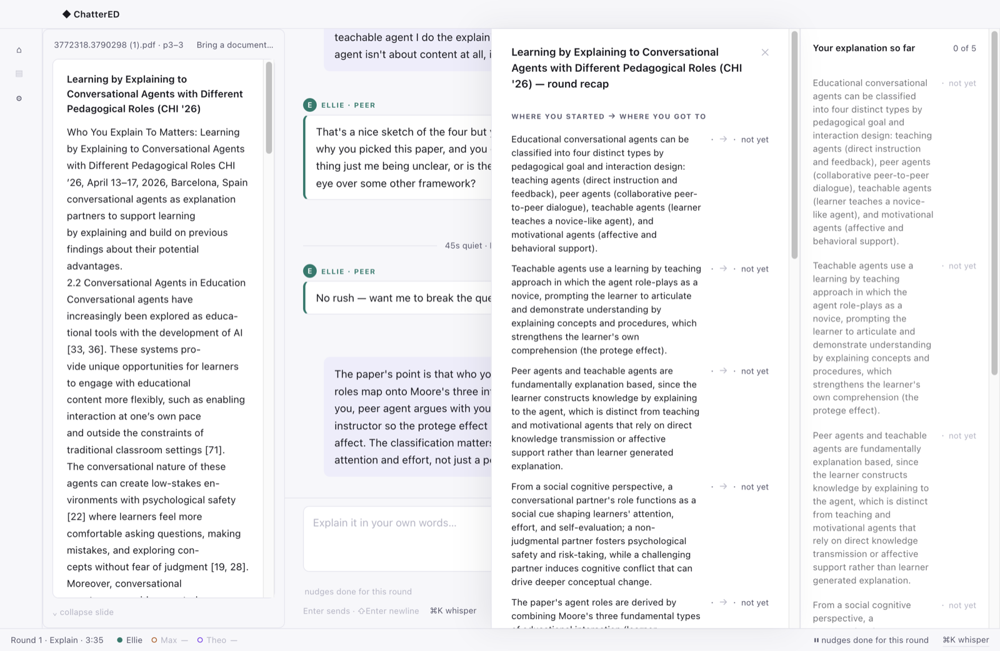
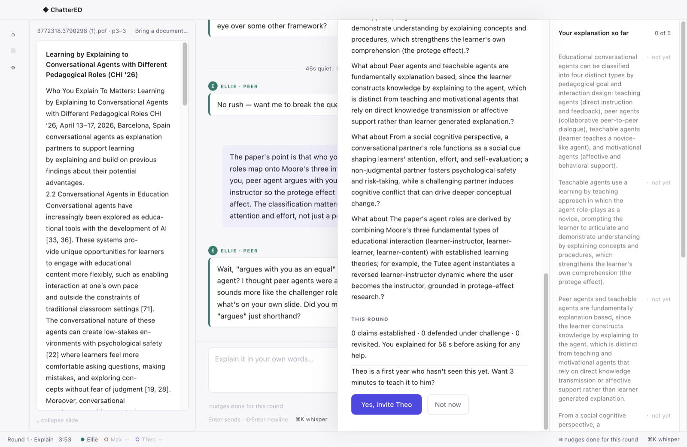

`16-recap.png` · `17-recap-bottom.png` — and here it comes apart.

- **The delta is not a delta.** §D4 says the start-vs-end block is the hero, two columns of glyphs,
  *"deliberately built to be screenshot-able as a pair."* What renders is five 60-word paragraphs
  each followed by `· → · not yet`. Measured: the card is **408 px wide and 2043 px tall** — 2.6
  screens of scrolling, in a 1600 px window, sitting on top of a ledger rail that shows the *same
  five paragraphs again*.
- **"What stayed open" is a template accident.** `actor.ts:965` builds
  `` `What about ${r.learnerLabel}?` ``. With a paragraph-length label the result is
  *"What about Peer agents and teachable agents are fundamentally explanation based, since the
  learner constructs knowledge by explaining to the agent, which is distinct from teaching and
  motivational agents that rely on direct knowledge transmission or affective support rather than
  learner generated explanation.?"* — five times, each ending `.?`.
- **"This round" is a score.** It reads *"0 claims established · 0 defended under challenge · 0
  revisited."* §B6 and §D1 L3 specify the **act profile** here — causal elaborations, examples,
  self-corrections, self-monitoring, challenges defended — precisely because it is *not* a count of
  ledger states. `actor.ts:957-962` builds `actProfile` by re-counting the ledger. The card *does*
  carry the spec's *"Nothing moved states this round. That happens — the transcript is still
  yours."* line up in the delta block — and then undoes it two blocks later with three zeroes. Three
  zeroes in a row on the screen that is supposed to be the payoff is the exact evaluation
  apprehension P5 exists to remove.
- **Theo is offered with an empty ledger.** §B6: *"gate not met (the Theo block is absent entirely,
  not shown greyed — an unavailable reward is a punishment)"*; §C9 sets the gate at every row `●`
  and the ladder at *analyse*. `actor.ts:966` offers the invitation whenever a tutee exists in the
  roster — no gate. And `RecapCard.svelte`'s **Yes, invite Theo** button has **no `onclick`
  handler**: it is a dead primary button.
- **No footer.** §B6 specifies **Export transcript** and **Explain something else**. Neither is
  rendered.

### A9 · Settings

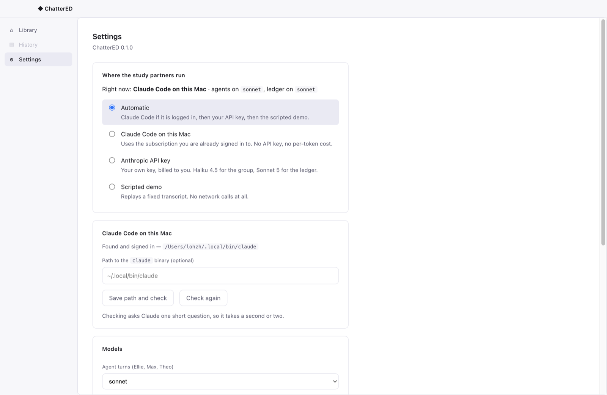

`18-settings.png` — one group, **Where the study partners run**, plus model dropdowns. §B7
specifies four groups: **Sources**, **Pacing**, **The room**, **Your work**. `STATUS.md` already
books this as A2 work, so it is not a surprise — but the *Pacing* group is not a nice-to-have.
P3 and `design-brief.md` §D4 make the disclosure honest **only because the learner can change it**:
*"a paced system the user can un-pace is a design choice; one they cannot is a dark pattern."*
Today the room says `⏸ pacing on` and the `don't do this` link on the nudge divider has nowhere to
go.

Settings also has no **Sources** group, which means: **once a document is open there is no way in
the entire application to change vault.** The only `Choose another folder…` control lives inside the
Library's empty-state card, which is replaced the moment you open a file.

### A10 · Full screenshot index

Every state reached in this session, in `docs/research/ui-review/`:

| File | State |
|---|---|
| `00-first-run.png` | First run, card 1 — *What this is* |
| `00b-first-run-2.png` | First run, card 2 — *Who answers* (backend detection) |
| `00c-first-run-3.png` | First run, card 3 — *Choose your slides folder* |
| `01-library-asfound.png` | Library, developer's live vault, no document — the as-found state |
| `01b-library-empty-after-firstrun.png` | Library immediately after first run: asked for the folder again |
| `02-library-academia.png` | Library, `Academia` vault, `Sources` promoted |
| `02b-library-fresh-no-courses.png` | Library on a clean database — no `COURSES` section at all |
| `03-document-paper.png` | Document open (US-Letter paper): Fit works |
| `04-fit-does-not-fit.png` | Document open (16:9 deck): Fit active, page clipped, h-scrollbar |
| `05-page-range-marked.png` | Page 3 marked with Start here / End here — indigo outline |
| `06-session-setup-step1.png` | Session setup step 1 — PDF replaced by a raw text dump |
| `07-setup-extracting.png` | Setup, extracting — *"Pulling the claims out of your slide…"* (~65 s) |
| `08-topic-sheet.png` | Topic promotion sheet |
| `09-setup-step2-claims.png` | Setup step 2 — five clipped claim rows |
| `10-room-open.png` | Room open: source pane, thread, ledger rail, status bar |
| `11-room-thinking.png` | 45 s silence nudge divider + `Ellie is typing…` |
| `12-room-reply.png` | Agent reply landed |
| `13-whisper.png` | ⌘K whisper picker; ledger collapsed to the 40 px strip |
| `14-whisper-open.png` | Whisper with Ellie, `🔒 private with Ellie` in the status bar |
| `15-closing-mode.png` | `Wrap up` → closing mode composer |
| `16-recap.png` | Recap card, top — the "delta" as five paragraphs |
| `17-recap-bottom.png` | Recap card, bottom — `What about …?`, three zeroes, ungated Theo |
| `18-settings.png` | Settings — backend and models only |

---

## B. Findings

Severity: **blocker** = the A1 video or a first user session is damaged by it; **major** = a
first-time student is confused, blocked or misled; **minor** = friction or spec drift a user will
notice; **polish** = craft.

### Blockers

| # | What I saw | Violates | Fix |
|---|---|---|---|
| **B1** | The Library has **no chat pane and no agents at all**. The room only exists after `Explain → paste-confirm → 5 claims → Open the room`. On `01-library-asfound.png` the right-hand 908 × 790 px is empty ground with one 230 px card in the corner. | §B0 ("GROUP CHAT (hero)"), P6 ("It should feel like a room the student already lives in"), the NUSSync reference where the chat pane is permanently docked right. Nielsen #6 (recognition, not recall). | Give the Library the **third pane**. Where the room is closed it shows the *pre-room* state: the concept the current selection would become, the three house rules, and one primary **Explain this →** button; where a room is live it shows the live thread (see §C wireframes). It is the same `Thread`/`Composer` pair already built — it needs a slot, not new components. §B1's "no agent appears in the Library" rule is honoured by showing **no avatars and no agent copy** until a room exists; a pane that says *what will happen* is not an agent presence. |
| **B2** | There is **no `Explain this` affordance in the file list at all**, and the one in the document header (`Explain p. 1 →`) is an 11px grey text link the same size and weight as `Close`. | §B1 L176 ("a right-aligned primary **Explain this** button that appears on hover or focus"); action-hierarchy / Nielsen #6. `DocumentPane.svelte` `.mini` class. | File-tree rows in `FileTree.svelte` get a right-aligned `Explain this` on hover/focus. In `DocumentPane.svelte` promote the action to `.btn-primary` and demote `Reveal in Finder` / `Close` to icon or secondary treatment. |
| **B3** | **Fit does not fit.** Measured on a 16:9 deck: container `clientWidth` 891 px, content `scrollWidth` 1345 px, label `Fit · 138%`, horizontal scrollbar visible (`04-fit-does-not-fit.png`). | `PdfViewer.svelte` hard-codes `(width - 48) / 612`. Nielsen #1 (visibility of system status — the control lies about what it did). | Use the page's real width, which the component already holds: `(width - 48) / (base?.w ?? 612)`. Recompute per page for mixed-size PDFs, and clear `drawn` on a fit-scale change so already-rendered canvases are redrawn. Also add a **Fit page** option (height-constrained) — for a slide deck, fitting the *page* is what a student actually wants. |
| **B4** | The round card at the top of every real session reads **"Your slide: convexity and the Hessian…"** regardless of the concept (`10-room-open.png`). | `room/actor.ts:461` → `roundCard: SCRIPT_ROUND_CARD`. Nielsen #2 (match between system and the real world) — and it will be on camera in the A1 video. | Build the round card from the live pack: `Your slide: ${pack.title}. …` with the same house-rules sentence. Keep `SCRIPT_ROUND_CARD` for `mode === 'scripted'` only. |
| **B5** | Ledger rows and recap rows carry **whole paragraphs**. Rail measured at 264 px wide, 1362 px of content in 792 px of height. "What stayed open" renders `What about <60-word paragraph>.?` five times. | §D1 ("scanned in the half-second a learner can spare"), §B5 (a 260px column, one row per claim, glyph + label + state word), §D2. Root cause: `DRAFT_SCHEMA` in `main/sessions.ts` constrains neither `label` nor `learner_label`, and the ingest system prompt never says what `learner_label` is for. | Constrain the schema: `learner_label: { type: 'string', maxLength: 40, description: 'At most six words. The phrase shown in the learner\'s progress rail, e.g. "what PSD means".' }`, and add one line to the ingest system prompt. Surface `learner_label` as a second, short field in the setup rows so the learner can fix it. Fix the open-question template to `Nothing yet on ${learnerLabel}.` (a statement, not a mangled question). Clamp `LedgerRow .label` to two lines with the full text in the expanded view. |

### Major

| # | What I saw | Violates | Fix |
|---|---|---|---|
| **M1** | Two left columns, 168 px + 244 px = **412 px of chrome before any content**, of which the first holds three items (one disabled) and a sometimes-empty `COURSES` list. On a clean vault the first column is literally three rows. | §B0's shell is `NAV+COURSES 168 │ SOURCE │ CHAT │ LEDGER`. The Library has turned the source column into *two* columns and dropped the other two. Nielsen #8 (aesthetic and minimalist design). | **Collapse the nav rail to a 56 px icon strip on every screen**, not just in a room (`store.navCollapsed` already does this; the Library just never sets it). Move the destination labels into tooltips + the app menu. Keep `COURSES` — but move it *under the topic list in the second column*, where it belongs conceptually, and render it only when there is at least one session. That returns ~112 px and makes the two remaining columns read as "where things are" and "what I'm doing", which is the spec's model. **Topics should not become the first column**: the first column is global navigation across four destinations and must survive History and Settings, where topics are meaningless. |
| **M2** | `COURSES · MA3236 · 1` on a vault with no maths in it; the same `MA3236` pre-filled in Session setup on a **clean database**. | `SessionSetup.svelte:11`: `$state(from?.moduleCode ?? 'MA3236')`. Nielsen #2. | Default to the topic's `module_code` when the folder name looks like one (`vault/service.ts#moduleCodeFor` already computes this), else to the topic name, else leave the field empty with placeholder `e.g. CS3249`. Never ship a real module code as a literal. |
| **M3** | **History** is grey, unclickable, carries only a native `title="Not in this build"` tooltip, is a `<span>` (not focusable, no `aria-disabled`), and gives the impression the app is broken. | `NavRail.svelte`. Nielsen #1; WCAG 4.1.2. | Either hide it until it exists, or make it a real destination whose screen says *"Your past sessions will be listed here. Nothing is lost — transcripts are in ~/Documents/ChatterED."* An empty screen you can reach beats a dead item you cannot. |
| **M4** | Two search entry points side by side — a 240 px `Search everything…` box and a `Find a file ⌘K` link — with nothing saying how they differ. | Nielsen #4 (consistency and standards), #6. | One box. `Search everything…` with the `⌘K` hint inside it on the right; typing a query searches content, and a `⌘K`-opened overlay is the *same* box in filename mode with a `Filenames` / `Everything` segmented toggle. Two boxes for one intention is the classic "we built two features" tell. |
| **M5** | The vault name truncates to `OneDrive-NationalUnivers…` with no tooltip, and **there is no way to change vault once a document is open** — `Choose another folder…` lives only inside the Library's empty-state card, and Settings has no Sources group. | §B7 Sources group; Nielsen #3 (user control and freedom). | Make the vault name a menu button: click → `Re-scan · Manage topics… · Reveal in Finder · Open another vault…`. Add `title` with the full path. Add the **Sources** group to Settings. |
| **M6** | Session setup discards the document and shows a raw pdf.js dump in a textarea; the right pane still shows the step-1 empty copy *"Pick the pages you want to explain"* after pages have been picked; no `①──②` step indicator. | §B2 (layout, states table: the "empty step 1" copy is for when nothing has been chosen). Nielsen #1, #4. | Keep `VaultBrowser`'s document pane on the left at the marked range, exactly as §B2 draws it; put the setup card in the right third; fold the raw text into a collapsed `▸ What I read from these pages (edit if it came out wrong)` disclosure under the claim list. Render the step indicator. |
| **M7** | Claim rows and the concept title are **single-line inputs that clip** (`09-setup-step2-claims.png`). The confirmation step the spec calls "the learner's first act of ownership" cannot be read. | §B2 ("each an editable one-line text field" was written for one-line claims — the content is now paragraphs, so the component must change with it). Nielsen #1. | Auto-growing `<textarea>` rows, 2–4 lines, plus the short `learner_label` field beside each. Add the `⠿` drag handle the spec specifies. |
| **M8** | **No trackpad or Mac keyboard zoom anywhere.** `grep` over `src/renderer` finds no `wheel`, `gesturestart`, `dblclick`, or `ctrlKey` zoom handler. No `Menu.setApplicationMenu` in `src/main`, so the **default Electron menu is live** — which means ⌘+ / ⌘− / ⌘0 zoom *the whole application chrome*, sidebar and all, instead of the PDF. No arrow-key or Page Up/Down page navigation. No pdf.js text layer, so no text selection and no ⌘F inside a document. | Platform convention (every Mac PDF surface: Preview, Safari, Chrome). Nielsen #7 (flexibility and efficiency of use). Note `STATUS.md` already records "a pdf.js text layer would fix that and is not built". | In `PdfViewer.svelte`: (a) `onwheel` with `e.ctrlKey` → pinch-zoom about the pointer (Chromium delivers macOS pinch as a ctrl-wheel), `preventDefault`; (b) `dblclick` → smart zoom toggling `Fit ⇄ 200%` at the click point; (c) window `keydown` for `⌘+ / ⌘- / ⌘0` scoped to the viewer, plus `←/→` and `PageUp/PageDown` for pages; (d) ship a real app menu (`Menu.setApplicationMenu`) so ⌘+ is *yours*, and add **File ▸ Open vault…**, **View ▸ Actual size / Zoom to fit**, **Session ▸ Explain this**. Two-finger horizontal swipe should map to page nav only once a text layer exists — until then it will fight the horizontal overflow that B3 removes. |
| **M9** | Recap: 408 × 2043 px overlay; delta rendered as five paragraphs; `0 claims established · 0 defended · 0 revisited`; Theo offered with an empty ledger; **Yes, invite Theo** has no handler; no `Export transcript` / `Explain something else`. | §B6, §D4, §C9 (the gate), P5 (no scoring). `RecapCard.svelte`, `actor.ts:950-972`. | Gate the Theo block on `every row === 'defended' && bloom === 'analyse'` and omit it entirely otherwise. Replace `actProfile` with the real act counts from the ledger/orchestrator log; when every count is zero, omit the block entirely and let the delta block's existing *"Nothing moved states this round…"* line stand alone, instead of printing three zeroes underneath it. Render the delta as two glyph columns using `learner_label`. Widen the card to ~560 px and let the thread sit behind at 40 %. Add the footer buttons; wire or remove the Theo button. |
| **M10** | **Bring a document…** replaces the entire room — thread, ledger, composer and status bar all disappear (`Room.svelte` `{#if store.browserOpen}`). | §C7's polychronicity argument (the learner must be able to watch the room while doing something else) and §B3 (the source pane is *part of* the room). | Open the browser as a **left-hand overlay over the source pane only**, keeping the thread and ledger live, with `Esc` / `Back to the room` to dismiss. The comment in the code — *"this is a trip to the shelf, not a different screen"* — is right; the implementation does the opposite. |
| **M11** | The in-room source pane shows extracted text with hyphenation artefacts (`explored as educa- tional tools`), not the page. | §B0 ("the slide you are explaining"), §C6 (the slide as arbiter, with a click-to-scroll page reference). | Render the actual PDF page(s) in `SourcePane` — `PdfViewer` already exists and is already handed a `Uint8Array` elsewhere; the material row carries `file_id` and the page range. Keep the text as the collapsed `▸ text I read` disclosure for when extraction went wrong. |
| **M12** | Settings has no **Pacing** group; the room shows `⏸ pacing on` with no control behind it, and the nudge divider's `don't do this` link has no target. | P3, §B7, `design-brief.md` §D4 — the disclosure is only honest if the control exists. | Ship the Pacing group (Reply speed 3-way, Quiet nudge toggles, the stage-2 toggle, "the countdown pauses while you're typing") before any user study. Point `don't do this` at it with the nudge toggle focused. |
| **M13** | ~600 px of vertical dead space under one 180 px card on the Library (`02-library-academia.png`). | Symptom of B1. | Fixed by B1. Until then, the launcher's centre column should at least show the topic's file list as cards with `Explain this` (§B1's actual design) rather than a sentence about how many files there are. |

### Minor

| # | What I saw | Violates | Fix |
|---|---|---|---|
| m1 | First-run card 3 asks for a folder, then the Library immediately asks again. | §B7 first-run; Nielsen #4. | Have card 3's picker call the same `vault.open()` path the Library uses, and land on a populated Library with the topic sheet already open. |
| m2 | *"17 files across 0 topics. Pick one on the left to read it"* when there are no topics. | Copy/state mismatch. | `{n} files, no topics yet. Pick which folders are your topics →` linking to the sheet. |
| m3 | Ledger header reads `0 of 5`, not `0 of 5 claims covered`. | §B5 L451. | One string. |
| m4 | The round card prints `Ledger: ·C1 ·C2 ·C3 ·C4 ·C5` but the rail rows carry no ids, so the two cannot be mapped. | §D2/§B3 consistency. | Show the id in `LedgerRow` (`C1` prefix, muted), as §B5's own wireframe does with `R1/R2/R3`. |
| m5 | The file tree auto-expands every folder — the developer's 683-file topic produces hundreds of rows and a 6-deep chain (`Critique 1 ▸ Clauding ▸ btw-probes ▸ btw-probes ▸ driver`). | Nielsen #8. | Collapse folders by default beyond depth 1; remember expansion per topic; add a `Filter files…` box as §B1 draws. |
| m6 | `Explain p. N →`, `Reveal in Finder`, `Close` are identical 11px grey links. | Action hierarchy. | Covered by B2. |
| m7 | Page-range fields are unlabelled and start empty; no `of 24`. | §B2 L241 (`Pages [30]–[31] of 38`). | Label the pair `Pages` and append `of {pageCount}`; pre-fill both with the current page so the control reads as set, not as an unfinished form. |
| m8 | The whisper picker implements one-key `E` / `M` selection but shows no hint. | §B4 ("Choosing is one keystroke"). | Render the letter as a `<kbd>` in each row. |
| m9 | The collapsed 40 px ledger strip's glyphs are near-invisible. | §B5 hidden state; WCAG 1.4.11. | Raise to `--glyph` at full opacity, add a 1px hairline and a `n of m` vertical label. |
| m10 | In a whisper the status bar carries four chips (`Round 1 · Explain · 2:19`, presence, `🔒 private with Ellie`, `⏸ nudges done for this round`, `⌘K whisper`). | §B0 status bar spec (round, presence, pacing, whisper). | Merge the nudge state into the pacing chip (`⏸ pacing on · nudges done`). |
| m11 | Ellie's whisper reply ended by offering to raise the question in the group, but no `RelayOffer` card appeared — the component exists and was not triggered. | §C8 beats 1–2. | Have the whisper turn emit a structured `relay_offer` alongside the prose, rather than relying on the prose alone. |

### Polish

| # | What I saw | Fix |
|---|---|---|
| p1 | Nav items are 12px/30px rows against NUSSync's 13px/~32px, and the active row's tint (`#eaeaf4`) is a weaker, greyer selection than NUSSync's indigo-tinted one. Message bodies are correctly capped at `72ch` — credit where due. | Match NUSSync: 13px labels, 32 px rows, `--indigo-tint` on the active row with a 2px indigo left marker. It is the same person's muscle memory. |
| p2 | Once a vault is open the Library loses its `Library` title — `01-library-asfound.png` has no screen name anywhere. NUSSync keeps `Files` in the header. | Put the screen name back in the header, left of the search box. |
| p3 | `Topics…` is an 11px grey link in the sidebar header; nothing says it is how you choose what a topic is. | `Topics…` → `Edit topics` with a small pencil, or fold it into the vault-name menu from M5. |
| p4 | Continue-card ledger glyphs render as three near-invisible dots at `--muted`. | Use `--glyph` and add the `n of m` count. |
| p5 | `Other 3940` sits in the same visual weight as real topics and dominates the list. | Pin `Other` to the bottom with a hairline above it and a muted count, as a "the rest of the tree" bucket. |

---

## C. Proposed layout

Two rules govern both wireframes. **(1) The window always has the same four slots** —
nav · source · conversation · rail — so the Library and the Room are the same shell in two states,
not two apps. **(2) The conversation slot is never empty and never absent**, because it is the
product; before a room exists it holds the thing that *makes* the room.

This keeps every §B1 rule that carries a design decision: no upload button, no cloud library, no
progress dashboard, and **no agent avatars, names or voices in the Library** — the pre-room pane
speaks in the app's own voice about what is about to happen, which is not the same as Ellie
standing there waiting for you.

### C1 · Library with a document open (no room)

```
┌────────────────────────────────────────────────────────────────────────────────────────────┐
│ ●●●   ChatterED                                                                            │
├────┬──────────────────────┬──────────────────────────────────────┬─────────────────────────┤
│ ⌂  │ Academia         ⌄   │ 3772318.3790298 (1).pdf              │ EXPLAIN THIS            │
│ ▤  │ ─────────────────────│ 10.3 MB · 24 pages    ⤢ Finder   ✕   │ ─────────────────────── │
│ ⚙  │ ● Sources        16  ├──────────────────────────────────────┤                         │
│    │ ○ Other           1  │ ‹ 3 /24 ›   ⊟ 100% ⊞  Fit ▾          │ Pages 3 – 3             │
│ ── │ ─────────────────────│ Pages 3 – 3   [Start here][End here] │ from this paper         │
│ ●  │ ▸ _text              ├──────────────────────────────────────┤                         │
│    │ ▾ Multi Agent AI ED  │ ┌──────────────────────────────────┐ │ You'll explain it to a  │
│ 56 │   ▤ 3757633.pdf      │ │                                  │ │ study group of two.     │
│ px │   ▤ 3772318…(1).pdf  │ │   THE PAGE, ACTUALLY FITTED      │ │                         │
│    │      [ Explain this ]│ │   width = pane − gutters          │ │ · They won't answer     │
│ ic │   ▦ README.md        │ │   pinch · ⌘+ · ⌘0 · dbl-tap      │ │   for you.              │
│ on │ ▸ timing messages    │ │   ← → pages                      │ │ · They'll disagree      │
│ s  │                      │ │                                  │ │   with each other.      │
│    │ ─────────────────────│ │   [ marked range outlined ]      │ │ · Replies are paced.    │
│    │ COURSES              │ │                                  │ │ · You have the last     │
│    │ ● CS3249          3  │ └──────────────────────────────────┘ │   word.                 │
│    │ ● CS4246          1  │                                      │                         │
│    │ ─────────────────────│                                      │ ┌─────────────────────┐ │
│    │ 16 files · Re-scan   │                                      │ │  Explain p. 3  →    │ │
│    │                      │                                      │ └─────────────────────┘ │
│    │                      │                                      │ Paste text instead →    │
├────┴──────────────────────┴──────────────────────────────────────┴─────────────────────────┤
│  Library · Academia · Sources                    Idle          [ Search everything…  ⌘K ]  │
└────────────────────────────────────────────────────────────────────────────────────────────┘
  56px          232–280px                 flexible                         300px
```

What changed and why:

- **Nav collapses to 56 px icons everywhere**, not only in a room (`store.navCollapsed`). Four
  destinations do not need 168 px of label. `COURSES` moves to the bottom of column two, under a
  hairline, where the other "things in my life" live — and disappears when there are none.
- **The third pane arrives.** It is not a chat yet; it is the **room's antechamber**: what you have
  selected, what will happen, the four house rules (already written, §B2), and one indigo primary
  **Explain p. 3 →**. This is the answer to *"where is the AI chat?"* — the slot is always there, so
  the learner sees the shape of the app on launch and the transition into a room is a *fill*, not a
  navigation.
- **One search box**, moved to the status bar with its `⌘K` hint inside it, so the header belongs
  entirely to the document.
- **`Explain this` on the file row**, on hover/focus, as §B1 specifies.
- **The page actually fits**, and the viewer answers pinch, `⌘+/−/0`, double-tap and arrow keys.
- **Fit ▾** is a small menu — `Fit width` / `Fit page` / `Actual size` — because a slide deck and a
  paper want different answers.

When no document is open, the third pane says instead: *"Pick a file on the left. You'll explain a
page or two of it, out loud, to a study group of two."* plus **Paste text instead →**, and the
centre pane holds the §B1 **Continue** strip and the topic's file list as rows with
`Explain this`. The empty ground disappears because the emptiness was the missing pane.

### C2 · Library with a live room

```
┌────────────────────────────────────────────────────────────────────────────────────────────┐
│ ●●●   ChatterED                                                                            │
├────┬───────────────────────────┬───────────────────────────────────────┬───────────────────┤
│ ⌂  │ 3772318…(1).pdf · p3      │  ROUND 1 · EXPLAIN                    │ Your explanation  │
│ ▤  │ Bring a document…    ⌄    │  Your slide: pedagogical roles in     │ so far     1 of 5 │
│ ⚙  │ ┌───────────────────────┐ │  learning-by-explaining. They won't   │ ───────────────── │
│    │ │                       │ │  answer for you. You have the last    │ C1 four agent     │
│ ── │ │  THE RENDERED PAGE    │ │  word.   Ledger: ·C1 ·C2 ·C3 ·C4 ·C5  │    types  ○ stated│
│ ●  │ │  at the marked range  │ │ ───────────────────────────────────── │ C2 teachable =    │
│    │ │                       │ │  ELLIE · peer                         │    protégé · not  │
│    │ │  (pdf.js, not a text  │ │ ┃ So before you get into the four      │ C3 explanation-   │
│    │ │   dump)               │ │ ┃ types — what made you pick this?     │    based  · not   │
│    │ │                       │ │                                       │ C4 role as social │
│    │ │                       │ │                             YOU  ┃    │    cue    · not   │
│    │ │                       │ │   The four types differ by what   ┃    │ C5 Moore ×theory  │
│    │ └───────────────────────┘ │   the learner is doing…          ┃    │           · not   │
│    │ ⌄ collapse slide          │                                       │ ───────────────── │
│    │                           │  ELLIE · peer                         │ remember ▸ under- │
│    │  ┌─ overlay: Bring a ───┐ │ ┃ ● ● ●  typing…                      │ stand ▸ apply ▸   │
│    │  │ document (covers the │ │                                       │ analyse           │
│    │  │ SOURCE pane only —   │ │ ┌───────────────────────────────────┐ │ ⓘ your words, not │
│    │  │ the thread keeps     │ │ │ Explain it in your own words…     │ │   a score  [hide] │
│    │  │ running behind)      │ │ └───────────────────────────────────┘ │                   │
│    │  └──────────────────────┘ │ ▁▁▁▁▁▁▁▁▁  wait-line                  │                   │
│    │                           │ Enter sends · ⇧Enter newline          │                   │
│    │                           │ ⌘K whisper               [ Wrap up ]  │                   │
├────┴───────────────────────────┴───────────────────────────────────────┴───────────────────┤
│ Round 1 · Explain · 1:47    Ellie ● Max ◐ thinking  (Theo —)   ⏸ pacing on ▸   ⌘K whisper   │
└────────────────────────────────────────────────────────────────────────────────────────────┘
  56px        320–420px collapsible          flexible · min 460px              260–320px
```

What changed from today's room:

- **The source pane renders the page**, not `material.extractedText`. The extracted text becomes a
  `▸ text I read from this page` disclosure inside the pane, which is where it belongs — a record,
  not the view.
- **"Bring a document…" becomes an overlay on the source column only.** The thread, the composer,
  the ledger and the timers stay on screen. A trip to the shelf, as the code comment intends.
- **The round card is generated from the live pack.**
- **Ledger rows are short labels with ids** (`C1 four agent types`), full text on expansion — the
  rail fits on one screen again and the Bloom ladder is above the fold.
- **`⏸ pacing on ▸`** is a click target that opens Settings ▸ Pacing, which now exists.
- The recap, when it comes, is a **560 px card over the thread with the thread visible at 40 %**,
  the delta as two glyph columns, and the Theo block present only when the gate is met.

---

## D. Top 10 fixes, in shipping order

Ordered so that each one makes the next cheaper or the demo safer. Effort is **S** ≤ half a day,
**M** ≈ 1–2 days, **L** ≈ 3–5 days, for one developer who knows this codebase.

| # | Fix | Why it is here | Files | Effort |
|---|---|---|---|---|
| 1 | **Fit fits.** `(width - 48) / (base?.w ?? 612)`, clear `drawn` on a scale change, add `Fit width / Fit page / Actual size`. | One line for the most visible broken control in the app, and it unblocks any gesture work. | `PdfViewer.svelte` | **S** |
| 2 | **Round card from the live pack**, and the hard-coded `'MA3236'` default removed. | Two one-line content bugs that both put someone else's lecture on camera. | `room/actor.ts:461`, `SessionSetup.svelte:11` | **S** |
| 3 | **Short ledger labels.** Constrain `learner_label` in `DRAFT_SCHEMA` + one line in the ingest prompt; clamp `LedgerRow` to two lines; fix the `What about …?` template. | Makes the rail scannable, the recap readable, and the recap's "what stayed open" stop emitting `.?`. Everything downstream of the ledger improves at once. | `main/sessions.ts`, `room/actor.ts:965`, `LedgerRow.svelte` | **S/M** |
| 4 | **Recap honesty.** Gate the Theo block (`every === defended && bloom === analyse`) and omit it otherwise; wire or remove the button; replace the ledger re-count with the real act profile, falling back to the spec's *"Nothing moved states this round…"* line; add `Export transcript` / `Explain something else`. | P5 is the design's load-bearing promise and today the payoff screen shows three zeroes and a dead reward button. | `room/actor.ts:950–972`, `RecapCard.svelte` | **M** |
| 5 | **The third pane in the Library.** Give the Library the conversation slot: the antechamber before a room, the live thread after. Primary `Explain this →` inside it; `Explain this` on file rows on hover. | This is complaints (1) and (2) and it is the single change that makes the app legible on launch. Doing it after 1–4 means the pane it reveals is already correct. | `Library.svelte`, `VaultBrowser.svelte`, `FileTree.svelte`, `DocumentPane.svelte` | **L** |
| 6 | **Nav rail to 56 px everywhere; COURSES under the topic list; History either real or hidden; one search box in the status bar.** | Pays for the third pane's width and kills the "first sidebar does not do much" complaint by making the column do exactly one honest thing. | `NavRail.svelte`, `App.svelte`, `VaultSidebar.svelte`, `VaultBrowser.svelte` | **M** |
| 7 | **Mac gestures and a real app menu.** ctrl-wheel pinch about the pointer, double-tap smart zoom, `⌘+/−/0` and arrow/PageUp-Down scoped to the viewer, plus `Menu.setApplicationMenu` with File ▸ Open vault…, View ▸ zoom, Session ▸ Explain this. | Complaint (4). The menu also steals ⌘+ back from Electron's default, which currently zooms the whole UI. | `PdfViewer.svelte`, `main/index.ts` | **M** |
| 8 | **Setup keeps the document.** Document pane left at the marked range, setup card right, `①──②` indicator, raw text demoted to a disclosure, auto-growing claim rows with the short label beside each, `⠿` handles. | The confirmation step is the learner's first act of ownership and it is currently unreadable. | `SessionSetup.svelte`, `VaultBrowser.svelte` | **M/L** |
| 9 | **The room shows the slide.** Render the page in `SourcePane`; make `Bring a document…` an overlay on the source column only. | Restores §B0's reason for the source pane to exist and stops the room disappearing when the learner fetches something. | `SourcePane.svelte`, `Room.svelte` | **M** |
| 10 | **Settings ▸ Pacing and ▸ Sources.** Reply speed, quiet-nudge toggles, the `don't do this` target; vault management and `Open another vault…`. | P3's disclosure is only honest with the control behind it, and today there is no way to change vault once a file is open. Last because nothing else depends on it — but it must land before any participant sees the app. | `Settings.svelte`, `Divider.svelte`, `main/ipc.ts` | **M** |

### One sentence for the developer

Your four complaints are one complaint: **the Library was rebuilt as a file browser and the pane
that carries the product was never put back** — fix items 5 and 6 and the first sidebar, the
missing chat and the empty space all resolve together; items 1 and 7 are the PDF viewer catching up
with the platform; and items 2, 3 and 4 are three small content bugs that are currently the loudest
thing on screen in the room and the recap.

